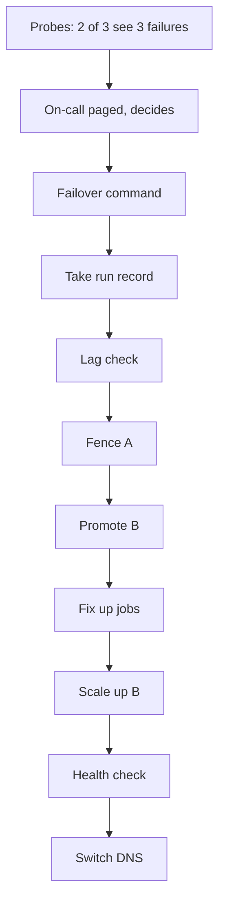

# Failover plan: Region A to Region B

Our invoicing SaaS runs active-passive in two cloud regions. A serves all traffic and B is a warm standby. When A is lost, a person runs one failover command. It writes a record that makes every app in A refuse writes, promotes B's database, starts B's workers and moves DNS to B. It never leaves two writable databases, because A is fenced (made to refuse writes) before B's database is promoted, and A fences itself even if we cannot reach it.

Today: A has 12 stateless web/API instances behind a regional load balancer, and B has 2 warm ones. PostgreSQL has its primary in A and an asynchronous streaming replica in B. Each time the replica receives WAL (the stream of database changes) from A, it records its replay lag, which is how far its replay trails A at that moment. The lag is typically under 5 s. Background jobs are rows in a `jobs` table; workers poll it and mark a row `running` while working. B's workers are scaled to zero. Each region has its own Redis cluster for sessions, not replicated between regions. Users reach the app through one DNS name managed by a global traffic manager, with a 60 s TTL.

Targets: RPO (most data we may lose) 30 s. RTO (time to recover) 15 min, measured from when on-call starts the failover.

## Terms

- **Control store**: a small strongly consistent key-value store outside region A (in B or a third location). A's apps and the failover command must both be able to reach it. It holds the two records below.
- **Active-region record**: says which region may accept writes, A or B. Every app and worker reads it.
- **Run record**: written by the failover command. It shows who started the run, when, and the last completed step. One run exists at a time.
- **Fence**: make A refuse all writes. Here, set the active-region record to B and let A's apps stop themselves.
- **Fail closed**: refuse writes when the record cannot be read.
- **Idempotent job**: a job that gives the same result if it runs twice.
- **Failover command**: one command a person runs from their own machine or a jump host, never inside region A.

## Flow

## Steps

1. **Probes.** Three external locations call A's `/healthz` every 10 s. A is down when 2 of 3 see 3 consecutive failures. That pages on-call and never fails over by itself. When A is refusing writes itself, `/healthz` fails with a reason, "fenced" or "control store unreachable", so the page tells on-call whether A is lost or has stopped itself. The exact reason format is open.
2. **On-call decides.** The paged engineer reads the failure reason and the active-region record (if it already says B, a fence has happened) and confirms A is really lost. Only a person starts a failover; there is no automatic promotion. The 15 min RTO starts when they run the command.
3. **Take run record.** The command writes a run record to the control store with a compare-and-set, so only one run exists. A second invocation finds the record and refuses. There is no lease or automatic takeover, because the command cannot tell a dead run from a slow one. A person reads the record and, once sure the first command has stopped, reruns with an explicit resume flag. If the control store is unavailable, the record cannot be taken and no failover can start until the store is restored.
4. **Lag check.** The command reads B's last recorded replay lag. It was recorded when B last received WAL from A, so it does not grow while A is down. Over 30 s (the RPO) the command stops. It continues only if on-call passes an explicit accept-data-loss override, which means the last seconds of writes are gone. This runs before fencing, so a refusal leaves A untouched. The value is a lower bound: writes A accepted after B's last WAL are unknown until A is recovered and compared with B.
5. **Fence A.** The command sets the active-region record to B. Every app and worker in A reads the record every 5 s. They refuse all writes when it says B, or when they cannot read it for 15 s (fail closed), and `/healthz` then reports failure. A partitioned A therefore stops itself, with no need to reach its cloud API or network. The command then waits 30 s, longer than the 5 s read interval plus the 15 s fail-closed window. It relies on this timing alone and does not check A's `/healthz`, since A may be unreachable.
6. **Promote B.** The command promotes B's replica. It succeeded when the replica is no longer in recovery and a test write works. If this takes over 2 min the run is marked failed. A stays fenced and on-call decides whether to resume.
7. **Fix up jobs.** A's workers are fenced or dead and B's are still at zero, so no worker is running. Any `jobs` row in B's database still marked `running` was cut off mid-work, so it is set back to `queued`. Jobs must be idempotent, because a re-run may repeat work and because work finished in A just before the loss may not have replicated. Redis is not involved.
8. **Scale up B.** The web/API tier goes from 2 to 12 instances and B's workers start. This is only after B's database is writable. B's apps and workers follow the same rule as A's: they accept writes only when the active-region record says B. The fence already set it, so they accept writes from the start. If it said A, they would refuse.
9. **Health check.** B's `/healthz` through B's load balancer must pass. If it does not pass within 5 min the run stops as failed. DNS is not touched, and on-call fixes the cause and resumes.
10. **Switch DNS.** This happens only after step 9. The traffic manager's record is pointed at B. With a 60 s TTL most clients move within about a minute, and some resolvers may be slower. The command then marks the run record done and keeps it as history. The active-region record stays B, so if A returns its apps read B and keep refusing writes.

## Rules that apply throughout

- Every step writes its completion to the run record, and every step is safe to repeat.
- Sessions live in each region's own Redis and are not replicated. Everyone signed in at failover time must sign in again; that is accepted.
- Failback: there is none. A's old database is never reused as primary. When A returns, it is rebuilt as a replica of B. Moving back is a separate planned switchover.
- What users see: from the fence until DNS switches, writes fail everywhere and B serves no traffic yet. Clients still pointed at A get read-only service if A is up, or errors if not, and nothing redirects them until DNS moves. This window is inside the 15 min RTO.

## What happens when things fail

| Failure | Result |
|---|---|
| Command crashes or loses its network mid-step | The run record holds the last completed step. A person reruns with the resume flag and it continues. |
| Second person starts a run | Refused while a run record exists (step 3). |
| Lag over 30 s | Stops before fencing. A is untouched. Continues only with the override (step 4). |
| Promote takes over 2 min | Run marked failed. A stays fenced. On-call decides whether to resume (step 6). |
| B health check fails for 5 min | Run marked failed. DNS not moved. On-call fixes and resumes (step 9). |
| On-call wants to abort | `--abort` is allowed up to and including the fence. It sets the active-region record back to A and marks the run record aborted, and A's apps resume writing by themselves. After Promote the run only goes forward. |
| Control store unavailable | No failover can start; on-call must restore the store. A's apps cannot read the record and refuse writes after 15 s. This is why the store should not share fate with B alone. |
| A cut off from the control store but otherwise healthy | A refuses writes after 15 s and `/healthz` fails with "control store unreachable", so the probes page on-call. Restoring the store connection fixes it, and A's apps resume once they read a record that says A. If on-call decides to fail over instead, the normal path applies. |

## Open questions

- Who has authority to start a failover (any on-call engineer, or only after approval)? Who may use the accept-data-loss override?
- Which product is the control store, and where exactly does it live (B alone would fail together with B)?
- Which machine or service exactly runs the failover command?
- The 5 s, 15 s, 30 s, 2 min and 5 min timings are my choices, not measured.
- The exact format of the `/healthz` failure reason.
