# Failover plan: Region A to Region B

The rule behind every step: **A can only write while it holds a lease, and the lease is kept outside A.** The failover command takes the lease away from A, waits out the lease length, and only then promotes B. A fences itself, so the plan works even when nobody can reach A's cloud API or network.

Run the failover command from a host outside A: a bastion in B or in the witness location.

## Flowchart

```mermaid
flowchart TD
  subgraph DETECT["Detection: never fails over by itself"]
    PROBE["Probes call A /healthz every 10 s from 3 locations"]
    DOWN{"2 of 3 probes see 3 consecutive failures?"}
    PAGE["Page on-call"]
    DECIDE{"On-call confirms A is lost?"}
    PROBE --> DOWN
    DOWN -- no --> PROBE
    DOWN -- yes --> PAGE --> DECIDE
    DECIDE -- "no: keep watching or fix A" --> PROBE
  end

  DECIDE -- yes --> CMD["On-call runs the failover command<br/>RTO clock starts"]
  CMD --> LOCK{"Run lock in coordination store free, or its holder's heartbeat stale?"}
  LOCK -- "no: another run is live" --> BUSY["Stop. Follow the live run instead"]
  LOCK -- yes --> STATE{"Active-region record already says B, epoch n+1?"}
  STATE -- "yes: resuming an interrupted run" --> RESUME["Skip pre-checks. Set B web desired count to 12 again"]
  STATE -- no --> Q

  subgraph PRE["Pre-checks: nothing has changed yet, A is still the active region"]
    Q{"Coordination store has a majority without A?"}
    REP{"B database reachable and still a streaming replica?"}
    LOSS{"Loss within 30 s? B's last recorded replay lag at most 30 s, and A's last lease renewal at most 15 s after B's last WAL receipt"}
    OVR{"Accept-data-loss override given?"}
    CAP{"B Redis up and quota for 12 web instances?"}
    Q -- yes --> REP
    REP -- yes --> LOSS
    LOSS -- yes --> CAP
    LOSS -- no --> OVR
    OVR -- yes --> CAP
  end

  Q -- no --> STOP0
  REP -- no --> STOP0
  OVR -- no --> STOP0
  CAP -- no --> STOP0
  STOP0["Stop and print the reason. Nothing changed, A stays active. Fix, then rerun"]

  CAP -- yes --> FLIP["POINT OF NO RETURN<br/>Compare-and-set the record from A, epoch n to B, epoch n+1, state FENCING"]
  FLIP -- "set rejected: record changed or no majority" --> STOP0

  FLIP --> WAIT["Fence wait: 20 s on the command's own clock<br/>15 s lease plus 5 s margin"]
  FLIP --> SCALE["Set B web tier desired count from 2 to 12"]
  RESUME --> WAIT

  subgraph AFENCE["Meanwhile in A, with no help from outside"]
    RENEW["Watchdog on A's DB host renews the lease every 3 s, accepted only while the record says A, epoch n"]
    SELF["No successful renewal for 15 s: watchdog stops Postgres and blocks port 5432 on the host. If the watchdog itself hangs, the kernel watchdog resets the host"]
    RENEW -- "renewal refused or store unreachable" --> SELF
  end
  FLIP -. "A's next renewal is refused" .-> RENEW
  FLIP -. "best effort, only if reachable" .-> API["Also stop A's DB VM and drain A's load balancer through the cloud API"]

  WAIT --> PROMQ{"B database already writable?"}
  PROMQ -- no --> PROMOTE["Run pg_promote on B, then write an epoch n+1 marker row"]
  PROMOTE --> PROMOK{"Out of recovery and marker write succeeded?"}
  PROMOK -- no --> PRETRY["Retry promotion. Never unfence A. Escalate after 3 min"]
  PRETRY --> PROMOTE
  PROMQ -- yes --> JOBS
  PROMOK -- yes --> JOBS["Requeue jobs left by A: rows in running with claim epoch below n+1 go to queued with attempt+1, or to needs_review if the job type is not safe to rerun"]
  JOBS --> WORK["Scale B workers up from 0. They claim jobs only while the record says B, epoch n+1"]

  WORK --> HEALTH
  SCALE --> HEALTH{"12 B web instances healthy and B /healthz passes: DB writable, Redis up, record says B?"}
  HEALTH -- no --> HWAIT["Keep waiting, replace failed instances, alert at minute 10"]
  HWAIT --> HEALTH
  HEALTH -- yes --> DNS["Point the traffic manager at B and mark A disabled"]
  DNS --> DNSOK{"Traffic manager confirms, and B answers on the public name?"}
  DNSOK -- no --> DRETRY["Retry the API, then fall back to the console"]
  DRETRY --> DNS
  DNSOK -- yes --> DONE["Record: B active, epoch n+1, state DONE. Release the lock<br/>Clients move within about 60 s of TTL. Users sign in again. A is queued for rebuild as a replica of B"]
```

The health gate (`HEALTH`) waits for both of its inputs: the web scale-up and the started workers, which come after promotion. Scaling starts right at the flip so that it runs during the fence wait and promotion. No traffic reaches B until DNS moves.

## Where the active-region record lives

It lives in a small consensus store (for example etcd) with three members: one in A, one in B, and a witness in a third location. Losing A, or cutting A off, still leaves a majority made of B and the witness, and a cut-off A on its own is a minority that cannot renew anything.

The record holds: active region, epoch, failover state and current step, run id and operator, flip time, whether the data-loss override was used, and A's lease (holder and last renewal time). The run lock and its heartbeat sit next to it.

These read it: A's DB watchdog, both regions' `/healthz`, the job workers, and the failover command. DNS does not hold the record. The traffic manager is switched only after the record and B's health say so.

## What triggers each step

| Step | Triggered by | Done when (also checked on a resume) |
|---|---|---|
| Page | Probe rule: 2 of 3 locations, 3 consecutive failures | — |
| Failover command | On-call, by hand | — |
| Pre-checks | Command start, with no run in progress | All pass, or the loss check fails and the override was given |
| Flip and fence | Pre-checks pass | Record says B, epoch n+1 |
| Web scale-up | Flip | 12 instances healthy behind B's load balancer |
| Promote B | Fence wait elapsed | `pg_is_in_recovery()` is false and the marker row is written |
| Requeue jobs | Promotion confirmed | No `running` rows with claim epoch below n+1 |
| Start workers | Requeue done | Workers registered under epoch n+1 |
| Move DNS | Health gate passes | The traffic manager answers with B |

## Fencing

- **Why it works with A unreachable.** A's Postgres accepts writes only while its watchdog keeps renewing a lease. The store accepts a renewal only while the record says A, epoch n. Once the flip commits, no renewal can succeed. The watchdog counts 15 s on its own monotonic clock from when it *sent* its last successful renewal, which was before the flip, and then stops Postgres. The command waits 20 s after the flip, so A has stopped writing before B is promoted.
- **A's database stays fenced afterwards.** A's Postgres always boots fenced and opens for writes only when the record says A at the current epoch. After a failover it never says that again. That is what enforces "A's old database is never reused as primary" until A is rebuilt as a replica of B.
- **The cost.** If A loses the store majority for 15 s while otherwise healthy, A fences itself and causes an outage. That is the price of fencing that works without A's network. To keep it rare, alert on renewal failures and keep the witness independent of both regions.

## Data loss check (RPO 30 s)

- The brief's check: B's last recorded replay lag must be at most 30 s.
- An added check: if A stays alive but is cut off from B, A keeps committing writes that B never receives, and B's frozen replay lag does not show it. After the flip, A can write for at most 15 s past its last renewal. So the command also requires that A's last lease renewal is no more than 15 s (30 s minus the lease) after B's last WAL receipt. The two times come from different hosts, so this check depends on NTP keeping their clocks close.
- Either check failing stops the command before anything changes. It continues only with the explicit accept-data-loss override, which is logged in the record.

## Jobs that were running in A

- A's workers stop when A dies, or lose their database when A fences itself. In B's copy of the `jobs` table a job can be `running` (claimed by A), `queued` (A's claim never reached B), or still open even though A finished it after B's last WAL. All of these will run again.
- The requeue step moves every `running` row with a claim epoch below n+1 back to `queued` with `attempt+1`. Because of the epoch filter, the step is safe to rerun after B's workers have started: it never touches B's own claims. This needs a `claim_epoch` column that workers set when they claim a job.
- Reruns must be harmless. Every external call (payment, invoice e-mail, e-invoicing submission) carries the job id as its idempotency key, which also covers a call that A finished during its last 15 s. Job types that cannot be made idempotent go to `needs_review` for a person to resolve. They are never rerun automatically.
- B's workers start only after promotion and the requeue are confirmed.

## A failed or interrupted run

- **Before the flip,** every stop leaves nothing changed, and A remains the active region. Fix the cause and run the command again.
- **The flip is the only step that cannot be undone.** After it, the command only moves forward. No path unfences A, and failback is a separate planned switchover after A has been rebuilt as a replica of B.
- **If the flip result is unknown** (for example a timeout), the command reads the record again. If the record shows this run's id at epoch n+1, the flip happened.
- **Resuming.** Every step after the flip first checks its done condition and skips itself if that holds, so running the command again is always safe. If the command dies or the operator's connection drops, the lock heartbeat goes stale after 30 s and a new run takes over. It waits the full 20 s fence period again unless B is already writable, rather than trusting the clock of the run that died. It also sets the web desired count again, then carries on from the first step that is not done.
- **Stuck steps after the flip** are retried in their loops, and an alert fires at minute 10 of the RTO budget. If B's database cannot be promoted at all, the outage continues and recovery is a restore from backup into B, covered by a separate runbook. A is not used.
- Every step writes its start and end time to the record and to the incident channel.

## RTO budget (15 min, from the command)

| Segment | Budget |
|---|---|
| Lock and pre-checks | 1 min |
| Flip, then 20 s fence wait | under 1 min |
| Promote and marker write | 1 min |
| Requeue and start workers | 1 min (runs alongside the scale-up) |
| Web scale-up from 2 to 12 and health gate | up to 8 min, starting at the flip |
| DNS change plus 60 s TTL | 2 min |
| **Critical path** (pre-checks, scale-up, DNS) | **about 11 min** |

The scale-up time only holds if B's instance images are pre-built and quota for 12 instances is reserved in B. Measure all of these numbers in regular failover drills.

## Added beyond the brief

These need sign-off:

- The three-member coordination store with a witness in a third location.
- The second data-loss check.
- The `claim_epoch` column on `jobs`.
- Idempotency keys on job side effects, and the `needs_review` status.
- Reserved quota in B.
