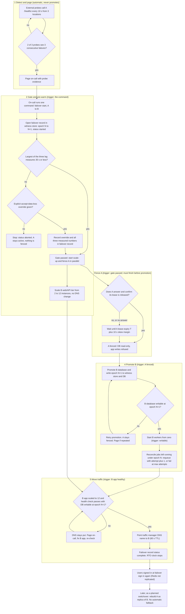

# Failover plan: Region A to Region B

Region A serves all traffic for the invoicing SaaS today. Region B is a warm standby: it holds a streaming copy of A's database, two web/API instances and no workers. If A is lost, one person runs one failover command. The command checks how much recent data B may be missing, fences A so it cannot write, promotes B's database, starts B's workers, and only then moves the DNS name to B. This order means two writable databases never exist at once.

Targets: RPO 30 s (at most 30 s of recent writes may be lost) and RTO 15 min, measured from when on-call starts the failover.

## Terms

- **Replica (standby)**: a database copy that receives A's change log and cannot accept writes until it is promoted.
- **WAL (write-ahead log)**: PostgreSQL's ordered log of every change. Replicas copy it from the primary.
- **Replay lag**: how far a replica's applied changes trail the primary at a given moment.
- **LSN**: a position in the WAL. Comparing two LSNs shows how many changes one copy lacks.
- **Promote**: turn a replica into a writable primary.
- **Epoch**: a version number for which region is active. Each failover moves it from N to N+1. Anything still carrying the old epoch is stale.
- **Lease**: a time-limited claim that A is the active region. It has a holder and an expiry time T. It must be renewed or it lapses.
- **Fence**: make A unable to write.
- **Witness store**: a small 3-node quorum store (three nodes that agree by majority) or a managed lease service, placed outside A and B, for example in a third region.
- **Watchdog**: a process on A's database host that renews A's lease and fences A locally if renewal fails.
- **Skew margin**: an extra 10 s wait that covers clock differences between machines.
- **Reaper**: the process that finds jobs left behind by a dead worker and requeues them.
- **Idempotency key**: an ID sent with each external action (invoice, payment, email) so the provider does not perform it twice.

## Where the active-region record lives

- The **witness store** is the only authoritative record of the active region, the current epoch, A's lease (holder and expiry T), and the failover record (steps done, lag measured, override flag).
- The **traffic manager DNS** follows that record. It is a consumer, not the source of truth.
- Each **database** stores the current epoch in a table. B's app and workers check it. A's app and workers see that their epoch is stale.

## Failover flow

The diagram shows the order. The steps below add the trigger, the data each part keeps, and what happens when a step goes wrong.

## Steps

1. **Detect and page** (automatic, never promotes).
   - Trigger: three external probes call A's `/healthz` every 10 s. A counts as down when 2 of the 3 probes see 3 consecutive failures.
   - Action: pages on-call with the probe evidence. Nothing else.
   - Data kept: no change.
   - If it goes wrong: nothing fails over by itself. A person decides.

2. **Start the failover and check the data gap** (trigger: on-call runs `failover start A to B`).
   - Action: opens the failover record in the witness store with epoch N to N+1 and status `started`.
   - Action: measures three numbers and records them in the failover record:
     1. B's last recorded replay lag. This is the value from when B last received WAL from A, so it does not grow while A is down.
     2. The age of B's last WAL receipt.
     3. The LSN gap between B's last received LSN and A's last LSN. A's probe or exporter reports A's LSN to the witness store on each heartbeat.
   - The 30 s threshold applies to the largest of the three. The first number alone misses writes that never left A, and those are the real data loss. This changes the brief; see open questions.
   - Data kept: witness store.
   - If the largest number is over 30 s: stop and set status `aborted`. A stays active and nothing is fenced. The failover continues only with an explicit accept-data-loss override, which is recorded with all three numbers.
   - If the gate passes (or is overridden): scale B's web/API tier from 2 to 12 instances, in parallel with step 3. No DNS change.

3. **Fence A** (trigger: gate passed; must finish before promotion).
   - Action: checks whether A answers and confirms its lease is released. If it does, A is fenced and the wait is skipped.
   - If A does not answer or does not confirm, the command waits until lease expiry T plus the 10 s skew margin. By then the watchdog has fenced A locally (see the fencing section).
   - Data kept: A keeps its data but is read-only. Its epoch is stale.
   - If it goes wrong: the command does not promote. The accept-data-loss override never skips this step.

4. **Promote B's database** (trigger: A fenced).
   - Action: promotes B's database and writes epoch N+1 to both the witness store and B's database.
   - Check: is B's database writable at epoch N+1?
   - Data kept: B's database and the witness store.
   - If it goes wrong: retry promotion. A stays fenced. Page on-call if the retries repeat.

5. **Start B's workers and reconcile jobs** (trigger: B's database writable at epoch N+1).
   - Action: starts B's workers from zero. Reconciles jobs left `running` under epoch N (see the jobs section).
   - Data kept: the `jobs` table in B's database.

6. **Move traffic to B** (trigger: B's app is healthy).
   - Check: is B's app scaled to 12 instances, and does its health check pass with the database writable at epoch N+1?
   - If yes: point the traffic manager DNS name to B (60 s TTL). Set the failover record to `complete`. The RTO clock stops.
   - If no: DNS stays put. Page on-call, fix B's app, and re-check.
   - Data kept: the failover record in the witness store.

7. **After cutover.** Users who were signed in at failover sign in again, because Redis sessions are not replicated. This is accepted. There is no automatic failback.

## Fencing A when it cannot be reached

- The **watchdog** runs on A's database host. It renews A's lease every 10 s against a 30 s TTL (a lease that lapses if not renewed within its time-to-live). It needs no network or cloud API. If renewal fails, it acts before T:
  - it revokes LOGIN on the app roles (`ALTER ROLE ... NOLOGIN`);
  - it terminates existing write sessions;
  - it sets the database read-only.
  - A's app tier health check then reports "not active".
- Promotion waits until T plus the 10 s skew margin. The command never promotes while A could still write. The accept-data-loss override never skips the fence.
- If A answers and releases its lease, the wait is skipped.
- Stopping A's instances or volumes through the cloud API is best effort. It runs in parallel when the API is reachable. Safety does not depend on it.
- **Residual risk**: a host that freezes for longer than the skew margin, then resumes with its database process alive, can accept a write after B is promoted. Only storage-level fencing (detaching or stopping A's data volume through the cloud API) closes that gap. Use it whenever the API is reachable.

## Jobs running in A at failover

Background jobs are rows in the `jobs` table. Workers poll it and mark a row `running` while they work on it. Job rows replicate asynchronously, so B sees whatever state reached it. There are three cases:

1. **Claimed on A, not finished, claim replicated.** B sees `running` under epoch N. The reaper treats any `running` row with epoch N or lower as orphaned, and requeues it with attempt plus 1. The decision uses the epoch tag, not heartbeat timing.
2. **Finished on A, finish not replicated.** B sees `running` and re-runs the job. Every external side effect (sent invoice, payment, email) carries an idempotency key, which is checked with the provider before re-running.
3. **Created on A, creation not replicated.** The job is lost from the queue. After cutover, a reconciliation query compares source rows (such as invoices) against jobs and produces a list for on-call to re-enqueue.

A's workers are fenced, so their database writes fail. Side effects they produced before the fence still happened on A, so idempotency is still required. B's workers start only after the database is writable at epoch N+1.

## Failed or interrupted runs

- **Job leases**: each claim has a heartbeat every 30 s and a lease of 90 s. If a worker crashes, its lease expires and the reaper requeues the job with exponential backoff (waits that grow with each retry).
- **Max attempts** (for example 5): the job moves to `failed`, alerts on-call, and stays for review. Nothing is dropped silently.
- **Interrupted failover command**: the failover record in the witness store is the state machine. Every step is idempotent and resumable.
  - Before promotion: resume from the last recorded step. An explicit abort re-acquires A's lease at a new epoch, and is allowed only while B is still a replica.
  - After promotion: never revert to A. Resume forward.
- **Promotion fails**: retry. A stays fenced, so the service stays unavailable until on-call resolves it. This is a deliberate choice, not an automatic one.

## Timeline against the 15 min RTO

| Window | Work | Note |
|---|---|---|
| 0 to 2 min | Command, record, lag check | Human decision point |
| 0 to 8 min | Scale B app 2 to 12 | Critical path; start at t=0 and measure it |
| 0 to 1 min | Fence A | At most T plus 10 s, about 40 s with a 30 s TTL |
| 1 to 3 min | Promote B, start workers, reconcile jobs | |
| about 8 to 10 min | B app health check passes | |
| 10 to 12 min | DNS change; 60 s TTL | Most clients move within a few minutes |

The plan has about 2 to 3 minutes of slack.

## Rollout

- Rehearse the B scale-up time before go-live. It is the critical path and dominates the budget.

## Open questions

- Should A's `/healthz` fail when A's database is unreachable or A's lease is lost? If not, a dead database behind a live app tier never pages.
- Witness store: its location and owner are not decided. It must sit outside A and B.
- Reconciliation owner: who runs the job and invoice reconciliation after cutover?
- Lag check: step 2 uses three measures, not the brief's single one. This needs sign-off.

## Later: failback (out of scope here)

A is rebuilt as a replica of B by a fresh base backup (a full copy of the database). `pg_rewind` (a tool that resyncs an old primary) is used only after verification. Before rebuilding, export A's unreplicated transactions to the reconciliation list, because rebuilding discards them. A's old database is never reused as primary. Moving back to A is a separate, planned switchover.