# Failover plan: Region A to Region B

Goal: move the invoicing SaaS from Region A to warm standby Region B when A is lost, with RPO 30 s and RTO 15 min (measured from on-call start), and never two writable databases at once.

The path runs from automatic detection, through one human-run command, fencing, promotion, job reconciliation, and DNS cutover. Each step names its trigger.

```mermaid
flowchart TD
    subgraph S1 ["1 Detect and page (automatic, never promotes)"]
        PR["External probes call A /healthz every 10 s from 3 locations"]
        PR --> DQ{"2 of 3 probes see 3 consecutive failures?"}
        DQ -->|"no"| PR
        DQ -->|"yes"| PG["Page on-call with probe evidence"]
    end

    PG --> CMD["On-call runs one command: failover start, A to B"]

    subgraph S2 ["2 Gate and pre-warm (trigger: the command)"]
        CMD --> REC["Open failover record in witness store: epoch N to N+1, status started"]
        REC --> LAGQ{"B last recorded replay lag 30 s or less?"}
        LAGQ -->|"no"| OVQ{"Explicit accept-data-loss override given?"}
        OVQ -->|"no"| HALT["Stop: status aborted. A stays active, nothing is fenced"]
        OVQ -->|"yes"| OVR["Record override and measured lag in failover record"]
        LAGQ -->|"yes"| SCALE["Scale B web/API tier from 2 to 12 instances, in parallel with step 3, no DNS change"]
        OVR --> SCALE
    end

    subgraph S3 ["3 Fence A (trigger: gate passed; must finish before promotion)"]
        SCALE --> FQ{"Does A answer and confirm its lease is released?"}
        FQ -->|"yes"| FENCED["A fenced: DB read-only, app writes refused"]
        FQ -->|"no, or no answer"| WAIT["Wait until A lease expiry T plus 10 s skew margin"]
        WAIT --> FENCED
    end

    subgraph S4 ["4 Promote B (trigger: A fenced)"]
        FENCED --> PROM["Promote B database and write epoch N+1 to witness store and DB"]
        PROM --> WR{"B database writable at epoch N+1?"}
        WR -->|"no"| RET["Retry promotion. A stays fenced. Page if repeated"]
        RET --> PROM
        WR -->|"yes"| WK["Start B workers from zero (trigger: writable)"]
        WK --> RJ["Reconcile jobs left running under epoch N: requeue with attempt plus 1, or fail at max attempts"]
    end

    subgraph S5 ["5 Move traffic (trigger: B app healthy)"]
        RJ --> HC{"B app health check passes with DB writable at epoch N+1?"}
        HC -->|"no"| HF["DNS stays put. Page on-call, fix B app, re-check"]
        HF --> HC
        HC -->|"yes"| DNS["Point traffic manager DNS name to B (60 s TTL)"]
        DNS --> DONE["Failover record status complete. RTO clock stops"]
    end

    DONE --> SIGN["Users signed in at failover sign in again (Redis not replicated)"]
    SIGN --> LATER["Later, as a planned switchover: rebuild A as replica of B. No automatic failback"]
```

## Where the active-region record lives

- **Witness store**: a small 3-node quorum store (or a managed lease service) placed outside both A and B, for example in a third region. It is the only authoritative record of: the active region, the current epoch, A's lease (holder and expiry time T), and the failover record (steps done, lag measured, override flag).
- **Traffic manager DNS** follows the record. It is a consumer of the record, not the source of truth.
- **Database copy**: each database stores the current epoch in a table, and B's app and workers check it. A's app and workers also see that their epoch is stale.

## Fencing when A is unreachable

- A's database host runs a **local watchdog** that renews A's lease every 10 s against a 30 s TTL. The watchdog does not need the network or the cloud API. If renewal fails, it acts before T: it revokes LOGIN on the app roles (`ALTER ROLE ... NOLOGIN`), terminates existing write sessions, and sets the database read-only. The app tier's health check then reports "not active".
- **Promotion waits** until T plus a 10 s skew margin. The command never promotes while A could still write. The fence is never overridden, even by the accept-data-loss flag.
- If A answers and releases its lease, the wait is skipped.
- Cloud-API stop of A's instances or volumes is best effort and runs in parallel when reachable. It is not required for safety.
- **Residual risk**: a host that freezes for longer than the skew margin, and then resumes with its database process alive, can accept a write after B is promoted. Only storage-level fencing (detach or stop A's data volume through the cloud API) closes that gap, so it should be used whenever the API is reachable.

## Replay lag check: what it does and does not show

The brief's check reads the lag recorded when B last received WAL. That value tells us how far replay trailed at that moment. It does not measure writes that never left A, which are the actual data loss. Two additional measures are recommended (this is a change to the brief):

1. Age of B's last WAL receipt.
2. LSN gap between B's last received LSN and A's last LSN, which A's probe or exporter reports to the witness store on each heartbeat.

Apply the 30 s threshold to the larger of these. Record all three numbers in the failover record, including any override.

## Jobs running in A at failover

Job rows replicate asynchronously, so B sees whatever state reached it. There are three cases:

1. **Claimed on A, not finished, claim replicated.** B sees `running` under epoch N. The reaper treats any `running` row whose epoch is N or lower as orphaned and requeues it with attempt plus 1. Decisions depend on the epoch tag, not on heartbeat timing.
2. **Finished on A, finish not replicated.** B sees `running` and will re-run the job. Every external side effect (sent invoice, payment, email) must carry an idempotency key that is checked with the provider before re-running.
3. **Created on A, creation not replicated.** The job is lost from the queue. After cutover, a reconciliation query compares source rows (such as invoices) against jobs and produces a list for on-call to re-enqueue.

A's workers are fenced, so their DB writes fail. Side effects they produced before the fence still happened on A, so idempotency is still required. B's workers start only after the database is writable at epoch N+1.

## Failed or interrupted runs

- **Job leases**: each claim carries a heartbeat (30 s) and a lease (90 s). A crashed worker's lease expires, and the reaper requeues the job with exponential backoff.
- **Max attempts** (for example 5): the job moves to `failed`, alerts on-call, and stays for review. Nothing is dropped silently.
- **Failover command interruptions**: the failover record in the witness store is the state machine. Every step is idempotent and resumable.
  - Before promotion: resume from the last recorded step. An explicit abort re-acquires A's lease at a new epoch and is allowed only while B is still a replica.
  - After promotion: never revert to A. Resume forward.
- **Promotion failure**: retry. A stays fenced. Since A is down, the service stays unavailable until on-call resolves it. That is a deliberate choice, not an automatic one.

## Timeline against the 15 min RTO

| Window | Work | Note |
|---|---|---|
| 0 to 2 min | Command, record, lag check | Human decision point |
| 0 to 8 min | Scale B app 2 to 12 | Critical path; start at t=0 and measure it |
| 0 to 1 min | Fence A | At most T plus 10 s, about 40 s with a 30 s TTL |
| 1 to 3 min | Promote B, start workers, reconcile jobs | |
| about 8 to 10 min | B app health check passes | |
| 10 to 12 min | DNS change; 60 s TTL | Most clients move within a few minutes |

The plan has about 2 to 3 minutes of slack. Rehearse the B scale-up time, since it dominates the budget.

## Decisions to confirm

- **A's /healthz**: should it fail when A's DB is unreachable or A's lease is lost? If not, a dead database behind a live app tier will never page.
- **Witness store**: the brief does not say where it lives or who runs it. It must sit outside A and B.
- **Reconciliation owner**: who runs the job and invoice reconciliation after cutover?

## Failback (out of scope here)

A is rebuilt as a replica of B by fresh base backup. Use `pg_rewind` only after verification. Before rebuilding, export A's unreplicated transactions to the reconciliation list, since rebuilding discards them. Moving back to A is a separate planned switchover.