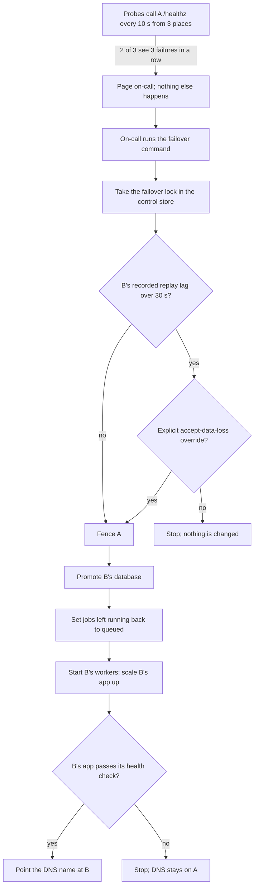

# Failover plan: Region A to Region B

Region A serves all users. Region B is a warm standby: it runs 2 app instances (A runs 12), its workers are scaled to zero, and it holds a read-only copy of A's database that trails A by a few seconds. When A is lost, one person runs one failover command. The command checks how much data B would lose, fences A so it cannot accept writes, promotes B's database, restarts the jobs, starts B's app, and only then moves the DNS name to B. Nothing happens automatically, so the plan never allows two writable databases.

## Terms

- **RPO (recovery point objective):** the most recent data we accept losing. Target: 30 s.
- **RTO (recovery time objective):** the longest time from when on-call starts the failover to users reaching B. Target: 15 min.
- **Primary:** the one writable database. **Replica:** a read-only copy that follows the primary's WAL (the log of every change).
- **Replay lag:** how far the replica's copy trails A. The replica records it each time it receives WAL from A, so the recorded value stays fixed while A is down. Typically under 5 s.
- **Fencing:** stopping A from accepting writes. It must work even when we cannot reach A's cloud API or network.
- **Promote:** turn B's replica into a writable primary. A replica cannot be promoted safely while A can still write.
- **Control store:** the record of which region is active, and of the progress of each failover run. Its location is still open (see Open questions).
- **Job:** a row in the `jobs` table. A worker marks it `running` while it works on it.
- **Idempotent:** running the same job twice gives the same result as running it once.

## Diagram

## Steps

1. **Detect.** Trigger: 2 of the 3 probe sites see 3 consecutive failures of A's `/healthz`, 10 s apart. The system pages on-call and changes nothing. A single failing probe site does not page.
2. **Start the run.** Trigger: on-call runs the failover command. It takes the failover lock in the control store, so only one run is active at a time. The control store keeps A as the active region until the switch is complete. The command logs each step as it finishes. If another run holds the lock, this one refuses to start.
3. **Check data loss.** Trigger: the lock is held. The command reads B's last recorded replay lag. If it is over 30 s, the command stops unless the person passes the explicit accept-data-loss override. Stopping changes nothing. This check comes before fencing, so a run that stops here does not cut off A.
4. **Fence A.** Trigger: the lag check passed or was overridden. Fencing must finish before B is promoted, and it must work even when A cannot be reached. If fencing cannot be confirmed, the command stops and B is not promoted.
5. **Promote B.** Trigger: A is fenced. B's database becomes the only writable primary. If promotion fails, B stays read-only and the command stops.
6. **Fix up jobs.** Trigger: B's database is writable. A's workers are gone, so any job still marked `running` has no worker. The command sets those rows back to `queued`, so B's workers can pick them up. Work A did after the last replicated change is lost, and is inside the RPO. Some of that work may run again. This is why jobs must be idempotent.
7. **Start B.** Trigger: jobs are reset. Only now do B's workers start, and B's app scales up from its 2 warm instances. B's Redis holds no sessions from A (sessions are not replicated), so users sign in again.
8. **Check health.** Trigger: B's app is scaled up. The command runs B's app health check. If it fails, DNS does not move.
9. **Switch DNS.** Trigger: the health check passes. The global traffic manager points the one DNS name at B. The record has a 60 s TTL, so some clients may keep A's address for up to about a minute.

**Interrupted runs.** The run stops at its last logged step if the command is interrupted, or if a step fails. The person can resume it from that step once the cause is fixed, or abort it. Abort stops the run. It does not un-fence A or un-promote B, because undoing either could recreate two writable databases.

## What happens when things fail

| Where | What happens | What on-call does next |
|---|---|---|
| Only one probe site fails | No page | None |
| Lag over 30 s, no override | Stops before any change; A is untouched | Wait, or rerun with the override |
| Fencing not confirmed | Stops before promotion; B stays read-only | Fix fencing, then resume |
| Promotion fails | Stops; B stays read-only; A stays fenced | Fix the cause, then resume |
| Job reset fails | Stops before workers start | Resume |
| B's health check fails | DNS stays on A, which is fenced, so users are down | Fix B, then resume or abort |
| Command interrupted | Run stays at its last logged step | Resume or abort |

## Not part of failover: failback

- There is no automatic failback.
- A's old database is never reused as primary. When A returns, it is rebuilt as a replica of B.
- Moving back to A is a separate, planned switchover.

## Open questions

- Where the control store lives, and how the command can reach it when A is lost. The active-region record depends on this.
- How fencing stops A's database from accepting writes when A cannot be reached. The apps can respect a fence, but a partitioned A whose database still accepts connections is not stopped by that alone. The mechanism is not chosen yet.
- What abort should undo, if anything. This plan says it undoes nothing.