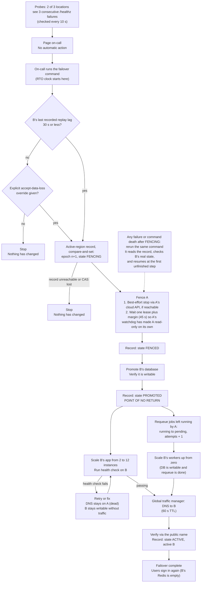

# Failover plan: Region A to Region B

## Summary

Today A serves all traffic and B is a warm standby with a read-only copy of A's database. Failover is one resumable command that a person runs after on-call is paged. The command writes its progress to an **active-region record** held outside both regions, makes A stop writing, promotes B's database, and only then starts B's workers and moves traffic. The shape exists so that two writable databases never exist at once, even when A cannot be reached.

## How the system works today

- **Web/API tier:** stateless, behind a regional load balancer. A has 12 instances, B has 2 warm.
- **Database:** PostgreSQL primary in A, with an asynchronous streaming replica in B.
- **Jobs:** rows in a `jobs` table in that database. Workers poll it and mark a row `running` while working on it. B's workers are scaled to zero.
- **Sessions:** a Redis cluster in each region, not replicated between regions.
- **Traffic:** users reach one DNS name managed by a global traffic manager, with a 60 s TTL.

## Targets and fixed rules

- RPO 30 s. RTO 15 min, measured from when on-call starts the command.
- Detection: external probes call A's `/healthz` every 10 s from three locations. A is down when 2 of the 3 see 3 consecutive failures. That pages on-call and never fails over by itself.
- A person starts failover by running a single failover command. There is no automatic promotion.
- A must be fenced before B's database is promoted, even when A's cloud API and network cannot be reached.
- B's workers start only once B's database is writable. DNS moves to B only after B's app is scaled up and passing its health check.
- Users signed in at failover time sign in again. This is accepted.
- No automatic failback. A's old database is never reused as primary.

## Terms

- **Replay lag:** how far B's replay trails A at the moment B last received WAL (Postgres's write-ahead log) from A. It is recorded then, so it does not grow while A is down. Typically under 5 s.
- **Fencing:** making sure A can no longer write to its database.
- **Active-region record:** a small record `{active, epoch, state, lease_expiry}` saying which region may write. It lives in a third location: a strongly consistent store (a 3-node consensus store or a managed equivalent) in a separate region or provider. It is not in either database, because A's may be down and B's is read-only until promotion. It is not in DNS, because DNS is the last step and has a 60 s TTL.
- **Epoch:** a number that goes up each time the record changes hands.
- **Compare-and-set (CAS):** a write that succeeds only if the record is still at the epoch the writer last read. It stops two operators at once and stops a stale rerun.
- **Lease:** A's permission to keep writing. It lasts 30 s and must be renewed.
- **Watchdog:** a process on A's database host that renews the lease every 10 s.
- **Point of no return:** the moment B is promoted. Before it the run can be aborted and A can resume. After it the run only rolls forward.

## Flowchart

Record states in order: `A-ACTIVE(n)`, `FENCING(n+1)`, `FENCED`, `PROMOTED`, `ACTIVE(B)`.

## Steps

1. **Page on-call.** Trigger: the probe rule above. It only pages. Nothing is kept. If probes disagree, nothing happens.
2. **Run the command.** Trigger: a person who has judged that A is really lost. The command keeps no state on the operator's machine. Its progress is the record plus a check of whether B's database is still in recovery (a read-only replica), so rerunning the same command is always the recovery action.
3. **Lag gate.** Trigger: command start. It reads B's last recorded replay lag. At 30 s or less it continues. Over 30 s it stops, and continues only with an explicit accept-data-loss override. The gate is a floor on data loss, not a measure of it: it cannot see writes A accepted after B last received WAL, so real loss can exceed the number. The command therefore also prints how long ago B last received WAL (the age) next to the override prompt. The age is information only. The 30 s RPO is a target the gate supports but cannot guarantee.
4. **Write FENCING.** Trigger: gate passed. The command does a CAS on the record to epoch n+1, state FENCING. If the record store is unreachable or the CAS loses, the command stops with nothing changed, and A, if alive, keeps its lease and keeps working.
5. **Fence A.** Trigger: FENCING written. The command cannot depend on reaching A, so A stops itself.
   - The watchdog can only renew the lease against its own epoch. Once the record is at n+1, renewals fail. If it cannot renew before the lease runs out, it sets Postgres read-only and then stops it, timing the lease on a monotonic clock from its last successful renewal.
   - The command waits one lease (30 s) plus a 15 s margin for clock and timer error, 45 s in all, whether or not any API call to A worked. A best-effort stop through A's cloud API runs at the same time and shortens the wait only if confirmed.
   - Then it writes FENCED. If interrupted, a rerun resumes the wait, measured from the record's timestamp, never shorter.
6. **Promote B's database.** Trigger: record shows FENCED. This is the only step that promotes, and it runs only from FENCED. The command promotes and verifies B is writable, then writes PROMOTED, the point of no return. If promotion fails or is unclear, a rerun checks B: still in recovery means retry the promote, already writable means continue. If B was promoted but the record write failed, a rerun sees B writable and writes PROMOTED.
7. **Requeue jobs left running by A.** Trigger: PROMOTED. See "Jobs mid-run in A". It is one idempotent statement, so an interrupted run repeats it before workers start.
8. **Start B's workers.** Trigger: requeue finished, so B's database is writable and no live worker's row is touched.
9. **Scale up B's app and health-check it.** Trigger: PROMOTED. It runs from 2 to 12 instances, after promotion so the health check exercises a writable database. If scale-up or the check fails, the command retries. DNS stays on A and B stays writable and idle, so no data is at risk.
10. **Move DNS.** Trigger: B's app is scaled up and passing its health check, not a timer. The global traffic manager points the name at B. If the update fails or is unclear, a rerun re-applies and verifies it.
11. **Record ACTIVE.** Trigger: the public name resolves to B and a request succeeds. The record becomes `ACTIVE`, active B. Users sign in again because B's Redis is empty.

## Failures that apply to every step

- **Command killed at any point:** rerun it. It resumes at the first unfinished step.
- **Two operators at once:** the second fails its CAS and stops.
- **Abort before promotion** (state FENCING or FENCED): the operator may run the documented abort. It writes epoch n+2 with A active, so A can renew again. A's watchdog may already have stopped Postgres, so A may need a restart.
- **After PROMOTED there is no way back to A.** If B cannot be brought up, repair B.

## Jobs mid-run in A

- Rows marked `running` in A are replicated to B like any other rows, but the workers that owned them are gone.
- Between promotion and starting B's workers, the command sets every `running` row to `pending` and adds 1 to its attempt count.
- **Jobs must be safe to run twice.** A job running in A may have done an external side effect (an email, a card charge, a webhook) before A was lost. Every such side effect needs an idempotency key stored with the job. If that is not yet true, fix it before relying on this plan.
- **Anything in the unreplicated tail is lost.** Jobs enqueued or completed in A after B's last received WAL are gone or reverted. A job whose completion was lost is rerun. A job enqueued in the tail never reaches B.
- A's workers are not trusted to stop. A partitioned A may keep running them. They can write nothing once A's database is fenced, but they can still call external services, which idempotency keys also cover.
- When A is rebuilt, its divergent tail (the WAL and rows after the point where B's timeline began) is exported and kept for manual reconciliation before the old data is discarded.

## After failover: A returns

A cannot renew its lease against any epoch but its own, so once the record is at n+1 it can never renew again, even with a healthy network. When A returns, its Postgres stays stopped or read-only. A is then rebuilt as a replica of B and never reused as a primary. Moving back to A is a separate planned switchover with its own plan.

## RTO budget (15 min from the start of the command)

| Step | Estimate |
|---|---|
| Lag check, record write | 15 s |
| Fence wait (lease plus margin) | 45 s |
| Promote and verify | 1 to 2 min |
| Requeue and start workers | 1 min |
| Scale B's app from 2 to 12 and pass health check | 4 to 6 min |
| DNS (60 s TTL) and verification | 2 min |
| **Total** | **about 10 to 12 min** |

This leaves a 3 to 5 minute reserve. The scale-up estimate is the least certain. The target does not include time before the command starts, such as the 30 s to detect a failure and the time on-call takes to decide.

## Not covered

- **Sessions:** B's Redis starts empty by design.
- **Failback:** none, as above.
- **Record store down together with A:** the command stops and B stays a replica until the store is back. A's watchdog fences itself in that case. The cost is a longer outage, not split-brain.

## Rollout: drills

Before this plan is trusted, rehearse the lag gate, the lease wait, the requeue and the scale-up time against a staging pair.

## Open questions

- Do all jobs with external side effects already store an idempotency key? If not, that must be fixed first.
- Is the 4 to 6 minute scale-up estimate right? It has not been timed.
- The 15 s margin on the fence wait is a judgment, not a measured clock-error bound.
