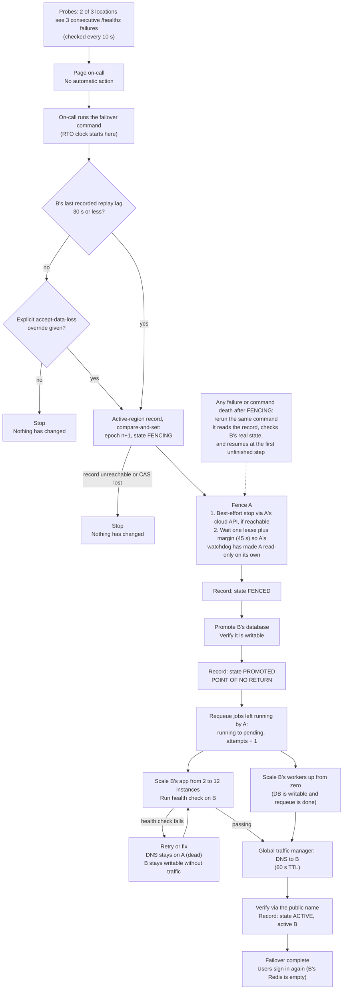

# Failover plan: Region A to Region B

## Summary

Failover is a person running one resumable command. The command records each step in an **active-region record** held outside both regions, and it never promotes B until A is fenced. A fences itself, so fencing works even when A is unreachable. Detection only pages on-call.

## Decisions this plan makes

These points are not set by the brief.

1. **The active-region record lives in a third location, outside A and B.** It is a small strongly consistent store (a 3-node consensus store or a managed equivalent in a separate region or provider). It holds `{active, epoch, state, lease_expiry}`.
   - It is not kept in either database, because A's database may be down and B's is read-only until promotion.
   - It is not kept in DNS, because DNS is the last step and has a 60 s TTL.
   - Every change is a compare-and-set on `epoch`. This blocks two operators running the command at once, and it blocks a rerun that is out of date.
2. **Fencing is a lease that A enforces on itself.** The command cannot depend on reaching A, so A must stop writing on its own when it loses contact with the record.
   - A watchdog on A's database host renews a lease on the record every 10 s. The lease is 30 s.
   - If the watchdog cannot renew before the lease runs out, it sets Postgres read-only and then stops it, using a monotonic clock measured from its last successful renewal.
   - A partitioned but running A therefore cannot take writes after its lease expires.
   - When the command changes the record to epoch n+1, A's renewals start failing. The command waits one full lease (30 s) plus a 15 s margin for clock and timer error. After that, A is fenced even if no API call to A succeeded.
   - A best-effort stop through A's cloud API runs at the same time and only shortens the wait if it is confirmed.
3. **The lag gate is a floor on data loss, not a measure of it.** The gate uses B's replay lag from the last time B received WAL from A. It cannot see writes A accepted after that moment, so real loss can exceed the number.
   - The command also prints how long ago B last received WAL (the age), and it shows that age next to the override prompt.
   - The age is information only and is not a gate. The 30 s RPO is therefore a target the gate supports but cannot guarantee.
4. **Jobs mid-run in A are requeued by the command.** The requeue runs after promotion and before any worker starts. See "Jobs mid-run in A".
5. **Point of no return.** The point of no return is the moment B is promoted. Before that point the command can be aborted and A can resume. After it, the run only rolls forward.

## Flowchart

## What triggers each step

| Step | Trigger | Gate or precondition |
|---|---|---|
| Page on-call | Probe rule: 2 of 3 locations see 3 consecutive failures | None. It never acts by itself. |
| Run the command | A person decides to | The person has judged that A is really lost, not just that the probes disagree |
| Lag gate | Command start | Lag 30 s or less, or the explicit override |
| Record to FENCING | Gate passed | Compare-and-set on the current epoch succeeds |
| Fence A | Record written | Wait one lease plus margin, whether or not the API call to A worked |
| Promote B | Record shows FENCED | A is read-only or confirmed stopped |
| Requeue jobs | Record shows PROMOTED | B accepts writes |
| Start B's workers | Requeue finished | B's database is writable |
| Scale up B's app and health-check it | Record shows PROMOTED | Starts after promotion so that health checks exercise a writable database |
| DNS to B | B's app is scaled up and passing its health check | Not before, and not on a timer |
| Record ACTIVE | Public name resolves to B and a request succeeds | None |

## Where the record lives and what it does

- The record is the single source of truth for "which region may write." The command, A's watchdog, and the failback tooling all read it.
- State sequence: `A-ACTIVE(n)` → `FENCING(n+1)` → `FENCED` → `PROMOTED` → `ACTIVE(B)`.
- A cannot renew its lease against any epoch other than its own. After the record moves to n+1, A can never renew again. That holds even if A comes back with a healthy network.
- When A returns, its watchdog still fails to renew, so Postgres stays stopped or read-only. A is then rebuilt as a replica of B. It is never reused as a primary.

## Jobs mid-run in A

- Rows marked `running` in A are replicated to B like any other rows, but the workers that owned them are gone.
- Between promotion and starting B's workers, the command sets every `running` row to `pending` and adds 1 to its attempt count. This happens before any worker starts, so no live worker's row is touched.
- This makes two things true, and the application must be built for them:
  - **Jobs must be safe to run twice.** A job that was running in A may have completed an external side effect (an email, a card charge, a webhook) before A was lost. Every such side effect needs an idempotency key stored with the job. If that is not yet true, fix it before relying on this plan.
  - **Anything in the unreplicated tail is lost.** Jobs enqueued, or completed, in A after B's last received WAL are gone or reverted. A job whose completion was lost is rerun. A job enqueued in the tail never reaches B.
- A's workers are not trusted to stop. A partitioned A may keep running them. They can write nothing once A's database is fenced, but they can still call external services. Idempotency keys cover that case too.
- When A is rebuilt, its divergent tail (the WAL and rows after the point where B's timeline began) is exported and kept for manual reconciliation before the old data is discarded.

## Failed or interrupted runs

The command stores no state on the operator's machine. Its progress is the record plus a check of B's real state (is B in recovery or not). Rerunning the same command is always the recovery action.

| Where it fails | State left behind | What happens |
|---|---|---|
| Lag over 30 s, no override | Nothing | Stops. The operator may rerun with the override. |
| Record store unreachable or the compare-and-set loses | Nothing | Stops. A, if alive, keeps its lease and keeps working. |
| During the fence wait | FENCING | Rerun resumes the wait. The wait restarts from the record's timestamp, never shorter. |
| **Abort before promotion** | FENCING or FENCED | The operator may run the documented abort. It writes epoch n+2 with A active, so A can renew again. A's watchdog may already have stopped Postgres, so A may need a restart. |
| Promotion fails or is ambiguous | FENCED | Rerun checks whether B is still in recovery. If it is, it retries the promote. If B is already writable, it continues. Promotion is attempted only if the record shows FENCED. |
| B promoted but the record write failed | Record behind reality | Rerun sees B writable, writes PROMOTED, and continues. |
| Requeue interrupted | PROMOTED | The requeue is a single idempotent statement. A rerun repeats it before workers start. |
| App scale-up or health check fails | PROMOTED | The command retries. DNS stays on A. B is writable and idle, and no data is at risk. |
| DNS update fails or is unclear | PROMOTED | Rerun re-applies and verifies the DNS record. |
| Two operators run the command at once | Whatever the first wrote | The second fails its compare-and-set and stops. |
| Command killed at any point | The last recorded state | Rerun resumes at the first unfinished step. |

After PROMOTED there is no way back to A. If B cannot be brought up, the fix is to repair B, not to return to A.

## RTO budget (15 min from the start of the command)

| Step | Estimate |
|---|---|
| Lag check, record write | 15 s |
| Fence wait (lease plus margin) | 45 s |
| Promote and verify | 1 to 2 min |
| Requeue and start workers | 1 min |
| Scale B's app from 2 to 12 and pass health check | 4 to 6 min |
| DNS (60 s TTL) and verification | 2 min |
| **Total** | **about 10 to 12 min** |

This leaves a 3 to 5 minute reserve. The scale-up estimate is the least certain and should be timed in a drill. The target does not include time spent before the command starts, such as the 30 s to detect a failure and the time on-call takes to decide.

## What the plan does not cover

- **Sessions:** B's Redis starts empty by design. Users sign in again.
- **Failback:** There is none. When A returns, it is rebuilt as a replica of B. Moving back to A is a separate planned switchover with its own plan.
- **Record store availability:** If the third-location store is down at the same time as A, the command stops, and B stays a replica until the store is back. A's watchdog fences itself in that case. The cost is a longer outage, not split-brain.
- **Drills:** The lag gate, the lease wait, the requeue, and the scale-up time should each be rehearsed against a staging pair before this plan is trusted.
