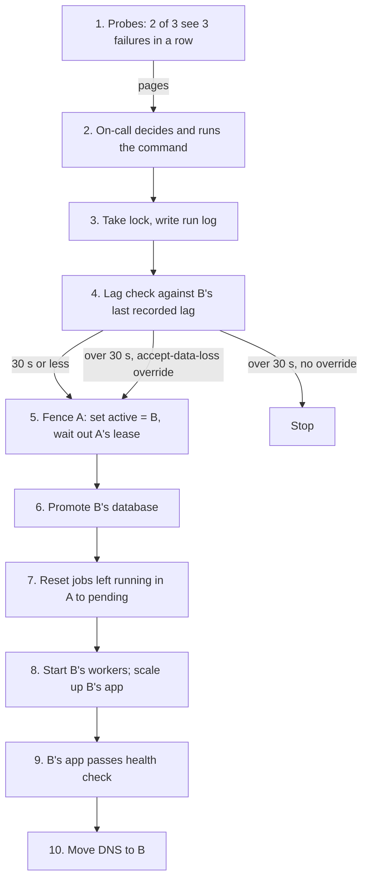

# Failover plan: Region A to Region B

Our invoicing app runs in Region A, with Region B as a warm standby. When A is lost, on-call runs one failover command. The command checks how much data B could lose, blocks A from writing, promotes B's database, repairs unfinished jobs, scales up B, and then points DNS at B. It is shaped so that two writable databases can never exist at once: A is blocked before B can accept writes.

Today: A serves all traffic. Its web/API tier has 12 instances behind a regional load balancer. A has the PostgreSQL primary. B has 2 warm web/API instances and an asynchronous streaming replica of the database. Background jobs are rows in the `jobs` table; workers poll it and mark a row `running` while they work on it. B's workers are scaled to zero. Each region has its own Redis cluster for sessions, and the two are not replicated. Users reach the app through one DNS name with a 60 s TTL, managed by a global traffic manager.

## Targets

- RPO 30 s (the most data we accept losing).
- RTO 15 min, measured from when on-call starts the failover.

## Terms

- **Probe**: an external check that calls A's `/healthz` every 10 s. Three probes run, one in each of three locations.
- **Replay lag**: how far B's replica trails A. B records it each time it receives WAL (PostgreSQL's change log) from A, and it is usually under 5 s. The last recorded value stays fixed while A is down, so it is the best number we have.
- **Control store**: a small key-value store that lives outside both regions' failure domains, so it is still reachable when A is lost. It holds four things: the active-region record (`active = A` or `B`, with a number that goes up on each change), the failover lock, the run log, and the fence.
- **Fence**: a rule that A must stop taking writes. It has two parts. The command sets `active = B` in the control store. A's apps and workers also hold a short lease (a permission that expires) on `active = A`. They renew it from the control store, and they stop all writes when a renewal fails or the record says `B`. So a partitioned A that cannot reach the control store stops itself. This is how fencing works even when we cannot reach A's cloud API or network.
- **Failover command**: the single command on-call runs. It is the only thing that starts a failover.

## Flow

## Steps

1. **Detect.** Trigger: every 10 s, the probes call A's `/healthz`. A is down when 2 of the 3 probes each see 3 failures in a row. This pages on-call and never starts a failover by itself. If the probes are wrong, on-call does not run the command.
2. **Decide and start.** Trigger: on-call runs the failover command. The RTO clock starts here. No automatic promotion exists.
3. **Take the lock.** The command takes a lock in the control store, so only one run is active, and starts a run log in the same store. Each later step writes "started" and "done" to the log. If a lock is already held, the command refuses to start and shows that run's log.
4. **Lag check.** The command reads B's last recorded replay lag. At 30 s or less it goes on. Over 30 s it stops, and it goes on only when on-call repeats it with the explicit accept-data-loss override. The check comes before fencing so that a stop leaves A untouched. The check is read-only.
5. **Fence A.** The command sets `active = B` in the control store, then waits one full lease period. After that wait, A's apps and workers have either seen the change or lost their lease, so none of them can write. This works without any contact with A. A stays blocked until A is rebuilt (see Failback).
6. **Promote B's database.** Only after step 5 is finished, the command promotes the replica to primary. Any writes A had not yet sent to B are lost, and the lag check already limited that to the RPO or to what on-call accepted.
7. **Fix up jobs.** Jobs that A's workers were running are still marked `running` in B's copy of the table, and nothing will finish them. The command sets every `running` row to `pending`. Jobs must therefore be safe to run twice (idempotent), because a job may have done part of its work in A. Jobs created in A during the lost last seconds of data are gone with the RPO.
8. **Scale up B.** B's workers start only after step 6 has made the database writable. B's app scales from 2 to the full size. Redis in B starts empty, so every user who was signed in has to sign in again. This is accepted.
9. **Health check.** The command checks B's app health. If it fails, the command retries and stays here. It does not move DNS.
10. **Move DNS.** Only after step 9 passes, the command points the traffic manager's DNS name at B and sets `active = B` as final. With the 60 s TTL, users move to B within about a minute. The run log is marked complete.

## Rules that apply throughout

- Never two writable databases: step 5 always finishes before step 6.
- B's workers wait for a writable database. DNS waits for a healthy B.
- No automatic failback. A's old database is never reused as primary.
- The command logs each step in the run log and can be resumed or aborted.

## When things go wrong

| Where | What happens |
|---|---|
| Command crashes or loses its connection | Run it again. It takes the lock (a stale lock held by a dead run can be released by on-call), reads the run log and resumes at the first step not marked done. Every step is safe to repeat. |
| Abort before step 6 | The command sets `active = A` again and releases the lock. A can renew its lease and resume. Nothing was promoted. |
| Abort after step 6 | Not allowed. B's database is now writable, so the only way is forward: resume from the log. |
| Lag over 30 s | Stops. Only the override continues. |
| Promotion fails | The run stops at step 6 and is retried. A stays fenced, so there is no writable database, which is the safe state. |
| Health check never passes | DNS is not moved. On-call investigates; the command can be resumed. |
| Control store unreachable when the command starts | The command cannot fence safely, so it refuses to go on. |

## Failback

When A returns, it stays fenced. It is rebuilt as a replica of B. Moving back is a separate planned switchover, not part of this plan.

## Open questions

- How long is A's lease period? It sets how long step 5 waits, and it must fit inside the 15 min RTO along with everything else.
- Which product hosts the control store, and how is it kept available when A is lost?
- How long does scaling B's app from 2 instances to full size take? Nobody has measured it against the RTO.
