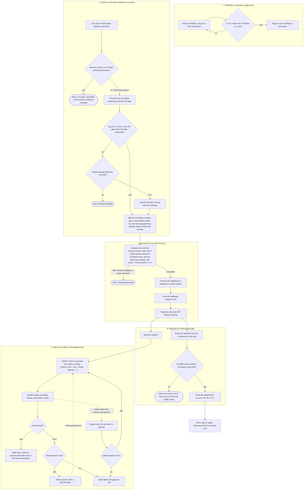

# Failover plan: Region A to Region B

Our invoicing app runs in two cloud regions. Region A serves all users. Region B is a warm standby: its database is a live, read-only copy of A's database, and it runs 2 web servers while its background job workers are scaled to zero. This plan moves users from A to B when A is lost.

The design goal is that no two databases accept writes at the same time. Section "Fencing" explains how this is enforced, and the open items name the one residual risk.

## Flowchart

## Notes

**Terms used below**
- **Warm standby:** a second region that is ready to take over but serves no users until needed.
- **Replica:** a read-only copy of the database that stays current by receiving the primary's changes. The database is PostgreSQL (Postgres).
- **WAL (write-ahead log):** Postgres's log of every change. Replicas receive it from the primary.
- **Replay lag:** how many seconds the replica trails the primary. B records this value each time it receives changes from A. While A is down, the recorded value does not change.
- **LSN (log sequence number):** a byte position in the WAL. The **LSN gap** is the number of bytes between two positions. Here it is the distance between where B's copy of the log ends and where A's log ended.
- **Timeline:** Postgres's numbered line of history. Each promotion starts a new timeline, so an old primary can tell it is out of date.
- **Promote:** turn a replica into a writable primary.
- **Fencing:** stopping an old primary from accepting writes.
- **Lease:** a time-limited right to be the writer. The holder must keep renewing it.
- **Witness:** a small record store in a third location, outside both regions. It records which region is active.
- **Compare-and-set:** a write that succeeds only if the stored value still equals the value the writer last read.
- **Idempotency key:** a unique ID sent with an external action. Repeating the action with the same key has no extra effect.
- **Reaper:** a periodic process that finds jobs whose worker has vanished and puts them back in the queue.
- **RPO (recovery point objective):** the most recent data we may lose. Here, 30 s.
- **RTO (recovery time objective):** the longest time users may be down. Here, 15 min.
- **TTL (time to live):** how long DNS resolvers may cache an answer. Here, 60 s.

**Triggers.** Step 1 runs automatically, but it only pages a person. Nothing is promoted automatically. Steps 2 to 4 start only when on-call runs the failover command. The command never calls A's cloud API or network. Step 5 runs automatically on B, but only after the command has promoted B.

**Where the active-region record lives.** The source of truth is a small record in the witness store. It holds:
- `active_region`: the region allowed to take writes.
- `epoch`: a counter that goes up by one at each failover.
- `lease_holder` and `lease_expiry`: which region currently holds the right to write, and until when.
- The Postgres timeline number of the current primary.

The record is not kept in A's database, because A cannot be trusted once it is cut off. It is not kept only in DNS, because DNS follows the record, not the other way round. The record is the commit point: the failover command changes it before promoting B. It uses a compare-and-set, so the write fails if the record changed after the command read it. An old primary compares its own epoch and timeline with the record, which tells it when it is out of date. The witness is a new component. The current setup does not have one.

**How fencing works without reaching A.** Fencing is lease-based, and A enforces it on itself.
- A's primary holds a lease recorded in the witness and renews it every 10 s. The example lease length is 30 s. The real numbers must be tuned.
- A's local fencing agent is a process on A's own hosts. Once renewals have failed for longer than the lease length minus a safety margin, it makes A's database read-only or stops it. It does not wait for the cloud.
- B waits until the lease in the witness has expired, plus a clock-skew margin (an allowance for machine clocks that disagree). Only then does it change the record and promote.
- **Residual risk:** if A's fencing agent hangs while A's database stays writable, no lease scheme can stop it, because B cannot reach A. The plan relies on drills that test this agent. Postgres has no built-in lease, so we must build this add-on.

**The data-loss gate and its limit.** Replay lag shows how far B trailed A's log when B last received changes. While A is down, this value does not grow. So it cannot show changes that A committed but never sent to B. That is why the LSN gap is also shown. The command shows the operator both numbers, in seconds and in bytes, and the operator reads them together. A large LSN gap can mean lost changes even when the lag is under 30 s. The plan owner must set the byte threshold for the gap. The LSN gap also needs A's latest position, and A cannot be asked while it is down. Section "Open items" covers this.

**Jobs running in A when failover happens.** Failover does not wait for A's workers. A job is claimed when a worker marks it `running`. What B's copy of the `jobs` table shows depends on which changes reached B before the outage.
- Jobs A marked `running` before the last change that reached B: B shows them as running, but no worker on B is doing them. Step 3 requeues them.
- Jobs A marked `done` after the last change that reached B: B still shows them as unfinished, so B runs them again. These completions fell inside the RPO window and are lost.
- Workers still alive on A's cut-off network may finish their external work, such as sending an invoice. Their database writes fail on the read-only database, so the results are discarded. The external effect may still have happened.

Requeuing is safe only if every external side effect is idempotent. Each one must be keyed by job and step, and the external system must honour that key. This must be built and tested before the plan is relied on.

**Failed or interrupted runs on B.** A claim sets `locked_until`, a time after which the claim counts as abandoned, and adds one to `attempt`. The worker keeps renewing `locked_until` while it works.
- If the job finishes, it is marked done, and its external side-effect key is saved in the same database transaction. The status change and the key are saved together or not at all.
- If the job errors and attempts remain, it is queued again after a backoff (a growing wait between tries). If no attempts remain, it is marked failed and on-call is paged.
- If the worker dies, its lock lapses. The reaper sets the job back to queued. The job then faces the same attempt limit, so a job that keeps crashing is eventually failed and paged.

Retries reuse the same idempotency keys, so an external system that honours the key can recognise a repeat and skip it.

**Returning A.** A's old database is never primary again.
- When A returns, its fencing agent reads the witness. If the epoch there is higher than A's own, the agent refuses to start the database as primary.
- A is rebuilt as a replica of B. Either take a fresh base backup (a full copy of B's data), or use `pg_rewind` (a tool that resynchronises only the parts that differ), if its conditions are met. Changes A made after the point where the two histories split are discarded.
- A's old volume is kept for manual reconciliation of invoices and jobs that never reached B. Nothing is merged automatically.
- Moving back to A is a separate, planned switchover.

**Sessions.** Sessions live in Redis, which is not replicated between regions. Users signed in at failover time must sign in again. This is accepted.

**RTO budget (15 minutes, counted from when the command starts).**
- Replay-lag gate and lease check: seconds.
- Lease wait: up to the lease length plus clock skew, about one minute with the example 30 s lease.
- Promotion, endpoint repoint and requeue: under a minute.
- Scaling B's web/API tier from 2 instances to full size: likely the longest step, so measure it in drills. If it is close to the budget, keep B's tier larger ahead of time.
- DNS: 60 s TTL. Some resolvers ignore TTL, so some users will arrive later.

**Open items.**
- Choose and provision the witness store in a third location.
- Build the fencing agent for A, and test it in drills, including a network partition while A keeps running.
- Decide where the command gets A's latest log position while A is unreachable. One option is for A to report it with each lease renewal. Without it, the LSN gap cannot be measured.
- Name the mechanism that repoints the database endpoint.
- Make `/healthz` check the database, so A's probes detect a dead database and not only a dead web tier.
- Make the job idempotency keys real before relying on the requeue.
- Set the byte threshold for the LSN gap.