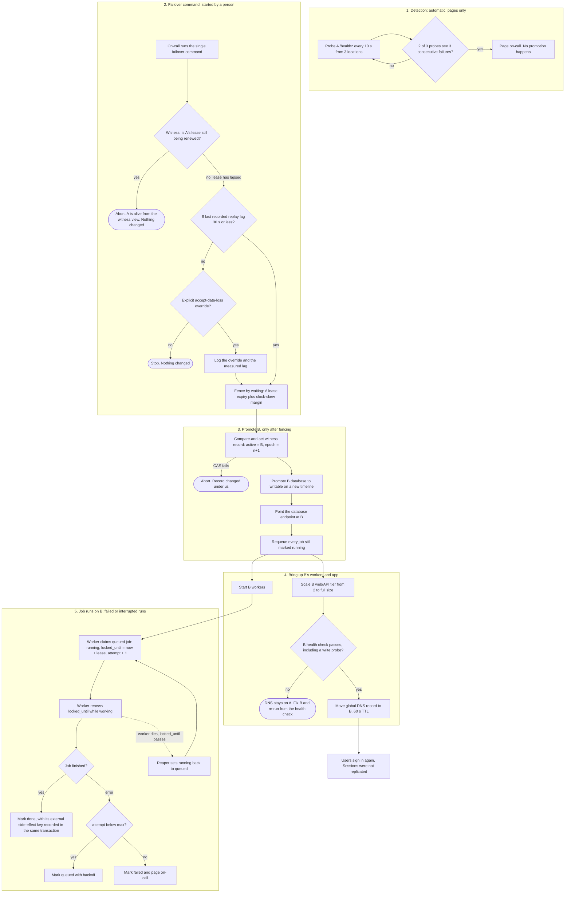

# Failover plan: Region A to Region B

## Flowchart

## Notes

**Triggers.** Step 1 is automatic and only pages. Every later step starts when a person runs the failover command. Nothing promotes on its own, and the command never calls A's cloud API or network.

**Where the active-region record lives.** The source of truth is a small record in a witness store in a third location, outside A and B. It holds `active_region`, `epoch`, `lease_holder` and `lease_expiry`. It is not kept in A's database, because A cannot be trusted when partitioned. It is not kept only in DNS, because DNS is downstream of the record. The record is the commit point: the command writes it with compare-and-set before promoting. The epoch equals the database timeline, so a stale primary can be recognised. This witness is a new component the current setup does not have.

**How fencing works without reaching A.** Fencing is lease-based and self-applied.
- A's primary holds a lease in the witness and renews it every 10 s. Example values: 30 s TTL, tune to your numbers.
- A's local fencing agent makes A's database read-only, or stops it, once renewal has failed for longer than the TTL minus a safety margin. It does not wait for the cloud.
- B waits until the last renewal it saw has expired, plus a clock-skew margin, before writing the new record and promoting.
- Residual risk: if A's fencing agent hangs while the database stays writable, no lease protocol can stop it, because B cannot reach A. The plan depends on that agent being tested in drills. Postgres has no native lease, so this is an add-on.

**The data-loss gate and its limit.** The gate reads B's replay lag from its last WAL receipt, and that value does not grow while A is down. It shows replay delay at the last receipt. It does not show WAL that A committed but never sent. Before the override decision, show the operator both the frozen lag and the gap between A's last known-good LSN (sampled before the outage) and B's received LSN. Treat the larger of the two as the exposure estimate.

**Jobs mid-run in A.** Failover does not wait for A's workers.
- Rows A committed as `running` before the last shipped WAL are running on B's copy, but no worker exists for them.
- Rows A committed as `done` after that point are lost with the RPO window. B re-runs those jobs.
- Workers still alive in A's partition can finish external work, but their commits fail on the read-only database and their results are discarded. Their external side effects may still have happened.
- Requeuing at promotion is safe only because every external side effect is idempotent, keyed by job and step. This must be built and tested before the plan is relied on.

**Failed or interrupted runs on B.** A claim sets `locked_until` and `attempt`, and the worker renews the lease while it works. If the worker dies, the reaper requeues the job after the lease lapses. After `max` attempts the job is marked failed and paged. Retries reuse the same idempotency keys, so a retry cannot repeat an external effect.

**Returning A.** A's old database is never a primary again.
- When A returns, its fencing agent reads the witness. If the epoch is higher than A's, it refuses to start the database as primary.
- A is rebuilt from B with a fresh base backup, or with `pg_rewind` if its requirements are met. A's divergent WAL after the fork point is discarded.
- Keep A's old volume for manual reconciliation of unreplicated invoices and jobs. Nothing is merged automatically.
- Moving back is a separate, planned switchover.

**Sessions.** Redis is not replicated, so users sign in again. This is accepted.

**RTO budget (15 min from command start).** Lag gate and lease check: seconds. Lease wait: up to TTL plus skew, about one minute. Promotion, endpoint repoint and requeue: under a minute. Scaling B from 2 to full size is likely the long pole and must be measured in drills. DNS: 60 s TTL, plus resolvers that ignore TTL. Consider pre-scaling B if the measured scale-up is close to the budget.

**Open items.**
- Choose and provision the witness store in a third location.
- Build the fencing agent for A and test it in drills, including a network partition with A still running.
- Name the mechanism that repoints the database endpoint.
- Make `/healthz` check the database, so A's probes detect a dead database and not only a dead web tier.
- Make the job idempotency keys real before relying on the requeue.