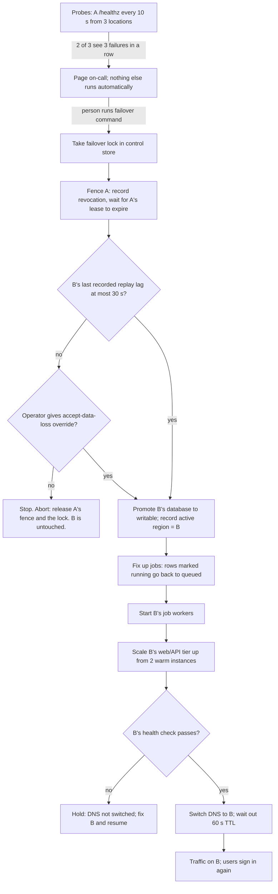

# Failover plan: Region A to Region B

## Summary

Our invoicing app runs in two cloud regions, A and B. Region A serves all users. Region B is a warm standby: it runs the same app and holds a copy of the database, but it does not serve users and does not accept writes. This plan moves users from A to B when A is lost.

The key rule is that at no time can two databases accept writes. Every step is designed around that rule.

## Terms

- **Active-passive:** only one region serves users and takes writes at a time. Today that region is A.
- **Warm standby:** a second region that is ready to use but kept small to save cost. B runs 2 web/API instances and zero job workers until a failover.
- **Primary database:** the one database that accepts writes.
- **Replica:** a read-only copy of the primary. It stays current by applying the change log (called WAL, the write-ahead log) that the primary sends it. B's replica is a few seconds behind A.
- **Promote:** turn a replica into a primary. After promotion it accepts writes and no longer follows A.
- **Fence:** a way to make sure the old primary cannot write. Here the fence is a lease (see below).
- **Lease:** a time-limited permission to write. A's apps may write only while they hold a current lease, and they renew it regularly. If they cannot renew it, it runs out and they stop writing.
- **Control store:** a small, highly available store outside both regions, so losing either region does not lose it. It records which region is active, holds the failover lock, holds A's fence, and keeps a log of each step the failover command takes.
- **RPO (recovery point objective):** the most recent data we accept losing. Target: 30 seconds.
- **RTO (recovery time objective):** the longest acceptable outage. Target: 15 minutes, counted from the moment on-call starts the failover.
- **Idempotent:** a job is idempotent if running it twice gives the same result as running it once. A repeated run does not repeat its outside effects, such as sending an invoice twice.
- **TTL (time to live):** how long DNS caches may keep an old answer. Here it is 60 seconds.

## Parts

- **Health probes:** three outside checkers. Each one calls A's `/healthz` endpoint every 10 seconds.
- **On-call:** the person who is paged and who runs the failover command.
- **Failover command:** a script that on-call runs. It performs the steps in order and logs its progress to the control store.
- **Postgres:** the database. A has the primary, and B has the replica.
- **Job workers:** processes that take rows from the `jobs` table in the database and run them. B's workers are scaled to zero until a failover.
- **Redis:** stores user sessions. Each region has its own Redis, and sessions are not copied between regions.
- **Global traffic manager:** answers the one DNS name that users type. Its answers have a 60-second TTL.

## Failover path

Read the diagram from top to bottom. Each box is one step. Each diamond is a yes-or-no check.

## What triggers each step

1. **Detection (automatic).** A is marked down when at least 2 of the 3 probe locations each see 3 failed checks in a row. This pages on-call. Nothing else happens on its own.
2. **Decision (manual).** A person runs the failover command. Nothing promotes B automatically.
3. **Lock.** The command takes a lock in the control store, so two failover runs cannot run at the same time.
4. **Fence A.** This step does not need to reach A. The command writes a revocation to the control store, then waits until A's lease has expired plus a safety margin. A's apps stop writing when their lease expires, even if they cannot reach the control store. The length of the lease is a setting that must be tested.
   - This fence covers A's apps only. A database process in A that accepts connections from outside those apps is not stopped by the lease. See the open gap below.
5. **Lag check.** The command reads the replay lag that B last recorded, at the last moment it received changes from A. That number does not grow while A is down. If it is 30 seconds or less, the run continues. If it is more than 30 seconds, the run stops unless an operator passes an explicit accept-data-loss override.
   - This check uses the recorded number. It does not measure what was actually lost.
6. **Promote B.** B's database becomes writable. From this point B is the only region that can write. The command records B as the active region in the control store.
7. **Fix up jobs.** A worker in A that was running a job is gone, so any row still marked `running` goes back to `queued`. Some of A's last changes may never have reached B. A job that finished in A just before the loss may look unfinished on B, so it runs again. This is why every job must be idempotent. A common method is to pass the job ID as an idempotency key to outside services, so they can reject a duplicate.
8. **Start B's workers.** This happens only after B's database is writable.
9. **Scale up B.** B's web/API tier grows from 2 warm instances to full capacity.
10. **Health check.** The command checks that B's app is healthy. DNS does not move until this check passes.
11. **Switch DNS.** This happens last. Users reach B once their DNS caches expire, which takes up to 60 seconds.
12. **Sessions.** Sessions do not carry over, because Redis is not copied between regions. Users who were signed in must sign in again. This is accepted.

## Jobs in A mid-run

When A is lost or fenced, its workers stop. A job they were running stays marked `running` in the copy of the database that B received. Step 7 resets those rows to `queued`, so B's workers pick them up again.

Jobs that finished in A but whose results had not reached B run again. Idempotency makes this safe.

## Failed or interrupted runs

- Before each step starts, the command writes "step started" to the step log in the control store. When the step finishes, it writes the result. The command moves on only after the result is written.
- To resume, run the command again. It reads the log and continues from the first unfinished step.
- Before repeating a step, the command checks the real state of the system. For example, it checks whether B is still in recovery mode. It does not rely on the log alone.
- Every step must be safe to repeat.
- **Abort is allowed only before the Promote step.** Abort releases A's fence and the lock, so A can resume as the active region. B is left untouched. A is still the active region at that point, so this is safe.
- **There is no abort after Promote.** Once B is promoted, the run only moves forward until it finishes.

## Rules that stay in force

- **No automatic failback.** A's old database is never reused as primary. When A returns, its database is rebuilt as a replica of B. Moving back is a separate, planned switchover.
- **No automatic promotion.** Only a person running the command can promote B.

## Open gap (must be decided before sign-off)

The fence works only if A's apps honor the lease. A database process in A that accepts connections from outside those apps is not stopped by the lease. The plan needs a fence that acts on A's database itself, and that can be applied without reaching A's cloud API.

Until that fence is named, a partitioned A that is still running could keep taking writes through a path the lease does not cover. Do not sign off this plan until the gap is closed.

## Notes

- The lag check uses the number B last recorded when it received changes from A. It does not measure what was lost.
- The fence wait adds time to the 15-minute RTO. The RTO runs from when on-call starts the failover, so the wait counts against it.