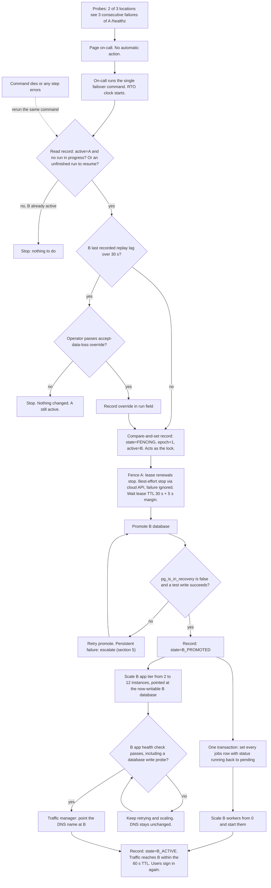

# Failover plan: Region A to Region B

This plan covers a person-started failover from detection to traffic on B. It never has two writable databases. All of it is built on one new component, the active-region record, described first.

## 1. The active-region record

This is a small, strongly consistent key-value store (compare-and-set and TTL leases) that lives **outside both regions**, in a third region or provider. It does not exist today and has to be added. Neither region's database, Redis or DNS can hold it. If it lived in A, it would be lost with A, and A's fence would then depend on A being reachable.

It holds one document:

| Field | Meaning |
|---|---|
| `active` | `A` or `B`, the region allowed to hold the writable database |
| `epoch` | Integer, incremented on every transition. Stale writers lose compare-and-set. |
| `state` | `A_ACTIVE`, `FENCING`, `B_PROMOTED`, `B_ACTIVE` |
| `run` | Run id, start time, operator, whether the data-loss override was used |

The record does three jobs.

1. **Lock.** The command moves the record with compare-and-set. Two people running the command cannot both proceed.
2. **Fence.** See section 2.
3. **Resume point.** Every step reads the record to decide what is already done. This is how an interrupted run continues (section 5).

## 2. How A is fenced when A is unreachable

The command cannot rely on reaching A's API or network, so A fences itself.

- A's database host runs a lease agent. While the record says `active=A`, the agent renews a write lease every 10 s with a 30 s TTL.
- If the agent cannot renew, or reads a higher `epoch` or `active=B`, it sets the primary read-only and then stops Postgres. A local watchdog stops Postgres if the agent itself hangs.
- A restarted A database comes up read-only. It takes writes only after it reads `active=A` from the record.
- The command moves the record to `FENCING` first, which stops all renewals. It then waits for the TTL plus a 5 s clock-skew margin, 35 s in all. After that wait, A is fenced whether it is partitioned, hung or healthy. A best-effort stop through A's cloud API runs in parallel. Its failure is logged and ignored.
- Only after that wait does the command promote B.

The fence holds because a partitioned A cannot reach the record, so it cannot renew its lease. This is why promotion waits for lease expiry and does not just call A's API.

## 3. Flowchart

Triggers by step:

| Step | Trigger |
|---|---|
| Page | The probe rule, automatic. It pages and does nothing else. |
| Everything from the command onward | A person running the command. Nothing after it needs another human action, except the override prompt and escalations. |
| Lag check | The command's first action, before any change. |
| Fence | The compare-and-set to `FENCING` succeeding. |
| Promote | The fence wait finishing. |
| Workers and requeue | `B_PROMOTED` recorded, which means the database is verified writable. |
| App scale-up | `B_PROMOTED` recorded. It runs in parallel with the job steps. |
| DNS | The B health check passing. |

## 4. Jobs running in A at failover

- Rows that were `running` in A are copied to B's database as `running`, because the replica has no knowledge of A's workers. Those workers are fenced and gone, so nothing is actually working on those rows.
- The requeue step sets all `running` rows to `pending` in one transaction. It runs after promotion and **before** B's workers start, so no worker sees a stale `running` row.
- Jobs are therefore at-least-once. A job that finished its side effect in A just before the loss, or whose completion was not replicated, will run again. Job handlers that send email, charge a card or call external systems need idempotency keys. This is a requirement on the job code, not something the failover can provide.
- Jobs enqueued or completed in A within the final unreplicated WAL are gone. This is the RPO window. After failover, reconcile from the invoice records and customer-visible state.

## 5. Failed or interrupted runs

The command is idempotent. Rerunning it reads the record and resumes at the first incomplete step.

| Interrupted at | State | Handling |
|---|---|---|
| Before the compare-and-set | `A_ACTIVE` | Nothing changed. Rerun or abandon. |
| Lag over 30 s, no override | `A_ACTIVE` | Stops cleanly. Rerunning with the override is the only way forward. |
| During fence wait | `FENCING` | A is already fenced or will be within the TTL. Rerun and wait out the remainder. Do not promote before the wait ends. |
| Promote fails or hangs | `FENCING` | Retry. If B's database cannot be made writable, no region is writable. A's data is intact. Only a human can decide to reactivate A, by deliberately moving the record back to `active=A` with a new epoch. The command never does this on its own. |
| After promote verified | `B_PROMOTED` | Roll forward only. The command never demotes B. Rerun to finish requeue, workers, scale-up and DNS. |
| Health check never passes | `B_PROMOTED` | DNS stays unchanged. Fix B or scale further, then rerun. Users see A's outage, but no second writer exists. |
| DNS update fails | `B_PROMOTED` | Retry. The update is idempotent. |
| Two operators run it at once | any | The second one loses compare-and-set and attaches to the run in progress. |

Once the record leaves `A_ACTIVE`, a returning A cannot take writes. It stays read-only until it is rebuilt as a replica of B. Failing back is a separate planned switchover, with its own plan.

## 6. Time budget

These are estimates to confirm in a rehearsal, not measurements. Budget starts when on-call runs the command.

| Step | Estimate |
|---|---|
| Preflight, lag check, compare-and-set | about 10 s |
| Fence wait | 35 s |
| Promote and verify | 30 to 60 s |
| Requeue and workers (parallel) | about 1 min |
| App scale 2 to 12 and health check | 3 to 6 min |
| DNS change and TTL expiry | about 90 s |
| **Total** | **about 6 to 10 min, against a 15 min RTO** |

Scale-up is the largest item and the main risk to the RTO. Keeping B at 2 instances is a cost choice that the RTO depends on, so rehearse it.

## 7. Caveats

- **The lag value understates data loss.** B records its lag when it last received WAL from A, so the value freezes when A dies. It says nothing about transactions A committed after that moment. Passing the 30 s check does not prove RPO was met. Have the command print the time of the last WAL receipt, so on-call can see how stale the number is. Treat a pass as "no known violation", not as a guarantee.
- **The record store is a new dependency.** If the command cannot reach it, failover cannot proceed. This is deliberate, because proceeding without it would give up the fence. Run it with its own redundancy.
- **Sessions.** B's Redis starts empty, so every signed-in user must sign in again. Expect a login spike right after DNS moves, and size B's app and auth path for it.
- **Lease TTL trade-off.** A shorter TTL speeds up failover but makes A fence itself on brief blips of the record store. 30 s with a 10 s renewal tolerates two missed renewals.
