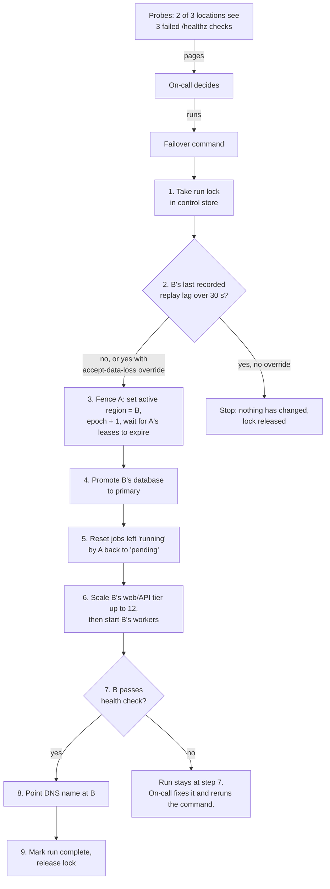

# Failover plan: Region A to Region B

**Goal.** When Region A is lost, move service to Region B without ever having two writable databases.

**Setup.** The system is active-passive. Region A serves all traffic. Region B is a warm standby, meaning it is running but idle. A holds the PostgreSQL primary database. B holds an asynchronous streaming replica of it. The replica receives WAL (Postgres's write-ahead log, its stream of changes) from A. Each time it receives WAL, it records its replay lag, which is how far B's copy trails A at that moment. The value is usually under 5 s.

**Key term.** *Fencing* means making sure A can no longer write to its database, so that B can safely become the only writable one.

**Targets.**
- RPO (recovery point objective) is 30 s. We accept losing up to 30 s of the newest writes.
- RTO (recovery time objective) is 15 min, counted from when on-call starts the failover command. Detection time is not counted.

## Components

| Component | Role in failover |
|---|---|
| External probes | Call A's `/healthz` every 10 s from three locations. A is declared down when 2 of the 3 locations see 3 consecutive failures. This only pages on-call. It never fails over by itself. |
| On-call | A person who decides to fail over and runs the command. Failover is never automatic. |
| Failover command | A single command that runs the steps below in order and records its progress in the control store. |
| Control store | A small, strongly consistent key-value store. It holds the **active-region record** and the failover run record. It must live outside Region A, in B or in a third location. Otherwise the failure that takes down A would take it down too. It is a new component, added by this plan. |
| Postgres | Primary in A, replica in B. The job queue is also here, as rows in a `jobs` table. |
| Job workers | Poll the `jobs` table and mark a row `running` while they work on it. In B they are scaled to zero until failover. |
| Web/API tier | Stateless. A has 12 instances. B has 2 warm instances. |
| Redis | One cluster per region, holding sessions. Not replicated between regions. |
| Global traffic manager | Serves the one DNS name users reach the app through, with a 60 s TTL (the time resolvers may cache the answer). |

## The active-region record

The control store holds one record, for example `{active_region: "A", epoch: 7}`. The epoch is a counter that increases on every change. Fencing and "who may write" both rest on this record.

- **Leases.** Every app instance and worker holds a short lease, for example 30 s, and renews it by reading the record. It may write to the database only while its lease is valid and the record names its own region as active.
- **Fail closed.** If an instance cannot reach the control store, or the record names another region, it cannot renew, and it stops writing when its lease runs out. This is how a partitioned A is fenced. We never need to reach A's cloud API or network, because A's own code refuses to write.
- **Assumption.** All writes to A's database come through the app tier and workers, and both carry this check.

## Failover path

## What triggers and does each step

Each step starts when the one before it finishes. Step 1 starts when on-call runs the command.

1. **Take the run lock.** The command creates a run record in the control store. A second run cannot start while one is open.
2. **Lag check.** The command reads B's last recorded replay lag. That value was written when B last received WAL, so it does not grow while A is down. If it is over 30 s, the command stops, changes nothing, and releases the lock. On-call may then start a new run with an explicit accept-data-loss override, which accepts losing more than the RPO allows.
3. **Fence A.** The command sets `active_region = B` and raises the epoch. It then waits one lease period plus a margin, so any partitioned A that is still running has stopped writing. B is not promoted until this wait ends. The wait counts toward the 15 min RTO.
4. **Promote B's database.** This starts only after the fencing wait ends, so only one writable database exists at any time.
5. **Fix up jobs.** This runs once B's database is writable and before any worker starts. See the next section.
6. **Scale up B.** The web/API tier goes to 12 instances. Then B's workers start. They start only now because B's database is writable only now.
7. **Health check.** B's app must pass its health check. If it fails, the run stays here.
8. **Switch DNS.** This happens only after B is scaled up and healthy. Users follow the change within the 60 s TTL, and that time counts toward the RTO.
9. **Complete.** The run is marked done and the lock is released.

## Jobs that were running in A

A's workers died, or were fenced, while some rows were `running`. After promotion those rows are stuck, because no worker owns them. Step 5 resets every `running` row on B to `pending`, so B's workers pick them up.

This has two consequences:
- **Jobs may run twice.** A job may have finished in A, or done part of its work, without the `done` status reaching B. Every job must therefore be safe to run again, for example by using idempotency keys on payments and emails.
- **Some jobs are lost.** Jobs enqueued in the last seconds before A was lost may not have reached B. That falls inside the RPO and is accepted.

## When a run fails or is interrupted

The command writes each completed step to the run record, and every step is safe to repeat. If the command crashes, loses its connection, or hits an error:

- **Resume.** Rerunning the command continues from the first unfinished step. The lock stops two people running it at once.
- **Abort during steps 1 to 3.** Nothing has been promoted, so on-call may abort. Abort sets the record back to A with a higher epoch and releases the lock. It refuses to do this if A is still unreachable, because the record would then name a region we cannot confirm is healthy. In that case on-call resumes the failover instead.
- **From step 4 on there is no abort.** B has taken writes, so the only way forward is to finish. A stays fenced. A failed health check or DNS update is fixed, and the run is resumed.
- **Stopped at the lag check.** The run changed nothing, so on-call can start a new run with the override, or investigate first.

## Sessions

B's Redis starts empty. Everyone signed in at failover must sign in again, which is accepted.

## After A returns

A's apps read the control store, see that B is active at a higher epoch, and refuse to write. A's old database is never reused as primary. It is rebuilt as a replica of B. Any writes it held that never reached B are kept for manual review. Moving back to A is a separate, planned switchover and never happens automatically.