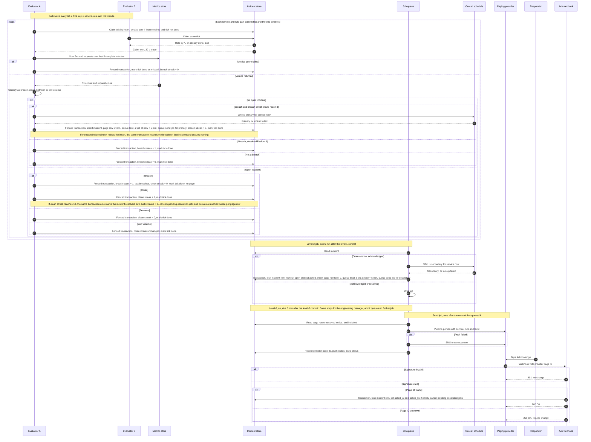

# On-call paging for API error-rate spikes

Today a cron script emails a shared inbox when the API error rate is high, and nobody reads it at 3 a.m. This design pages the on-call people instead. Two evaluators check each service and alert rule every minute against the metrics store and record each result in one shared transactional database. After three breaching minutes they open one incident and page the primary. A durable job queue then pages the secondary and the engineering manager, 5 minutes apart, until someone acknowledges. Each minute's decision commits as one transaction, so a crash never leaves half-done state.

## Terms

- **Evaluator**: one of the two identical instances that run the checks.
- **Tick**: one evaluation of one service and alert rule for one minute. Its key is service, rule and tick minute.
- **Window**: the five complete minutes before a tick. Consecutive ticks overlap by four minutes.
- **Complete minute**: a minute the metrics store reports as finished counting, so late counts are not missed.
- **Breach**: error rate above 2 percent on at least 500 requests in the window.
- **Clean**: error rate below 1 percent on at least 500 requests.
- **Between**: error rate from 1 to 2 percent on at least 500 requests.
- **Low volume**: fewer than 500 requests in the window.
- **Streak**: the count of consecutive breach or clean ticks. There is a breach streak and a clean streak.
- **Incident**: one period of breach for a service and rule, from opening until it resolves.
- **Page**: one message to one person at one escalation level. Level 1 is the primary, level 2 the secondary, and level 3 the engineering manager, the last level.
- **Roster**: the primary, secondary and manager person IDs from the last successful schedule lookup for the service.
- **Rule state**: one row per service and rule, holding both streaks and the roster. It exists before any incident does.
- **Acknowledge (ack)**: a responder taps Acknowledge in the paging app to say they have the page.
- **Provider**: the external paging service. It sends push notifications and SMS texts, and it calls our webhook when someone acks.
- **Push**: a notification to the provider's phone app. **SMS**: a text message.
- **Webhook**: a URL on our side that the provider calls.
- **Signature**: a code the provider attaches to each webhook call, so we can check that it is genuine.
- **Idempotent**: safe to repeat. Running it again changes nothing.
- **Tick claim**: a row that says which evaluator is working on a tick. It has a lease, an expiry time. After the lease expires, the other evaluator may take over.
- **Fenced transaction**: a database transaction whose first statement checks that this evaluator still holds an unexpired claim on a tick that is not done. If the check fails, it writes nothing.
- **Partial unique index**: a database rule that rejects a second row with the same values, but only for rows that match a condition. Here it means at most one open incident per service and rule.
- **Job queue**: a table of jobs, each with a due time. It lives in the same database, so jobs survive restarts.
- **Job worker**: a loop inside each evaluator process that runs due jobs.
- **Send job**: a queued job that sends one page or one resolved notice through the provider.
- **Resolved notice**: a message to everyone paged for an incident, saying it has resolved.
- **Alarm**: a notice to a monitored channel that someone must look at. It does not page anyone.
- **Backoff**: waiting longer before each retry.
- **Dead-man heartbeat**: a regular signal from the evaluators to an outside monitor. The monitor alarms when the signal stops.
- **Store clock**: the clock of the shared database. Every due time, lease and streak uses it.

## Diagram

## Steps

The diagram shows the order. These notes add the trigger, the data each step keeps, and the rules that apply. Failures are in the table below.

1. **Tick starts.** Trigger: both evaluators wake every 60 seconds. Each reads the store clock and cuts it to the minute, so both agree on the tick minute. For each service and rule pair, an evaluator works on that pair's current tick and the tick before it, earlier one first. It claims a tick by inserting a tick claim with a 30-second lease. It can also take over a claim whose lease has expired while its tick is not done. A current tick is not evaluated until its earlier tick is done. If an evaluator cannot claim the earlier tick, it leaves both and tries again on the next wake. If it claims the earlier tick, it runs that tick and then the current one in the same wake. Data: `tick_claims`.

2. **Metrics read.** Trigger: a claim is won. The evaluator sums 5xx and request counts over the window, using only complete minutes. Nothing is written yet. If the query fails, the tick is written as missed.

3. **Decide and commit.** Trigger: metrics returned. The evaluator classifies the window as breach, clean, between or low volume. Before deciding, it reads the pair's rule state. The decision is written in one fenced transaction, which also marks the tick done. That transaction reads the streaks again after its fence check and writes new values from that read. Ticks of one pair run in order, so nothing else changes the streaks in between. Data: `rule_state`, `tick_claims`.
   - No incident open: a breach adds 1 to the breach streak. Any other result sets it to 0. Low volume is not a breach, because the streak must be consecutive. If a breach makes the streak reach 3, go to step 4.
   - Incident open: go to step 5.

4. **Open an incident.** Trigger: no incident is open and the breach streak would reach 3. The evaluator looks up the primary before any transaction. Then one fenced transaction:
   - inserts the incident, with breach count 1 and last breach set to this tick;
   - inserts the level-1 page row;
   - queues the level-2 job at now plus 5 minutes, and the send job for the primary;
   - if the lookup succeeded, writes the roster from it, sets the breach streak to 0 and marks the tick done.

   If the lookup failed or found no primary, the incident still opens (see the table). If the partial unique index rejects the insert, the same transaction records the breach on the existing incident (breach count plus 1, last breach set) and queues nothing. Data: `incidents`, `pages`, `jobs`, `rule_state`.

5. **Record or resolve while open.** Trigger: an incident is open for the pair. Each branch is a fenced transaction that marks the tick done.
   - Breach: breach count plus 1, last breach time set, clean streak set to 0. No page.
   - Clean: clean streak plus 1. At 10 clean ticks in a row, the same transaction marks the incident resolved, sets both streaks to 0, cancels pending escalation jobs and queues one resolved notice per recorded page.
   - Between: clean streak set to 0. The incident stays open. The 10 clean minutes must be unbroken.
   - Low volume: clean streak unchanged.

   Page rows and ack fields stay as recorded. A later breach starts a new incident with both streaks at 0, and its level 1 starts fresh.

6. **Escalate.** Trigger: the level-2 job is due, 5 minutes after the level-1 commit. The job re-reads the incident. If it is open and not acknowledged, the job looks up the secondary before any transaction. One transaction then locks the incident row, rechecks that it is open and not acknowledged, inserts the level-2 page row, queues the level-3 job at now plus 5 minutes and queues the send job for the secondary. If the incident is acknowledged or resolved, the job drops and queues nothing. The level-3 job does the same for the engineering manager and queues nothing further, because level 3 is the last level. Level 3 is queued only by a successful level-2 commit. Data: `jobs`, `pages`.

7. **Send.** Trigger: a commit queues a send job. The job worker runs it once, after that commit.
   - It reads its page row, which holds the person and the level, and the incident for the service and rule. The person is the one chosen at page time. Resolved notices use the people recorded on the page rows, not a new lookup, so the 09:00 handover cannot change who hears about a resolution.
   - It calls the provider's push with the person and a short summary: service, rule and level. The provider's response gives a provider page ID. The job stores that ID and the push status on the page row.
   - If the push fails (error or timeout), it sends SMS to the same person and records the SMS status.
   - A retry sends only the channels that have not succeeded: push first, then SMS if push failed. Retries stop once one channel succeeds. A page's retries also stop when the incident resolves or is acknowledged, because the job re-reads the incident first. A resolved notice's retries do not stop that way. They continue until a channel succeeds.
   - A page with no person (empty person ID) sends nothing, is not retried, and records push and SMS status as "no person". Escalation runs on schedule. A resolved notice with no person is handled the same way.
   - A resolved notice is a send job of kind `resolved`, one per recorded page. It creates no page row, so it cannot escalate. It goes to everyone paged, including the person who acked.
   - Once a push succeeds and its ID is stored, no further push is sent for that page. Delivery is at least once, so a duplicate push is possible after a crash (see the table). It adds no level, because each level has one page row.

8. **Acknowledge.** Trigger: a responder taps Acknowledge, and the provider calls the webhook with the provider page ID. The webhook checks the signature, finds the page by its provider page ID and gets the incident from that page. One transaction locks the incident row, sets acked_at and acked_by if they are empty, and cancels pending escalation jobs. acked_by is the person on the page that was acked. An ack from any level stops escalation. An ack does not change the incident's status. Only the metrics resolve an incident. Data: `incidents`, `pages`, `jobs`.

## Where state lives

One transactional database, shared by both evaluators, holds these tables.

- `incidents`: id, service, rule, status (open or resolved), opened_at, resolved_at, breach_count, last_breach_at, acked_at, acked_by. A resolved incident keeps its page rows and ack fields as they were.
- `rule_state`: one row per service and rule, which exists before any incident. Holds breach_streak, clean_streak and roster. While no incident is open, the clean streak is not used and stays at 0. Opening sets the breach streak to 0. Resolving sets both streaks to 0. Each successful schedule lookup replaces the roster in the same transaction that uses it.
- `tick_claims`: primary key (service, rule, tick_minute), claimed_by, lease_until, status (claimed or done).
- `pages`: unique (incident_id, level), person_id (empty when no person was found), provider_page_id, push_status, sms_status, created_at. The unique key means each level has one page per incident.
- `jobs`: kind (escalation, send or resolved), incident, page or level, due time, status (pending, done or cancelled).
- A partial unique index on (service, rule) where status is open allows at most one open incident.
- **Job worker**: a loop inside each evaluator process. It runs each pending job whose due time has passed by the store clock, then marks it done. Any worker may run any due job. Two workers running the same job is harmless: escalation rechecks under a row lock, and each level has one page row. A job whose worker crashes mid-run stays pending and runs again. Escalation timers are jobs, not in-process timers, so a restart or dead instance cannot lose them. A job re-reads its incident before acting. Cancel marks the incident's pending escalation jobs as cancelled, in the same transaction as the ack or the resolution, so they never run. This is not a third service. The brief names two instances.
- **Time**: every due time, lease and streak uses the store clock. Evaluator wall clocks are not used for escalation decisions.

## Why the two evaluators cannot double count

- Only the evaluator whose insert wins a tick evaluates it. A takeover of an expired claim is one conditional update, so only one instance wins. The new holder runs the whole tick: it reads metrics again and makes its own decision. The old holder's transaction never committed, so nothing from it remains.
- The old holder does not watch its lease. Its fenced transaction changes no row if the lease has expired, so it writes nothing. Each tick's streak change therefore applies once, and a re-run cannot count a breach or a clean minute twice.
- A pair's ticks run in order, so streaks never apply out of sequence.
- The partial unique index blocks a second open incident. The unique (incident_id, level) key blocks a second page for a level. Escalation and ack both lock the incident row, so they cannot interleave.
- Schedule lookups and provider calls never run inside a transaction. A slow call holds no lock and never delays escalation.

## What happens when things fail

| What fails | What happens |
|---|---|
| Evaluator crashes before its commit | Nothing is written. Its lease expires. Within about a minute the other evaluator takes the tick over and runs it again from a fresh metrics read. |
| Evaluator crashes after its commit | Queued jobs still run on the other evaluator's job worker. Nothing waits on the crashed one. |
| Evaluator is slow and loses its lease | Its fenced transaction changes no row and writes nothing. The new holder decides the tick. |
| Crash during opening, before commit | The incident row, level-1 page row, level-2 job, send job and tick-done mark all roll back. The tick re-runs after lease expiry. |
| Holder of an earlier tick crashes, and the evaluator that takes it over also fails | The one-tick look-back never retries that tick, and the pair stops evaluating. See open questions. |
| Metrics query fails | The tick is marked missed. The breach streak resets to 0 and the clean streak is unchanged. The missed minute is not retried, because the next tick's window covers it. |
| Both evaluators or the metrics store down | Nothing pages. The dead-man heartbeat, which lives outside this system, alerts when the evaluators stop reporting. |
| Schedule lookup fails at any level | Use the roster slot for that level from the last successful lookup. If the slot is empty, for example on the first incident before any lookup has succeeded, still open the incident and queue the next level as normal. Record no person on the page row and raise a failure alarm. The clock still advances. A send job for a page with no person sends nothing and is not retried. |
| Push call fails (error or timeout) | The send job sends SMS to the same person. |
| Push and SMS both fail | The page row is marked failed. The send job retries with backoff, sending only channels that have not yet succeeded. Escalation continues on schedule. |
| Paging provider fully down | As above. Also raise a non-paging alarm to a monitored channel. The email inbox nobody reads is not an acceptable fallback. |
| Crash after the provider accepts a push, before the page ID is stored | The retry pushes again. This is accepted, and it adds no level. The first push's ID is never stored, so an ack on that first notification cannot be matched. Escalation continues on schedule. |
| Responder never receives the page | The system does not track delivery. The escalation clock does not wait for it. |
| Ack webhook lost | The provider retries. If the ack is still lost, escalation may page one level too far. This is accepted. |
| Ack signature invalid | Reject with 401. Nothing changes. |
| Ack with unknown page ID | Return 200 so the provider stops retrying. Log it. Change nothing. |
| Duplicate or late ack | The first ack sets acked_at. Later acks change nothing. The handler is idempotent. |
| Ack lands during level-2 escalation | Both lock the incident row. If the ack goes first, the job's recheck drops the escalation. If the job goes first, the ack cancels the level-3 job it just queued. |
| Process restart mid-escalation | Jobs are durable. A job whose due time has passed runs at once. |
| Job worker crashes mid-run | The job stays pending and runs again. This is harmless, as described under job worker. |
| Resolution before ack | Resolution cancels queued escalations, so escalation stops there. A job that still runs re-reads the incident, sees it resolved and drops itself. |

## Open questions

- Can the provider take our page ID in the push request, or do we learn its ID only from the send response? If an ack can arrive before the ID is stored, the webhook cannot find the page.
- If the push fails and SMS is sent, the design stores no page ID for the SMS. Does the SMS response give an ID the webhook can match? Until this is known, an ack on an SMS-only page cannot be matched.
- The earlier-tick check looks back only one tick. If the evaluator that takes over an earlier tick also dies, that tick is never retried and the pair stops evaluating. Decide a longer look-back before launch.
- Does the provider offer delivery receipts, or an idempotency key that would stop a duplicate push on retry? The design uses neither.
- How many times should a failed page be retried, and how long is the backoff? The brief sets no limit, so the design sets none.
- The 1 percent clean rule and the 500-request floor interact on low-traffic services. Check the interpretations above against real traffic before launch.
- Escalation timing is exact to the job queue, not to the 60-second tick.