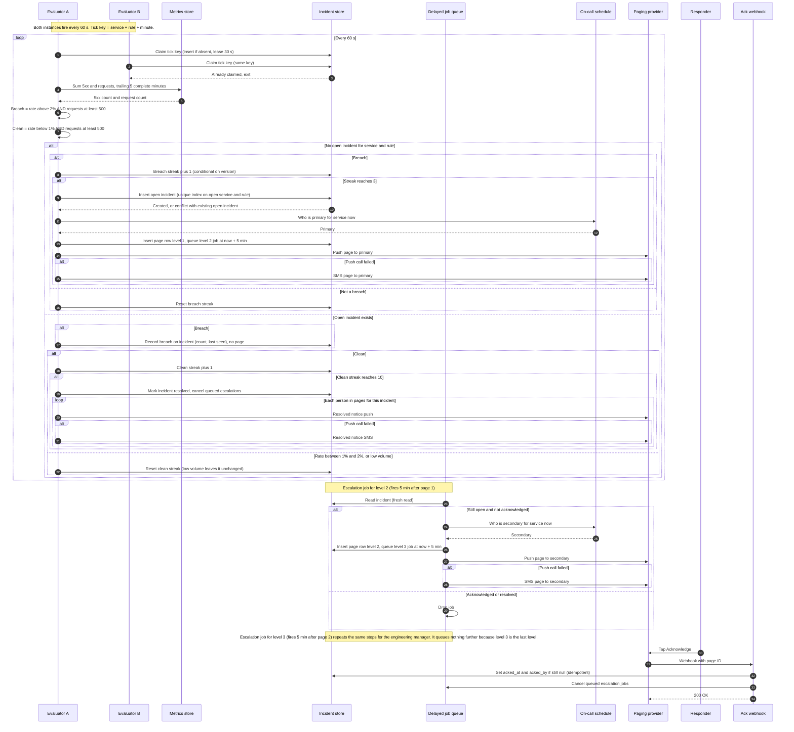

# On-call paging for API error-rate spikes

## Sequence diagram

## Where state lives

- **Incident store**: one transactional database shared by both evaluator instances. It holds three tables.
  - `incidents`: id, service, rule, status (open or resolved), opened_at, resolved_at, breach_streak, clean_streak, breach_count, last_breach_at, acked_at, acked_by, version. A partial unique index on (service, rule) where status is open enforces at most one open incident.
  - `tick_claims`: primary key (service, rule, tick_minute), claimed_by, lease_until.
  - `pages`: unique (incident_id, level), person_id, provider_page_id, push_status, sms_status, created_at.
- **Escalation timers** are jobs in a durable delayed-job queue, not in-process timers. A restart or a dead instance cannot lose them. Each job carries the incident ID and level, and it re-reads the incident before acting.
- **Time** comes from the store's clock for every due time, lease and streak. Evaluator wall clocks are not used for escalation decisions.

## Coordination and duplicate suppression

- Both instances wake every minute, but only the one whose insert creates the tick claim evaluates. The other exits. If the claiming instance dies, its lease expires and the other can re-run the same tick. Every write is conditional, so a re-run cannot count a breach twice.
- The partial unique index makes a second open incident impossible. A conflicting insert is recorded as a breach on the existing incident and does not page.
- The unique (incident_id, level) constraint on `pages` means a duplicate escalation job cannot send a second page for the same level.
- After an incident resolves, its row is no longer open, so the next breach inserts a new row. That is the "new incident" rule.

## Rule interpretations (decisions to confirm)

- An evaluation with fewer than 500 requests is not a breach. It resets the breach streak, because the streak must be consecutive. It does not advance the clean streak.
- A rate between 1% and 2% keeps an open incident open. It resets the clean streak, so the 10 minutes must be continuous.
- A missed tick (metrics unavailable) resets the breach streak and leaves the clean streak unchanged.
- The metrics query reads only minutes the store reports as complete, which guards against ingestion lag.
- The person paged is looked up from the schedule service at page time. The `pages` row records who was paged. Resolved notices go to those recorded people, not to a fresh lookup, so the 09:00 handover cannot change who hears about the resolution.

## Failure handling

- **Push fails**: the SMS fallback runs in the send path. The next escalation job is queued before any send, so a slow or failed send never moves the clock. If both push and SMS fail, the `pages` row is marked failed, the send is retried in the background with backoff, and escalation continues on schedule.
- **Paging provider fully down**: same as above. The system also raises a non-paging alarm to a monitored channel, because the email inbox nobody reads is not an acceptable fallback.
- **Schedule service down**: use the roster stored on the incident at its last successful lookup. If there is none, raise a failure alarm and still advance the clock.
- **One evaluator crashes**: the other continues after the lease expires.
- **Both evaluators or the metrics store down**: nothing pages. This is the one silent failure, so it needs an independent dead-man heartbeat that lives outside this system.
- **Acknowledgement webhook lost**: the provider retries. If the acknowledgement is still lost, escalation may page one level too far. This is accepted. The handler must verify the provider signature and be idempotent.
- **Duplicate or late acknowledgement**: the first one sets `acked_at`. Later ones do nothing. Any acknowledgement stops escalation.
- **Process restart mid-escalation**: jobs are durable. A job whose due time has passed runs immediately.
- **Resolution before acknowledgement**: the resolve step cancels queued escalations, so escalation stops there.

## Open risks

- Escalation timing is exact to the job queue, not to the 60 s evaluation tick.
- The 1% clean-streak rule and the 500-request floor interact on low-traffic services. The interpretation above should be checked against real traffic before launch.
