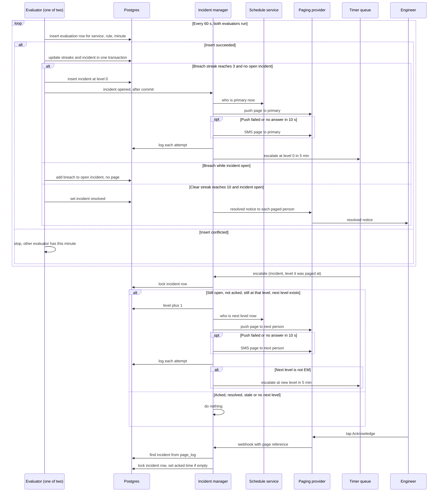

### Error-rate paging

Today a cron script emails a shared inbox when a service's API error rate is high, and nobody reads it at 3 a.m. This design pages a person instead. Two evaluator instances check each service's error rate every minute and write each result to Postgres. After three breaching minutes in a row, an incident opens and the on-call primary is paged. If nobody acknowledges within 5 minutes, the page moves to the secondary, then to the engineering manager (EM), 5 minutes apart. The incident resolves itself after 10 quiet minutes. Postgres holds all state, so both evaluators and the timers agree on what is open, and for each minute only the evaluator whose write wins acts on it.

### Terms

- **5xx**: an HTTP server-error response (status 500 to 599).
- **Metrics store**: a time-series database. The API gateway writes request and 5xx counts per service every minute. The trailing 5-minute rate is the 5xx total divided by the request total over the last five one-minute buckets.
- **Breach**: a minute where the trailing window has more than 2% 5xx and at least 500 requests.
- **Clear minute**: a minute where the trailing window has less than 1% 5xx.
- **Neither**: any other minute that has requests.
- **Streak**: consecutive minutes of one kind. A minute of another kind resets it.
- **Alert rule**: a named condition on a service. Here, the 5xx rule above.
- **Incident**: one open problem for one service and one alert rule.
- **Schedule service**: says who is primary, secondary and EM for a service right now. Rotations hand over at 09:00 every day.
- **Paging provider**: an outside service that sends push notifications to its phone app, and SMS. Each send returns a provider reference. When the engineer taps Acknowledge (ack) in the app, the provider calls our webhook (an address on our side) with that reference.
- **Timer queue**: holds a message and delivers it after a delay. Used for the 5-minute escalation step.
- **Incident manager**: the code module that opens incidents, sends pages, escalates and handles acks. It is part of the app, not a separate service. The evaluator calls it directly after its database commit. The timer queue and the webhook call it too.
- **Escalation level**: 0 is primary, 1 is secondary, 2 is EM.
- **Row lock**: a Postgres lock on one row. Other transactions that need that row wait until the lock is released at commit.

### Flow

### Rules

1. **Classify each minute.** A minute is breach, clear or neither, judged on its trailing window. A window with no requests changes nothing. This includes a service with no series in the store, because a missing series cannot show a clear rate. A neither minute resets both streaks. A breach resets the clear streak, and a clear minute resets the breach streak.
2. **One writer per minute.** Both evaluators run every 60 seconds and each tries to insert an `evaluation` row for the service, rule and minute. Only the insert that succeeds handles that minute. The other evaluator stops. The streak update and any incident change commit in one transaction, so each minute counts once.
3. **Open.** When the breach streak reaches 3 and `rule_state` has no open incident, the winner inserts an incident at level 0. A unique index allowing one open incident per service and rule backs this up. After the commit, the incident manager pages the primary.
4. **While open.** A breach adds one to the incident's breach count and sends no page.
5. **Resolve.** When the clear streak reaches 10 with an incident open, the status change to resolved commits in the same transaction. Then each person who was paged for the incident gets one resolved notice. A breach after that opens a new incident with fresh streaks.
6. **Every page uses one procedure.**
   - Look up the person for the level in the schedule service at the moment of sending, so a 09:00 handover is respected. If the lookup fails, write a failed row with no person and send nothing. Rule 7 still applies.
   - Send push. If the push call errors or gets no answer within 10 seconds, send SMS.
   - Write one `page_log` row per attempt, with the provider reference the provider returned.
   - Each page names the service, the alert rule and the current 5xx rate.
7. **Escalate timer.** After a page to the primary or secondary, queue an escalate message for 5 minutes later. Queue it whatever the page result. No timer follows the EM page.
8. **Escalate check.** The escalate message names the incident and the level it was paged at. The incident manager locks the row and acts only if the incident is open, not acked and still at that level. Then it pages the next level, as in rule 6. Otherwise it does nothing. In normal flow the check always passes, because each level queues one timer. The check exists for duplicate, redelivered or late timers, which then do nothing.
9. **Ack.** The webhook gives a provider reference. `page_log` maps it to the incident. The incident manager locks the row and sets acked time if it is empty. Any ack stops escalation, and later acks change nothing. An ack does not change breach counting or resolving. The incident stays open and counts breaches until 10 quiet minutes pass, acked or not.
10. **Ack and escalate share the row lock.** If the ack commits first, escalate does nothing. If escalate commits first, the next level is paged once, and the ack then stops any further levels.
11. **Resolved notices.** Each distinct person with a `page_log` row for the incident gets one resolved notice, however many attempts they had. People at levels never reached have no row and get nothing. Notices use push then SMS, with the person taken from `page_log` instead of a fresh lookup. They are logged with purpose resolved. No timer is queued. Timers that fire later do nothing, because the incident is no longer open.

### Where state lives

All state is in Postgres.

- `rule_state`: one row per service and rule. Holds the breach streak, the clear streak and a pointer to the open incident, if any.
- `evaluation`: one row per service, rule and minute. Its unique key picks the one evaluator that handles that minute.
- `incident`: status (open or resolved), level, breach count, acked time and resolved time.
- `page_log`: one row per page attempt and per resolved notice. Holds the incident, purpose (page or resolved), role, person (empty if the lookup failed), channel (push or SMS), result and provider reference. The ack webhook and resolved notices read it.

The timer queue holds only the pending escalate messages, each with its incident and level.

### When things fail

| What fails | What happens |
|---|---|
| One evaluator stops | The other evaluates every minute. The `evaluation` key still gives one writer per minute. |
| Both evaluators miss a minute, or the metrics store is unreachable | No evaluation row for that minute, so it is not counted. Streaks continue from the last counted minute. |
| Service has no requests in the window | Nothing changes. |
| Push errors or gets no answer in 10 s | Send SMS. Both attempts are logged. |
| Push and SMS both fail | Logged as failed. The escalate timer still runs. |
| Schedule lookup fails | Logged as failed, with no person. Nobody is paged at that level. The escalate timer still runs and moves on to the next level. |
| Push timed out but was delivered and acked | The timed-out attempt may have no provider reference, so the ack may not match any row. Escalation continues. See open questions. |
| Ack webhook lost | Escalation continues to the next level. |
| Resolved notice fails | Logged. Not retried. |
| Duplicate or late escalate message | The escalate check finds it stale and does nothing. |
| Timer queue loses a message | Not handled. See open questions. |
| Crash after commit, before a page is sent | Not handled. See open questions. |
| Postgres is down | Nothing is evaluated, paged or acked. See open questions. |

### Open questions

- A page or escalate message lost after commit, whether from a crash or a dropped timer, is never retried. Is a sweep for pending work needed?
- A Postgres outage stops detection and paging. Is a fallback needed?
- The 10-second push timeout is a guess. It must be checked against the provider's real response times.
- Does the provider return a reference when a push call times out? If not, an ack for a delivered push that timed out cannot be matched, and escalation continues without it.
- The exact wording and layout of the page are not set here.