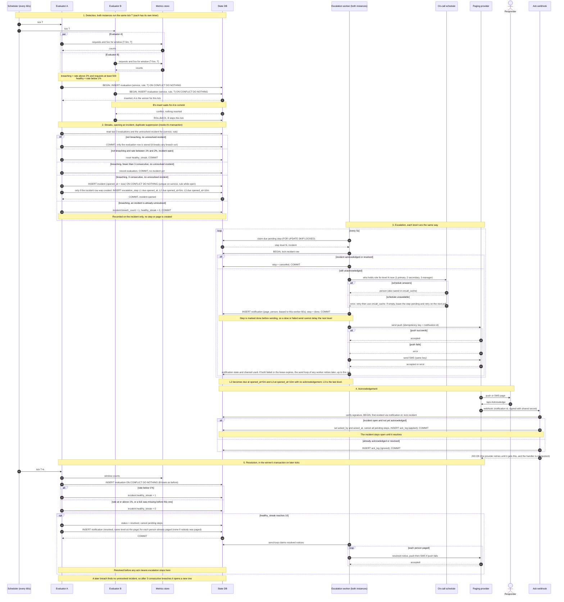

# Paging on-call when the API error rate spikes

Today a cron script emails a shared inbox when the API returns too many errors, and nobody reads it at night. This design replaces it with paging. Two evaluator instances measure the error rate every minute. After 3 breaching minutes in a row, one of them opens an incident in a database. Workers then page the primary, the secondary and the engineering manager in turn, 5 minutes apart, until someone acknowledges. The incident resolves on its own after 10 healthy minutes, and everyone who was paged gets a "resolved" notice. All state lives in one database with unique indexes, so the two instances need no leader and cannot create two incidents or double pages.

## Terms

- **Tick**: a clock minute rounded down, computed from the wall clock. Both evaluators name the same tick without talking to each other.
- **Evaluation**: the result for one (service, rule, tick). The error rate is 5xx divided by requests over the trailing 5 minutes ending at the tick, taken from the metrics store (a time-series database queried by time range, fed by the API gateway).
- **Breaching**: rate above 2% and at least 500 requests in the window.
- **Healthy**: rate below 1%, even with zero requests. The 500-request floor applies only to breaching.
- **Incident**: one unresolved problem for a (service, rule). At most one can be unresolved at a time.
- **Escalation step**: one planned page (level 1 primary, level 2 secondary, level 3 engineering manager) with a fixed due time. Level 3 is the last.
- **Notification**: one outgoing page or "resolved" notice, stored as an outbox row before it is sent. Its id is the idempotency key sent to the paging provider (a repeat send with the same key should not page twice).
- **Paging provider**: the external service with two send APIs, push to its mobile app and SMS. Its app has an Acknowledge button, which makes the provider call our webhook.
- **On-call schedule service**: answers "who is primary, secondary or manager for service X right now?". Rotations hand over at 09:00, so the answer can change mid-incident.
- **Partial unique index**: a unique index that covers only rows matching a condition. Here it allows only one `open` incident per (service, rule).
- **`FOR UPDATE SKIP LOCKED`**: a row-claiming query. Each row goes to one worker, and other workers skip it.

## Sequence diagram

## Notes on the diagram

### Where state lives

All state is in one relational database (Postgres-style, with transactions and unique indexes). Evaluators and workers keep nothing in memory that matters, so a restart or a second instance cannot lose or duplicate anything.

| Table | Purpose | Key constraint |
|---|---|---|
| `evaluation` | One row per (service, rule, tick): requests, 5xx, rate, `breaching`, `healthy` | Unique on (service, rule, tick). First writer wins. |
| `incident` | status (`open` or `resolved`), `opened_at` (database clock time of the insert, not the tick), `acked_by`, `acked_at` (first applied ack only), `breach_count` (breaches recorded while open, audit only), `healthy_streak`, `resolved_at` | Partial unique index on (service, rule) where status is `open`. |
| `escalation_step` | Three rows per incident (levels 1 to 3), each with a fixed `due_at` and a state of `pending`, `done` or `cancelled` | Unique on (incident, level) |
| `notification` (outbox) | One row per page or resolved notice: `kind`, `level`, `person`, channel used, state (`pending`, `sent` or `failed`), attempts, `lease_until` | Unique on (incident, level, kind). The row id is the provider idempotency key. |
| `ack_log` | One row per ack webhook received: notification, person, `received_at`, `applied` or `ignored` (already acknowledged or resolved). This is the audit record. | None. Retries may add rows. |
| `oncall_cache` | The last person the schedule service returned for each (service, role), with `fetched_at`. Updated on every successful lookup. | Unique on (service, role) |

### How the two evaluators coordinate

- There is no separate scheduler service. Each instance runs its own once-a-minute timer. If an instance is down or late, the other handles the tick. A tick nobody handled is backfilled later (see failures).
- Each instance queries the trailing 5 minutes ending at the tick, so both compute the same answer.
- Each instance runs one transaction per tick that starts with `INSERT evaluation ... ON CONFLICT DO NOTHING`. Only the instance whose insert succeeded goes on to update streaks and possibly open an incident, in that same transaction. The other instance's insert waits for the commit, does nothing and moves on. There is no leader election.
- "3 consecutive breaching evaluations" is read from the last 3 `evaluation` rows (ticks T-2, T-1, T), not from a counter. A missing tick row breaks the run, so the count restarts after the gap. An evaluation that is not breaching stores nothing but its own row, and that row, with `breaching` false, is what breaks the run. Only `healthy_streak` is stored, on the incident.
- The incident insert is a second guard. The partial unique index blocks a second open incident even when a backfill or a later tick tries to open one. Escalation steps are written only when the incident insert created a row.
- Escalation workers run in both instances. They claim due steps with `FOR UPDATE SKIP LOCKED`, so each step is handled by exactly one worker.

### How the 5-minute timers work

- There are no in-process timers. When an incident opens, the same transaction writes all three steps with absolute due times: `opened_at`, `opened_at + 5m` and `opened_at + 10m`. `opened_at` is the real time of the insert, so an incident opened by a backfilled tick still gets due times in the future, and the three levels never fire at once.
- Fixed due times are what stop a failed or slow page from moving the clock. Workers poll every 5 seconds, so each level goes out within about 5 seconds of its due time (the first page within about 5 seconds of the incident opening). This jitter never accumulates.
- Acknowledgement or resolution sets all pending steps to `cancelled` in one update. After level 3, nothing is re-paged and the incident stays open until it resolves.

### How pages and notices are sent

- The worker that creates a `notification` row leases it to itself for 60 seconds and sends it right away. A separate send loop, running in every worker, claims any row that is `pending`, or `failed` and due for retry, or whose lease has expired, using `FOR UPDATE SKIP LOCKED`. It takes a new 60-second lease before sending. Resolved notices are sent by this same loop.
- Retries use backoff and stop after 5 attempts. A row that reaches the cap stays `failed` for good.

### What an acknowledgement does

- It cancels the pending escalation steps. It does not resolve the incident: the incident stays open until 10 healthy minutes, and later breaches are still counted on it. Nobody else is told at ack time. Everyone paged gets the "resolved" notice later.
- The webhook carries the notification id. The handler looks up that row, and from it the incident and the person. The provider signs each webhook with a shared secret, and the handler rejects anything unsigned or wrongly signed, so a forged request cannot silence escalation.

### Rules applied where the brief was silent

- A rate between 1% and 2%, or a breach on volume grounds alone, is neither breaching nor healthy. It resets the incident's `healthy_streak` and breaks any breach run.
- A missing tick also resets `healthy_streak` to 0 once the next evaluation is written, because 10 consecutive healthy minutes cannot be confirmed across a gap. Backfill in order fills the gap first when it can.
- After an incident resolves, a new incident still needs 3 consecutive breaching evaluations.
- The on-call lookup happens when each level is paged, not when the incident opens. A 09:00 handover mid-incident therefore pages whoever holds the role at that moment. The person actually paged is stored on the notification row.
- The "resolved" notice goes to the people recorded on the page notification rows, not to the current on-call. Each resolved row copies the `level` of the page it follows, so the unique key (incident, level, kind) holds.

### How failures are handled

| Failure | Behaviour |
|---|---|
| Push call fails | The same worker sends SMS right away. The notification row records the channel used. |
| Push and SMS both fail | The row is marked `failed` and the send loop retries it with backoff up to the cap. Escalation is unaffected because step due times are fixed and the next level is claimed on schedule independently. |
| Retry cap reached | The row stays `failed` and is visible in the audit data. Nobody is told separately. Escalation has already moved on to the next level on schedule, which covers a person who was never reached. If level 3 fails, no one is left to page (see open questions). |
| Worker crashes mid-send | The row's 60-second lease expires, and the send loop in another worker retries with the same idempotency key. If the provider does not honour keys, a rare duplicate page is possible. I chose that over a missed page. |
| On-call schedule service is down | Retry a few times, then use the `oncall_cache` entry for that role and page that person. The step is still marked `done`, so the clock is unaffected. With no cache entry, the step stays `pending` and is retried on every poll, while later levels still fire on their own fixed times. An ack or resolution cancels it. |
| Metrics store query fails, or no instance ran a tick | No `evaluation` row is written for that tick. The gap counts as neither breaching nor healthy. Evaluators backfill missing ticks in order (up to 15 minutes back) once the store or an instance is back, and results are deterministic because they are anchored to the tick. If the store stays down, an open incident stays open and escalation carries on, because it does not use metrics. Auto-resolution waits until evaluations resume. |
| One evaluator is down | The other carries on with no change. Idempotent inserts make it safe for both to run. |
| Ack and escalation race | Both lock the incident row. If the ack commits first, the escalation sees `acked_at` and cancels. If the escalation commits first, the page goes out, which is the one tolerated duplicate. The ack still cancels everything after it. |
| Ack webhook is down | The provider retries and the handler is idempotent. Escalation may page the next level meanwhile. Over-paging is safer than a missed page. |
| Ack arrives after a prior ack or after resolution | An `ack_log` row is written as `ignored`. The incident is not changed. |

## Open questions

- The design assumes the provider returns our notification id in the ack webhook and signs its webhooks. If it does not, the ack handler needs another way to find the incident and check the sender.
- The 60-second lease, the 5-second polling interval and the 5-attempt retry cap are my choices, not from the brief.
- If every level fails to reach anyone (retry cap on level 3, or no person known for a role), nothing alerts a human. The brief gives no further channel, so this is a known gap.
