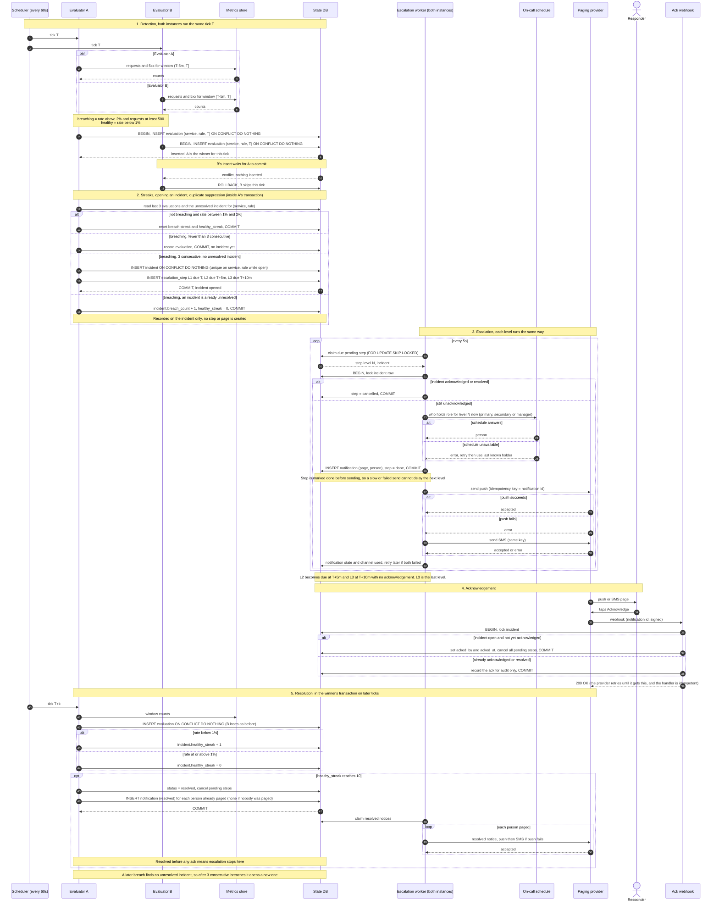

# Paging on-call when the API error rate spikes

## Where state lives and how the pieces coordinate

All state lives in one relational database (Postgres-style, with transactions and unique indexes). Evaluators and workers keep nothing in memory that matters, so a restart or a second instance cannot lose or duplicate anything.

| Table | Purpose | Key constraint |
|---|---|---|
| `evaluation` | One row per (service, rule, tick minute): requests, 5xx, rate, `breaching`, `healthy` | Unique on (service, rule, tick). First writer wins. |
| `incident` | status (`open` or `resolved`), `opened_at`, `acked_by`, `acked_at`, `breach_count`, `healthy_streak`, `resolved_at` | Partial unique index on (service, rule) where status is `open`. This enforces at most one unresolved incident. |
| `escalation_step` | Three rows per incident: level 1, 2 and 3, each with a fixed `due_at` and a state of `pending`, `done` or `cancelled` | Unique on (incident, level) |
| `notification` (outbox) | One row per page or resolved notice: `kind`, `person`, channel used, state, attempts | Unique on (incident, level, kind). The row id is the provider idempotency key. |

**How the two evaluators coordinate**
- Both instances run every minute. Each works on a tick, which is the clock minute rounded down, and queries the trailing 5 minutes ending at that tick. Anchoring to the tick means both compute the same answer.
- Each instance runs one transaction per tick: `INSERT evaluation ... ON CONFLICT DO NOTHING`. Only the instance whose insert succeeded goes on to update streaks and possibly open an incident, in that same transaction. The other instance's insert waits for the commit, does nothing, and moves on. There is no leader election.
- Escalation workers run in both instances too. They claim due steps with `SELECT ... FOR UPDATE SKIP LOCKED`, so one step is handled by exactly one worker.

**How the 5-minute timers work**
- There are no in-process timers. When an incident opens, the same transaction writes all three escalation steps with absolute due times: `opened_at`, `opened_at + 5m` and `opened_at + 10m`.
- Anchoring to `opened_at` is what stops a failed or slow page from moving the clock. Worker polling (every 5 seconds) adds a few seconds of jitter to each level, but the jitter never accumulates.
- Acknowledgement or resolution flips all pending steps to `cancelled` in one update. Level 3 is the last level. After it, nothing is re-paged and the incident stays open until it resolves.

**Rules I applied where the brief was silent**
- "Healthy" means a rate below 1%, including zero requests, regardless of the 500-request floor. The floor applies only to breaching.
- An evaluation with a rate between 1% and 2%, or one that breaches on volume grounds alone, is neither breaching nor healthy. It resets both streaks.
- After an incident resolves, a new incident still needs 3 consecutive breaching evaluations.
- The on-call lookup happens when each level is paged, not when the incident opens. A 09:00 handover mid-incident therefore pages whoever holds that role at that moment. The person actually paged is stored on the notification row.
- The "resolved" notice goes to the people recorded on the notification rows, not to the current on-call.

## How failures are handled

| Failure | Behaviour |
|---|---|
| Push call fails | The same worker sends SMS right away. The notification row records the channel used. |
| Push and SMS both fail | The row is marked `failed` and retried with backoff up to a cap. Escalation is unaffected because step due times are fixed and the next level is claimed on schedule independently. |
| Worker crashes mid-send | The notification row has a lease. When the lease expires, another worker retries using the same idempotency key (the notification id). If the provider does not honour idempotency keys, a rare duplicate page is possible. I chose that over a missed page. |
| On-call schedule service is down | Retry a few times, then fall back to the last known holder of that role, cached with each tick. The step is still marked `done`, so the clock is unaffected. |
| Metrics store query fails | No `evaluation` row is written for that tick. The gap counts as neither breaching nor healthy. Evaluators backfill missing ticks in order (up to 15 minutes back) once the store is reachable, and the results are deterministic because they are anchored to the tick. |
| One evaluator is down | The other one carries on with no change. Idempotent inserts make it safe for both to run. |
| Ack and escalation race | Both lock the incident row. If the ack commits first, the escalation sees `acked_at` and cancels. If the escalation commits first, the page goes out, and this is the one tolerated duplicate. The ack still cancels everything after it. |
| Ack webhook is down | The provider retries, and the ack handler is idempotent. Escalation may page the next level in the meantime. Over-paging is safer than a missed page. |
| Ack arrives after resolution | It is recorded for audit and has no other effect. |

## Sequence diagram

