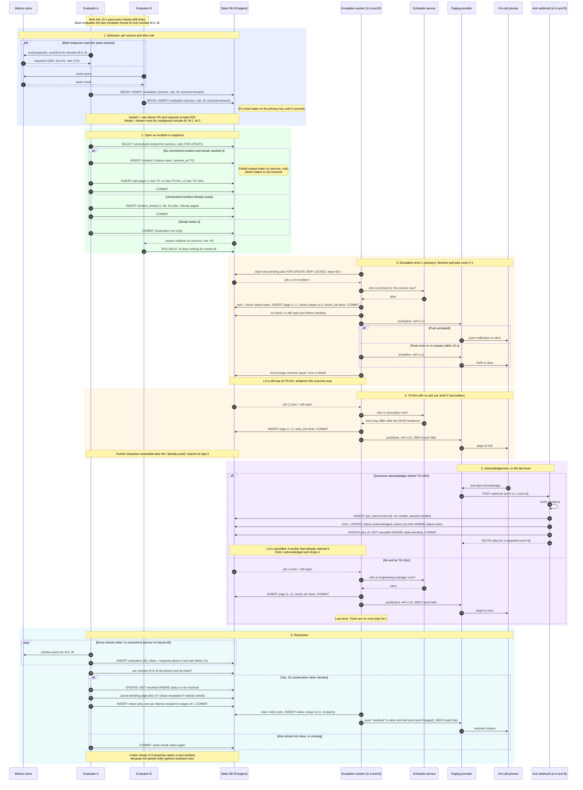

# Paging on-call for public API error-rate spikes

## Design in brief

- **All state lives in one HA Postgres database.** The evaluator instances hold no state that matters. Either instance can do any step at any time, and a crash loses only work that was never committed.
- **The two instances coordinate through unique keys, not leader election.** Both instances evaluate every minute. The `evaluations` table has a primary key on `(service, rule, minute)`, so only one instance can commit a result for a given minute. The other instance's insert fails and it skips that minute. A partial unique index on `incidents (service, rule) WHERE status <> 'resolved'` enforces the "one unresolved incident" rule as a second guard.
- **The 5-minute timers are rows in a `jobs` table.** When an incident opens, the same transaction writes all three escalation jobs, due at T0, T0+5m and T0+10m, where T0 is when the incident opened. A worker loop runs in both instances, polls every 5 s and claims due jobs with `FOR UPDATE SKIP LOCKED`. Due times are fixed when the incident opens and never depend on when or whether a page was delivered, so a failed or slow page cannot delay the clock. An acknowledgement or a resolution cancels the pending jobs.
- **Every time comes from the database's `now()`**, both minute buckets and `due_at`. Clock skew between the instances therefore has no effect.

## Sequence

## Where state is kept

All of it is in Postgres, in these tables:

| Table | Key | Holds |
|---|---|---|
| `evaluations` | PK `(service, rule, minute)` | Requests, 5xx, rate, and an outcome of `breach`, `clean`, `neutral` or `unknown`. The PK makes sure one instance per minute does the work. Breach streaks and clean streaks are both computed from these rows. |
| `incidents` | partial unique `(service, rule) WHERE status <> 'resolved'` | `open`, `acknowledged` or `resolved`, plus opened, acked and resolved times and who acknowledged. |
| `incident_breaches` | `(incident_id, minute)` | Breaches recorded on an unresolved incident. They never page anyone. |
| `jobs` | id, index on `(state, due_at)` | Durable timers for the L1, L2 and L3 pages and the resolved notices: `due_at`, `state` (`pending`, `claimed`, `done` or `cancelled`), `lease_until`. |
| `pages` | unique `(incident_id, level)` and unique `(incident_id, recipient)` for notices | Who was actually paged, by which channel, and the outcome. The resolved notices go to the people in this table, not to whoever is on call when the incident resolves. |
| `ack_events` | PK provider event id | Makes the webhook idempotent. |
| `schedule_cache` | `(service, role)` | The last good answer from the schedule service, refreshed every minute. |

Outcomes:
- **breach:** rate above 2% and at least 500 requests.
- **clean:** at least 1 request and rate below 1%.
- **neutral:** anything else, for example a rate of 1 to 2%, or a rate above 2% on fewer than 500 requests.
- **unknown:** the metrics query failed.

Any outcome other than breach resets the breach streak, and so does a missing minute. Any outcome other than clean resets the clean streak.

The page `ref` we send to the provider is `incident-level`. We use it to match the acknowledgement webhook to the right incident, and as the provider's dedup key on retries.

## How failures are handled

| Failure | Behaviour |
|---|---|
| One evaluator instance is down | The other instance wins every minute's insert and runs the worker and the webhook. There is no failover step. |
| An instance crashes in the middle of an evaluation | Its transaction rolls back. The other instance's insert was waiting on the key, so it now succeeds and that instance evaluates the minute. |
| Both instances are down for a while | No rows are written for those minutes. On start, an instance first evaluates any missing minutes from the last 10 (the metrics are stored), then resumes normal ticks. |
| A worker crashes after claiming a job | The lease expires after 60 s and the other instance claims the job again. The unique `(incident, level)` constraint stops a second page row. A page row left in "sending" is resent with the same `ref`, so at worst the person is notified twice, but they are never missed. |
| The push call fails or times out | The page goes by SMS instead, right away, with the same `ref`. |
| Push and SMS both fail | The page is marked `failed` and SMS is retried up to 3 times, 30 s apart. A notice goes to the ops chat. The next level still fires at its fixed due time. |
| Push is accepted but never reaches the phone | We cannot detect this. Escalation covers it, because the next level fires anyway. |
| The schedule service is slow or down | We use `schedule_cache`. If the cached answer is older than the last 09:00 handover, we still page that person and flag the page as stale. With no answer at all, the level counts as a failed page and the next level fires on time. |
| An ack arrives while a page is being sent | The ack and the worker lock the same incident row, so they run one after the other. The worker checks the status again just before calling the provider. The only remaining risk is a page that leaves a few milliseconds after the ack. The person who gets it sees that the incident is already acknowledged. |
| The webhook is down, or an ack is lost | The provider retries, and `ack_events` drops duplicates. If the ack never arrives, escalation continues. This errs toward paging more people, never fewer. |
| An ack arrives for a resolved incident, or arrives twice | It is recorded and has no other effect. |
| The metrics store query fails | The outcome is `unknown`, which resets both streaks. After 3 `unknown` minutes in a row, the primary gets a one-off "monitoring blind" push or SMS. This opens no incident and starts no escalation. |
| The database is down | Nothing evaluates or pages. We mitigate with HA Postgres (a synchronous replica and automatic failover). We also add a dead-man check outside the database: the existing cron script is repointed to send one SMS through the provider if no `evaluations` row has been written for 3 minutes. |

## Assumptions and open questions

- **Late metrics.** We evaluate minute M 70 s after it starts, which assumes the gateway's per-minute counts are complete by then. If they arrive later, we increase the delay.
- **A provider ref we can match on.** We assume the provider accepts a client reference or dedup key and sends it back in the ack webhook.
- **"Stayed below 1% for 10 consecutive minutes."** We read this as 10 consecutive one-minute evaluations, each with a trailing 5-minute rate below 1%. A minute with zero requests is not counted as clean, so an outage that drives traffic to zero does not resolve itself. The brief has no manual resolve, and we need to decide whether to add one.
- **After an ack.** The person who acknowledged stays the owner, even across a 09:00 handover, and nobody is paged again for that incident.