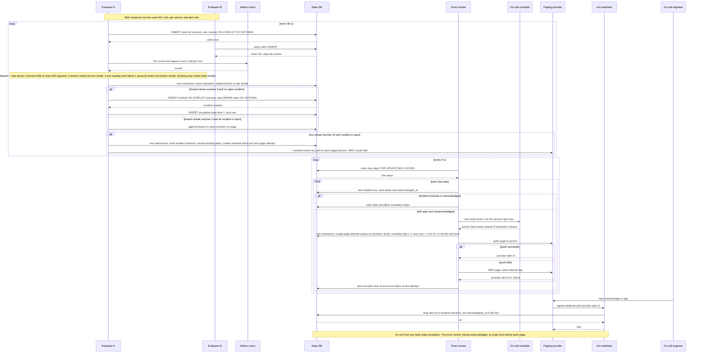

# On-call paging for API error-rate spikes

## What this is

Today a cron script emails a shared inbox when the API returns too many errors. Nobody reads that inbox at 3 a.m. This design pages the on-call engineer instead. Two identical evaluator processes check each service's error rate every 60 seconds. After 3 bad checks in a row, they open one incident and page the primary on-call person by push notification, or by SMS if push fails. If nobody acknowledges within 5 minutes, the secondary is paged. If there is still no acknowledgement 5 minutes later, the engineering manager is paged. The incident resolves on its own after 10 calm minutes.

All shared memory lives in one transactional database. That lets the two evaluators run side by side without talking to each other, and it keeps every timer safe across restarts.

## Terms

- **Error rate**: 5xx responses divided by all requests, over the trailing 5 minutes, for one service.
- **Breach**: a check where the error rate is above 2% and the window holds at least 500 requests.
- **Low reading**: a check where the error rate is below 1%.
- **Breach streak, low streak**: how many breaches, or low readings, in a row.
- **Incident**: one unresolved problem for one service and one alert rule. At most one can be open.
- **Escalation level**: 1 is the primary, 2 the secondary, 3 the engineering manager (the last level).
- **Escalation step**: a scheduled row that means "page level L at this time."
- **Page attempt**: one try to notify one person at one level, by push or SMS.
- **Acknowledgement (ack)**: the on-call person taps Acknowledge in the paging app. An ack stops escalation.
- **Paging provider**: the outside service that sends push and SMS pages and reports acks.
- **Provider alert id**: the id the provider gives each page. The ack sends it back.
- **Webhook**: a URL on our side that the provider calls when someone acks.
- **Schedule service**: answers who holds each level for a service right now.
- **Metrics store**: a time-series database with per-minute request and 5xx counts.
- **State database**: the one shared database that holds every table in this design.
- **Claim**: a row that says "I am evaluating this minute." The first insert wins.
- **Timer worker**: a process that runs due escalation steps. It wakes every 5 seconds.
- **Reaper**: a background job that resends page attempts that were not sent or failed.
- **Gap**: a minute whose metrics could not be read.
- **Heartbeat**: a regular check-in from the evaluator to the paging provider. If check-ins stop, the provider raises an alert.
- **ON CONFLICT DO NOTHING**: a database insert that silently does nothing when a row with the same key exists.
- **Unique key**: a database rule that rejects a second row with the same value. A *partial* unique index applies only to rows that match a condition, here "status is open."
- **FOR UPDATE SKIP LOCKED**: a read that locks the rows it returns and skips rows another worker already locked.
- **claimed_until**: a timestamp on a timer worker's claim. After it passes, another worker may take the step.
- **Database clock (now())**: the state database's own time. Using it means hosts with different clocks agree.

## Sequence diagram

## How the state is kept

All state is in the state database. Timers are rows, not in-process sleeps, so they survive restarts and failover.

- `rule_state` (service, rule): breach_streak, low_streak, last_eval_minute.
- `evaluations` (service, rule, minute is the primary key): the claim first, then the result.
- `incidents`: id, service, rule, status (open or resolved), opened_at, acknowledged_at, acked_level. A partial unique index on (service, rule) where status is open allows at most one open incident. A breach after a resolution creates a new row.
- `breach_log`: breaches recorded on an open incident. These never page.
- `escalation_steps` (unique on incident and level): due_at, status (pending, done or cancelled), claimed_until.
- `page_attempts` (unique on incident and level): recipient, channel (push or sms), status, provider_alert_id. A level can be paged at most once.
- `resolution_notices` (unique on incident and page attempt): one resolved notice per page attempt that was sent.

## How the steps run

1. **Claim the minute.** Every 60 seconds, both evaluators try to insert a claim for the same service, rule and minute. Only the first insert wins. The winner alone queries the metrics store for the trailing 5 minutes and saves the result and the streak change in one transaction. The loser skips that minute. So streaks move once per minute, whichever evaluator is up.
2. **Classify the reading.** A breach advances the breach streak and resets the low streak. A low reading advances the low streak and resets the breach streak. Anything else resets both. Streaks count only saved results.
3. **Open an incident.** When the breach streak reaches 3 and no incident is open, the evaluator inserts an incident. The partial unique index makes a second open incident for the same service and rule fail, so the insert does nothing and the evaluator carries on. The evaluator then writes escalation step level 1, due now. While an incident is open, further breaches go to `breach_log` and never page.
4. **Page the level.** Every 5 seconds, the timer worker claims due steps. It locks the incident row and reads its status and acknowledged_at. If the incident is resolved or acknowledged, the step is cancelled and escalation stops. Otherwise, the worker asks the schedule service who holds this level now. The person is looked up at this moment, not when the incident opened, so a 09:00 handover is picked up mid-incident. In one transaction, the worker creates the page attempt and, if this level is not the last, schedules level L+1 due 5 minutes from now. The next step is saved before any provider call, so a slow or failed send cannot delay the clock.
5. **Send the page.** The worker sends a push first. If the push call fails, it sends an SMS with the same attempt key. It then stores the provider alert id and the send status on the attempt.
6. **Acknowledge.** The on-call person taps Acknowledge. The provider calls the webhook with the alert id. The webhook maps the id to an incident and level, sets acknowledged_at if it is still null, and returns 200. The timer worker sees acknowledged_at under lock before its next page, so a late timer cannot page anyone after an ack.
7. **Resolve.** When the low streak reaches 10 and an incident is open, the evaluator resolves it in one transaction. It cancels pending steps and creates one resolved notice per sent page attempt. Then it pushes each resolved notice to the person who was paged, with SMS if push fails. If nobody was acknowledged before the resolution, the cancelled steps stop escalation there.

## What happens when things fail

| Failure | What happens |
|---|---|
| Metrics store unavailable | The winning evaluator saves no evaluation and changes no streak. The minute is logged as a gap. A gap is neither a breach nor a low reading, so it starts or stops neither streak. |
| Evaluator crashes after claiming | That minute is lost. The other evaluator claims the next minute. Streaks count only completed evaluations. |
| Both evaluators down | Nothing pages. The heartbeat in the paging provider alerts when check-ins stop. It is the only detection for this failure. |
| Push call fails | The worker sends an SMS with the same attempt key. The escalation clock is not affected. |
| SMS also fails | The attempt is marked failed. The next level's step stays scheduled, so escalation continues on time. A background retry resends failed and pending attempts with the same attempt key. It never holds the timer. |
| Push times out but was delivered | The SMS fallback can notify the person twice. Pass the attempt id as the provider's idempotency key where the provider supports it. Otherwise accept the duplicate. |
| Page saved but never sent | The reaper resends attempts still pending after a short grace period. This is the same retry path as in the SMS row. |
| Timer worker crashes | Its claimed steps expire at claimed_until. A surviving worker reclaims them. The unique key on (incident, level) stops a duplicate page. |
| Schedule service unavailable | Use the last answer recorded for that service and level. If there is none, page the configured fallback contact and flag the page for review. |
| Ack webhook down or lost | The provider retries the webhook. The update is idempotent. Before paging the next level, the timer worker can also query the provider for the ack status of earlier attempts. |
| Resolved notice fails | It retries in the background. Escalation has already stopped, so this does not affect it. |
| State database unavailable | Evaluators and timers stop, so nothing pages. Run the database with high availability. The heartbeat covers this case too. |

## Open questions

- **Confirm the low-streak rule.** The low streak counts any reading below 1%, including windows with fewer than 500 requests. The 500-request floor applies only to breaches. If this is wrong, a quiet service would never resolve.
- **Assumed: the metrics query is safe to repeat.** A retried evaluation gets the same counts.
- **Assumed: every ack carries the provider alert id.** The webhook needs it to map the ack to an incident and level.
- **Unknown: does the paging provider accept an idempotency key?** If not, a push that timed out but was delivered can cause a duplicate SMS.