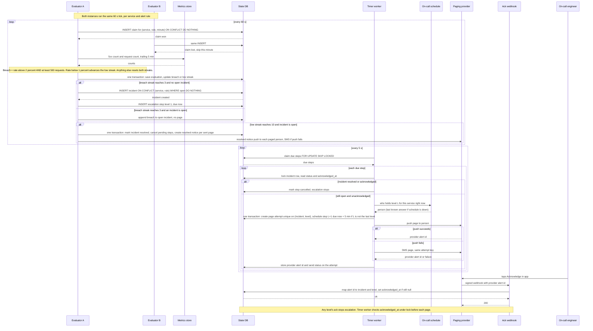

# On-call paging for API error-rate spikes

## Sequence diagram

## Where state lives

All state is in one transactional database shared by both evaluator instances. Timers are rows, not in-process sleeps, so they survive restarts and failover. `now()` is the database clock, which avoids skew between hosts.

- `rule_state` (service, rule): `breach_streak`, `low_streak`, `last_eval_minute`.
- `evaluations` with primary key (service, rule, minute): the per-minute claim, then the result.
- `incidents`: id, service, rule, status (open or resolved), opened_at, acknowledged_at, acked_level. A partial unique index on (service, rule) where status is open enforces at most one unresolved incident. A breach after resolution creates a new row.
- `breach_log`: breaches recorded against an open incident. These never page.
- `escalation_steps` with unique (incident_id, level): due_at, status (pending, done, cancelled), claimed_until.
- `page_attempts` with unique (incident_id, level): recipient, channel (push or sms), status, provider_alert_id. The unique key means a level can be paged at most once.
- `resolution_notices` with unique (incident_id, page_attempt_id): one resolved notice per person who was paged.

## How the timers and the two evaluators coordinate

- **One evaluator per minute.** Both instances try to insert the same (service, rule, minute) claim. Only the winner queries metrics and writes streaks, in the same transaction as the evaluation row. Streaks therefore move once per minute, whichever instance is up.
- **Escalation clock.** When a page is sent, the next step (level L+1, due now + 5 min) is written in the same transaction as the page attempt. It is scheduled before any provider call, so a slow or failed send cannot delay the clock.
- **Ack check under lock.** Each due step locks the incident row and reads `acknowledged_at` and `status`. An ack or resolution that committed first cancels the step, so a late timer cannot page someone after an ack.
- **Idempotent paging.** Both timer workers use `FOR UPDATE SKIP LOCKED` and unique keys on steps and attempts. Two workers cannot send the same level twice.
- **Dedupe of breaches.** The partial unique index means an insert for a second open incident fails, and the breach is appended to the existing incident instead.
- **Who is paged.** Each level's person is looked up when the step runs, not when the incident opens, so a 09:00 handover is picked up mid-incident.

## Failure handling

- **Metrics store unavailable.** The winning evaluator writes no evaluation and changes no streak. The minute is logged as a gap. A gap is neither a breach nor a low reading, so it does not start or stop either streak.
- **Evaluator crashes after claiming.** That minute is lost. The other instance claims the next minute, and streaks count only completed evaluations.
- **Evaluators fully down.** Nothing pages. Configure a heartbeat in the paging provider that alerts when the evaluator stops checking in. This is the only detection path for that failure.
- **Push fails.** The attempt falls back to SMS. If SMS also fails, the attempt is marked failed and the escalation step stays scheduled. Failed sends retry in the background and never hold the timer.
- **Push times out but was delivered.** The SMS fallback can double-notify. Pass the attempt id as the provider idempotency key where the provider supports it. Otherwise accept the duplicate.
- **Timer worker crashes.** Its claimed steps expire (claimed_until) and any surviving instance reclaims them. The unique (incident, level) key prevents a duplicate page.
- **Pages committed but not sent.** A reaper resends attempts that are still pending after a short grace period. This is the only path that resends a page.
- **Schedule service unavailable.** Use the last answer recorded for that service and level. If there is none, page a configured fallback contact and flag it for review.
- **Ack webhook down or lost.** The provider retries the webhook, and the update is idempotent. As a mitigation, the timer worker can query the provider's ack status for earlier attempts before paging the next level.
- **Resolved notice fails.** It retries in the background. It does not affect escalation, which has already stopped.
- **Database unavailable.** Both evaluators and timers stop, so nothing pages. Run the database with high availability. The provider heartbeat (above) covers this case too.

## Assumptions

- The metrics store query is safe to repeat, so a retried evaluation gives the same counts.
- The low streak counts any reading below 1 percent. The 500-request floor applies only to breaches. Confirm this, because a quiet service would otherwise never resolve.
- Each ack carries the provider alert id, so the webhook can map it to an incident and level.
