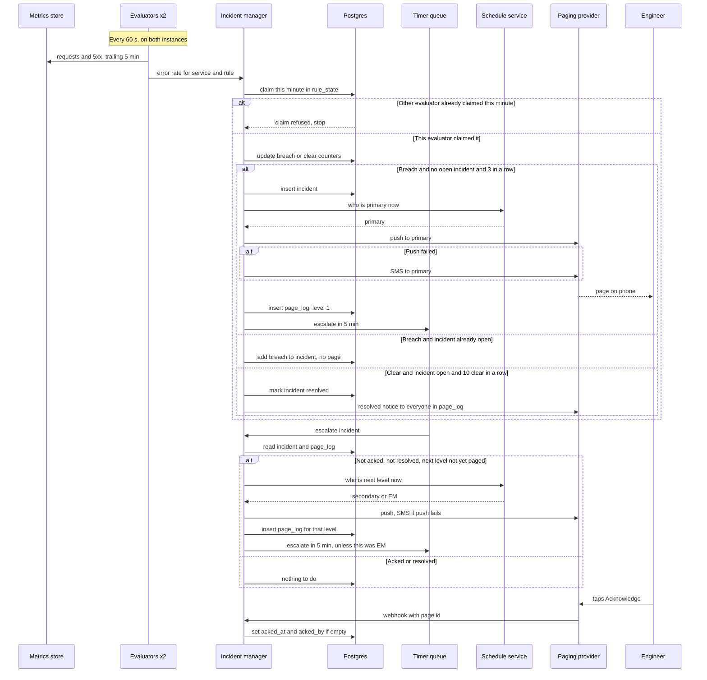

# Error-rate paging

Today a cron script emails a shared inbox that nobody reads at 3 a.m. This design pages on-call engineers instead. Two evaluators check each service's error rate every 60 seconds. After 3 breaching checks in a row, they open one incident per service and alert rule and page the primary, then the secondary, then the engineering manager, until someone acknowledges. The incident resolves once the error rate has stayed low for 10 minutes.

## Terms

- **Error rate**: 5xx responses divided by all requests, over the trailing 5 minutes.
- **Breach**: an evaluation where the error rate is above 2% and the window holds at least 500 requests.
- **Clear minute**: an evaluation where the error rate is below 1%.
- **Incident**: one open problem for one service and one alert rule. At most one can be open per service and rule.
- **Page**: one message to one person. It goes by push first, and by SMS if the push call fails.
- **Acknowledge (ack)**: the engineer taps Acknowledge in the paging app. The paging provider then calls our webhook.
- **Metrics store**: a time-series database with per-minute request and 5xx counts for each service.
- **Schedule service**: tells us who is primary, secondary and engineering manager (EM) for a service right now. Rotations change at 09:00 every day.
- **Timer queue**: holds a message and returns it at a set time.
- **Paging provider**: an outside service that sends push and SMS, and reports acks through the webhook.
- **Postgres**: the one shared store. It holds `rule_state` (one row per service and rule, with the counters), `incident`, and `page_log` (one row per page sent).

## Diagram

## How it works

1. **Evaluate (every 60 s, both instances).** Each evaluator reads the trailing 5-minute request and 5xx counts from the metrics store and works out the error rate. Both run on the same schedule.
2. **Claim the minute.** Before changing any counter, the evaluator updates `rule_state` for this service and rule, but only if its last claimed minute is older than this one. The first evaluator to claim the minute applies the result. The other one stops. This is how two instances never count the same minute twice.
3. **Update the counters.** In the same transaction, the claimer updates `rule_state`:
   - Breach: add 1 to consecutive breaches, and set clear minutes to 0.
   - Not a breach: set consecutive breaches to 0. A window under 500 requests is never a breach.
   - Error rate under 1%: add 1 to clear minutes. Otherwise set clear minutes to 0.
4. **Open an incident.** If consecutive breaches reach 3 and no incident is open for this service and rule, insert an `incident` row and page the primary (step 5). A unique index on open incidents also blocks a second one. If an incident is already open, add the breach to it and page nobody. Breaches are recorded on the incident only.
5. **Page the primary.** The incident manager asks the schedule service who is primary at this moment, so a 09:00 handover is respected. It sends a push. If the push call fails, it sends an SMS instead. It writes a `page_log` row for this incident and level, then sets a 5-minute timer on the timer queue. The timer is set whatever the send result, so a failed page never delays escalation.
6. **Escalate.** When the timer fires, the incident manager reads the incident and its `page_log` rows first. If the incident is acked or resolved, or the next level is already in `page_log`, it does nothing. Otherwise it pages the next level the same way as step 5. Level 2 is the secondary. Level 3 is the EM, the last level, so no timer is set after it. A duplicate timer is therefore harmless.
7. **Acknowledge.** The provider calls our webhook with its page id. The incident manager finds the `page_log` row and sets `acked_at` and `acked_by` on the incident, but only if they are empty, so the first ack wins. Any ack stops escalation, because step 6 checks it.
8. **Resolve.** When an open incident has 10 clear minutes in a row, the incident manager marks it resolved. It then sends a "resolved" notice, push first with SMS as fallback, to everyone with a `page_log` row for this incident. A minute at or above 1% resets the clear count, so the incident stays open. If the incident resolves before anyone acks, the check in step 6 finds it resolved and escalation stops. A breach after resolution opens a new incident, which needs 3 breaches in a row again.

## What happens when things fail

| Failure | What happens |
|---|---|
| Metrics store cannot be read in a minute | That minute is skipped. No counter changes. |
| One evaluator is down | The other evaluator runs every minute. Nothing else changes. |
| Both evaluators run the same minute | Only the first to claim it applies it (step 2). |
| Push call fails | The same person gets an SMS. The escalation timer is still set. |
| Push and SMS both fail | `page_log` records both failures. The timer still runs, so escalation moves on. (The brief does not say; this is a decision.) |
| Incident manager crashes mid-step | State is in Postgres. Timers still fire, and the next run reads Postgres. The unique level key in `page_log` stops a retry from paging twice. |
| Schedule service cannot answer | See open questions. |
| Ack webhook is lost | See open questions. |

## Open questions

- What happens when the schedule service cannot name a person at a page time? Not decided.
- Can a window under 500 requests count toward the 10 clear minutes? The brief does not say. The current rule lets it count if its rate is under 1%.
- Does the paging provider retry a webhook that fails? Not known. If it does not, an ack could be missed and escalation would continue.
- What happens if a timer is lost? Nothing re-sends it, so escalation would stop. Not decided.
- The brief does not name a channel for the resolved notice. This design uses push with SMS fallback. Confirm.