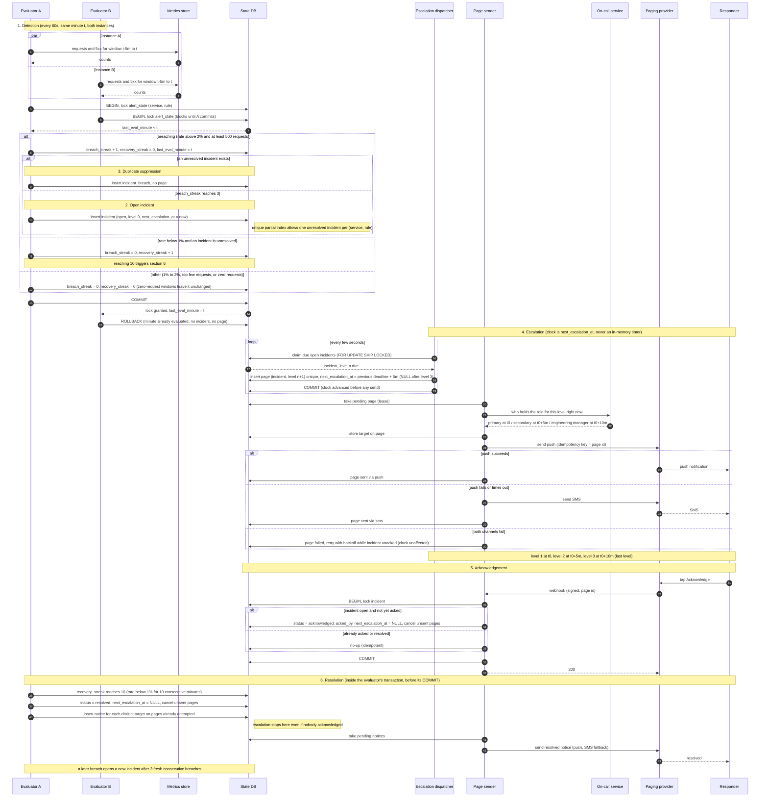

# On-call paging for public API error-rate spikes

Today a cron script emails a shared inbox when the API returns too many errors, and nobody reads that inbox at 3 a.m. This design replaces it with paging. Two evaluator instances check the error rate every minute and open an incident after 3 consecutive breaches. A dispatcher then pages primary, secondary and engineering manager at 5-minute intervals until someone acknowledges or the incident resolves. All state lives in one transactional database, and a row lock makes the two evaluators act as one. Timers are stored deadlines, so a crash loses nothing.

## Terms

- **Metrics store**: a time-series database. The API gateway writes per-minute request counts and 5xx counts per service to it, and we query it by time range.
- **On-call service**: answers "who is primary / secondary / engineering manager for service X right now?". Rotations hand over at 09:00 every day, so the answer can change mid-incident.
- **Paging provider**: external service with two send APIs, push (to its mobile app) and SMS. The app has an Acknowledge button. A tap makes the provider call our webhook.
- **Rule**: an alert definition. This document covers one rule, the error-rate rule. Incidents are tracked per (service, rule).
- **Breaching evaluation**: an evaluation where the 5xx rate over the trailing 5 minutes is above 2% and the window holds at least 500 requests.
- **Streak**: a count of consecutive evaluations. `breach_streak` counts breaching ones. `recovery_streak` counts ones with the rate below 1%.
- **Incident**: one unresolved episode for a (service, rule). Status is open, acknowledged or resolved.
- **Level**: who is paged. 1 is primary, 2 is secondary, 3 is the engineering manager (the last level).
- **Evaluator**: a process that runs the check each minute. There are two instances.
- **Escalation dispatcher**: a poller that creates the page for each due level.
- **Page sender**: a worker that looks up the person, sends the push or SMS, and handles the acknowledgement webhook.
- **Lease**: a time-limited claim on a row. If the holder dies, the lease expires and another worker takes over.
- **`FOR UPDATE SKIP LOCKED`**: a Postgres row-lock query. It locks the rows it returns and skips rows another transaction has locked.
- **Unique partial index**: a unique index over only the rows matching a condition. Here it allows one unresolved incident per (service, rule).
- **Idempotency key**: an ID the provider uses to ignore a repeated send.
- **Watchdog**: a separate alert that fires when evaluation itself has stopped.

## Fixed rules

- Evaluate every 60 seconds.
- Open an incident after 3 consecutive breaching evaluations.
- At most one unresolved incident per (service, rule). Further breaches are recorded on it and page nobody.
- An incident resolves automatically once the rate has stayed below 1% for 10 consecutive minutes. A breach after that is a new incident.
- Escalation: page the primary. If nobody acknowledges within 5 minutes, page the secondary. After 5 more minutes without acknowledgement, page the engineering manager, the last level. Any acknowledgement stops escalation.
- Every page goes by push first. If push fails, send SMS. A failed page never stops or delays the escalation clock.
- On resolve, everyone who was paged gets a "resolved" notice. If it resolves before anyone acknowledged, escalation stops there.
- The two evaluators run on the same schedule for availability. Together they must not create two incidents or send double pages.

## Sequence diagram

The numbers in the notes match the sections of the diagram.

## Where state lives

All state is in one durable transactional database (for example Postgres). Neither evaluator keeps anything in memory that matters, so a restart or failover loses nothing.

| Table | Key | Holds |
|---|---|---|
| `alert_state` | (service, rule) | `last_eval_minute`, `breach_streak`, `recovery_streak`. This row is also the lock that serialises the two evaluators. |
| `incident` | id. Unique partial index on (service, rule) `WHERE status <> 'resolved'`. | `status`, `current_level` (0 to 3), `next_escalation_at`, `acked_by`, `acked_at`, `resolved_at`. |
| `incident_breach` | (incident, minute) | Breaches recorded on an unresolved incident. They never page anyone. |
| `page` | id. Unique on (incident_id, level). | `target`, `channel_used`, `status` (pending, sending, sent, failed, cancelled), attempts, lease. |
| `notice` | id | A "resolved" message per paged person, with the same delivery fields as `page`. |

## How the two evaluators coordinate

- Both run every minute for the same minute boundary `t`. They query the same closed window `[t-5m, t)`, so they reach the same verdict. The window should end a short lag before `t`, so late-written gateway counts land first.
- Each opens a transaction and runs `SELECT ... FOR UPDATE` on the `alert_state` row. If `last_eval_minute >= t`, the other instance already processed that minute, so this one rolls back. Streaks advance exactly once per minute.
- The unique partial index on `incident` is the backstop. A second concurrent insert fails, so two incidents for one (service, rule) are impossible even if the locking has a bug.
- If an instance dies mid-transaction, nothing commits and the other instance's attempt wins. A minute that neither evaluates is a gap. A gap resets both streaks, because the rules say "consecutive". This is the conservative choice.

## How the 5-minute timers work

There are no in-process timers. The escalation clock is the column `incident.next_escalation_at`.

- Opening an incident sets it to now, so level 1 is due immediately.
- Any number of dispatcher instances poll every few seconds for open incidents where `next_escalation_at <= now`, using `FOR UPDATE SKIP LOCKED`.
- The dispatcher claims a level in one short transaction. It inserts the `page` row (the unique (incident, level) constraint prevents a double page), sets `current_level`, and sets `next_escalation_at` to the previous deadline plus 5 minutes. Anchoring to the previous deadline stops dispatcher lag from accumulating. After level 3 the deadline is NULL, because the engineering manager is the last level.
- The clock advances at claim time, never depending on whether the push or SMS succeeds. So level 1 fires at t0, level 2 at t0+5 and level 3 at t0+10.
- Acknowledgement and resolution both set `next_escalation_at = NULL` in a transaction that locks the same incident row. If an ack and an escalation race, exactly one commits first and the other sees the new state.

## Who gets paged

The on-call lookup happens when the page is sent, not when the incident opens. An incident open across 09:00 pages whoever holds the role when each level fires. The resolved person is stored as `target` on the `page` row. That row is the record of who was paged, and the "resolved" notices use it.

## Failure handling

| What fails | What happens |
|---|---|
| Push fails or times out | The sender sends SMS for the same `page` row and records `channel_used`. A timed-out push may have been delivered, so the person might get both. We accept a duplicate over a missed page. |
| Both channels fail | The page is retried with backoff while the incident is open and unacknowledged. This loop never touches `next_escalation_at`, so escalation proceeds on schedule. |
| Sender crashes | A `sending` page has a lease. When it expires, another sender picks the page up. The provider idempotency key is the page id, if the provider supports one. |
| On-call lookup fails | The sender retries with a short timeout. The clock has already advanced, so the next level still fires on time. |
| Metrics store down | The evaluation errors and no state changes. This is a gap, which resets the streaks. A watchdog alerts if no evaluation commits for a few minutes. Otherwise a dead evaluator pair looks the same as a healthy API. |
| Ack webhook | It verifies the provider signature and is idempotent. Duplicates, and acks on a resolved incident, are no-ops. If the webhook is unreachable, the provider's retry may arrive after the next level fired. That means one extra page, never a missed one. |
| Database unavailable | Evaluators and dispatchers do nothing (fail closed). Nothing is paged twice, and everything catches up from the stored deadlines when the database returns. |

## Assumptions where the brief is silent

- A window with zero requests has no defined rate. It is not a breach and does not advance the recovery streak.
- A rate between 1% and 2% is not a breach and resets `recovery_streak`. A breach during an open incident also resets it.
- After a resolve, a new incident needs 3 fresh consecutive breaching evaluations.
- An acknowledged incident stays acknowledged until the auto-resolve condition is met.

## Open questions

- Does the paging provider support idempotency keys? If not, a sender crash after a send can cause one duplicate page.
- The window lag, dispatcher polling interval, retry backoff and watchdog threshold ("a few minutes") are not fixed yet.
