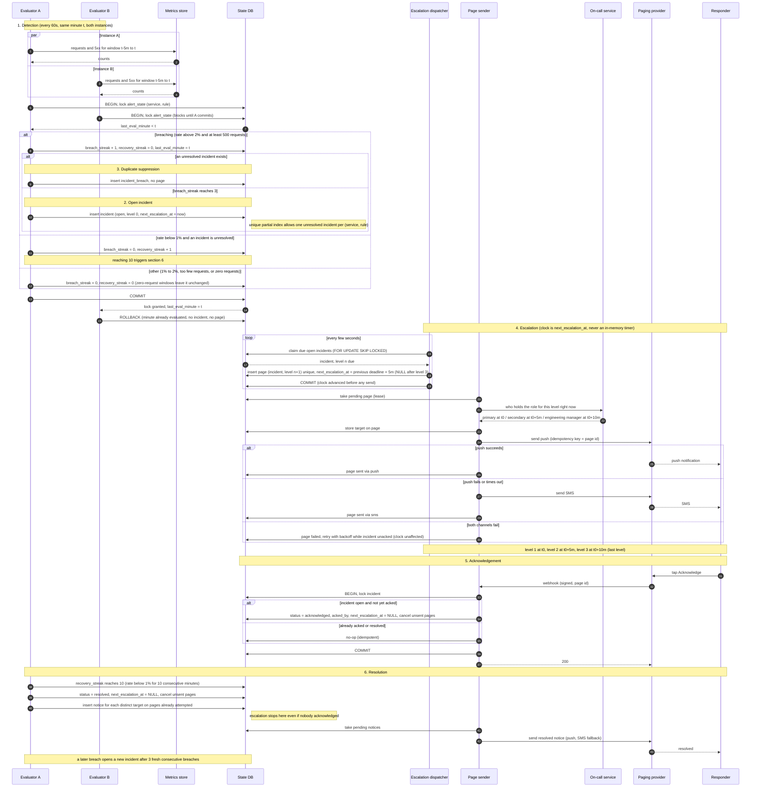

# On-call paging for public API error-rate spikes

## Design notes

### Where state lives

All state is in one durable transactional database (for example Postgres). Neither evaluator keeps anything in memory that matters, so a restart or a failover loses nothing.

| Table | Key | Holds |
|---|---|---|
| `alert_state` | (service, rule) | `last_eval_minute`, `breach_streak`, `recovery_streak`. This row is also the lock that serialises the two evaluators. |
| `incident` | id. Unique partial index on (service, rule) `WHERE status <> 'resolved'`. | `status` (open, acknowledged, resolved), `current_level` (0 to 3), `next_escalation_at`, `acked_by`, `acked_at`, `resolved_at`. |
| `incident_breach` | (incident, minute) | Breaches recorded on an unresolved incident. These never page anyone. |
| `page` | id. Unique on (incident_id, level). | `target`, `channel_used`, `status` (pending, sending, sent, failed, cancelled), attempts, lease. |
| `notice` | id | A "resolved" message per paged person, with the same delivery fields as `page`. |

### Coordination of the two evaluators

- Both instances run every minute for the same minute boundary `t`. They query the metrics store for the same closed window `[t-5m, t)`, so they reach the same verdict. In practice the window should end a short lag before `t` so late-written gateway counts land first.
- Each instance then opens a transaction and takes `SELECT ... FOR UPDATE` on the `alert_state` row. If `last_eval_minute >= t`, the other instance has already processed that minute, so this one rolls back and does nothing. Streak counters are therefore advanced exactly once per minute.
- The unique partial index on `incident` is the backstop. A second concurrent insert fails, which makes two incidents for the same (service, rule) impossible even if the locking logic has a bug.
- If an instance dies mid-transaction, nothing commits and the other instance's attempt for that minute wins. A minute that neither instance evaluates is a gap. A gap resets both streaks, because the rules say "consecutive". This is the conservative choice.

### How the 5-minute timers work

There are no in-process timers. The escalation clock is the column `incident.next_escalation_at`.

- Opening an incident sets `next_escalation_at = now`, which is level 1 due immediately.
- An escalation dispatcher (any number of instances) polls every few seconds. It runs `SELECT ... WHERE status='open' AND next_escalation_at <= now FOR UPDATE SKIP LOCKED`.
- It claims a level in one short transaction. The transaction inserts the `page` row (the unique (incident, level) constraint prevents a double page), sets `current_level`, and sets `next_escalation_at = previous deadline + 5 min`. Anchoring to the previous deadline stops dispatcher lag from accumulating. The deadline is set to NULL after level 3, because the engineering manager is the last level.
- The clock is advanced at claim time. It never depends on whether the push or SMS call succeeds.
- The timeline is level 1 at t0, level 2 at t0+5, and level 3 at t0+10.
- Acknowledgement and resolution both set `next_escalation_at = NULL` in a transaction that locks the same incident row. This serialises them against the dispatcher. If an ack and an escalation race, exactly one commits first, and the other sees the new state.

### Who gets paged

The on-call lookup happens when the page is sent, not when the incident opens. Rotations hand over at 09:00, so an incident open across 09:00 pages whoever holds the role at the moment each level fires. The resolved `target` is stored on the `page` row. That row is the record of who was paged, and the "resolved" notices use it.

### Failure handling

- **Push fails or times out.** The sender calls SMS for the same `page` row and records `channel_used`. A push that timed out may have been delivered, so the person might get both. We accept a duplicate over a missed page.
- **Both channels fail.** The page is retried with backoff while the incident is still open and unacknowledged. This is a separate loop and never touches `next_escalation_at`. Escalation proceeds on schedule regardless.
- **Sender crash.** A `sending` page has a lease. When the lease expires, another sender picks it up. The provider idempotency key is the page id, if the provider supports one.
- **On-call lookup fails.** The sender retries with a short timeout. The clock has already advanced, so the next level still fires on time.
- **Metrics store down.** The evaluation errors and no state changes. This produces a gap, which resets the streaks. Add a watchdog alert if no evaluation commits for a few minutes. Otherwise a dead evaluator pair looks the same as a healthy API.
- **Ack webhook.** It verifies the provider signature and is idempotent. Duplicates, and acks on a resolved incident, are no-ops. If the webhook is unreachable, the provider's retry may arrive after the next level has fired. That means one extra page, never a missed one.
- **Database unavailable.** Evaluators and dispatchers do nothing and fail closed. Nothing is paged twice, and everything catches up from the stored deadlines when the database returns.

### Assumptions where the brief is silent

- A window with zero requests has no defined rate. It is not a breach, and it does not advance the recovery streak.
- A rate between 1% and 2% is not a breach and resets `recovery_streak`. A breach during an open incident also resets it.
- After a resolve, a new incident needs 3 fresh consecutive breaching evaluations.
- An acknowledged incident stays acknowledged until the auto-resolve condition is met.

## Sequence diagram

