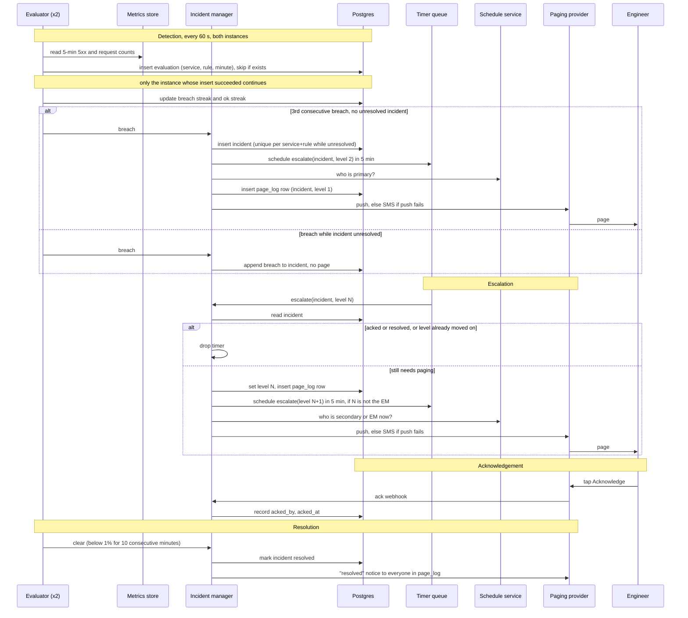

### Error-rate paging

Today a cron script emails a shared inbox when the API has too many errors, and nobody reads it at night. This design replaces it. Two evaluator instances check each service's error rate every minute. Both write to Postgres, and Postgres decides which one acts, so there is never a second incident or a second page. When a service breaches 3 times in a row, an incident opens and the primary on-call is paged. Timers escalate to the secondary and then the engineering manager until someone acknowledges. When the error rate recovers, the incident resolves and everyone paged is told.

Terms:
- **Evaluator**: a process that runs every 60 seconds. We run two copies on the same schedule for availability.
- **Breach**: one evaluation where the error rate is above 2% and the window has at least 500 requests. Error rate is 5xx count / request count over the trailing 5 minutes.
- **Alert rule**: the named condition being checked. The rule here is the error-rate rule. An incident is identified by (service, rule).
- **Metrics store**: a time-series database. The API gateway writes per-minute request and 5xx counts per service. The evaluator reads from it.
- **Incident manager**: the component that owns all incident changes: opening, paging, escalating, acknowledging, resolving.
- **Postgres**: the only place incident state lives. Key tables are `incident`, `evaluation`, and `page_log`.
- **Timer queue**: a queue that delivers a message after a delay. It only wakes the incident manager. It is not the source of truth.
- **Schedule service**: answers "who is primary, secondary or engineering manager (EM) for service X right now?". Rotations hand over at 09:00 daily, so the answer can change mid-incident.
- **Paging provider (Pager)**: external service with a push API (mobile app) and an SMS API. Its app has an Acknowledge button, and tapping it makes the provider call our ack webhook.

Steps the diagram cannot show:

1. **Detection.** Both evaluators read the metrics store each minute. Each tries to insert an `evaluation` row keyed by (service, rule, minute). The insert that succeeds is the only one that continues. It updates the breach streak and the "below 1%" streak in the same transaction, so a crash leaves nothing half-counted. If the metrics store is unreachable, the evaluation is skipped and does not count as a breach or as a clear.
2. **Opening.** After 3 consecutive breaches, the incident manager inserts an incident. A unique index allows only one unresolved incident per (service, rule), so a second insert fails and becomes "record the breach on the existing incident, page nobody". A breach after resolution is a new incident.
3. **Paging.** Before sending, the incident manager inserts a `page_log` row for (incident, level), and a duplicate insert means the page was already sent. It looks up the person on duty at that moment, which is why the lookup is repeated at every level. It sends by push, and if the push call fails, by SMS. If both fail, the row is marked failed and escalation carries on. If the schedule lookup fails, that level is marked failed and skipped.
4. **Timers.** The 5-minute timer for the next level is queued before the page is sent, so a slow or failed page never delays it. When a timer fires, the incident manager checks Postgres: if the incident is acknowledged or resolved, or already at that level, it drops the message. This makes duplicate or late timers harmless. The EM is the last level and queues no further timer.
5. **Acknowledgement.** The ack webhook records who acknowledged and when. Any acknowledgement stops escalation, because later timers see it and drop.
6. **Resolution.** The incident resolves after the rate stays below 1% for 10 consecutive evaluated minutes. Everyone with a `page_log` row for it gets a "resolved" notice. If it resolves before anyone acknowledged, escalation stops, since timers see the resolved state.

Failures at a glance:

| Failure | What happens |
|---|---|
| One evaluator down | The other carries on. The unique `evaluation` insert prevents double counting when both run. |
| Push fails | Same page goes by SMS. |
| Push and SMS both fail | Row marked failed in `page_log`. Escalation timer is unaffected. |
| Schedule lookup fails | That level is marked failed and skipped. The next timer still fires. |
| Timer duplicated or late | Incident manager checks Postgres and ignores stale messages. |
| Metrics store unreachable | Evaluation skipped, no streak change. |

Open questions:
- If the person on duty changes at 09:00 mid-incident, someone already paged keeps the page, and the next level uses the new schedule. Is that the wanted behavior?
- If the timer queue loses a message, escalation stalls. A periodic sweep of unresolved, unacknowledged incidents could cover this. Not decided.
- The ack webhook needs authentication from the provider. Not designed here.