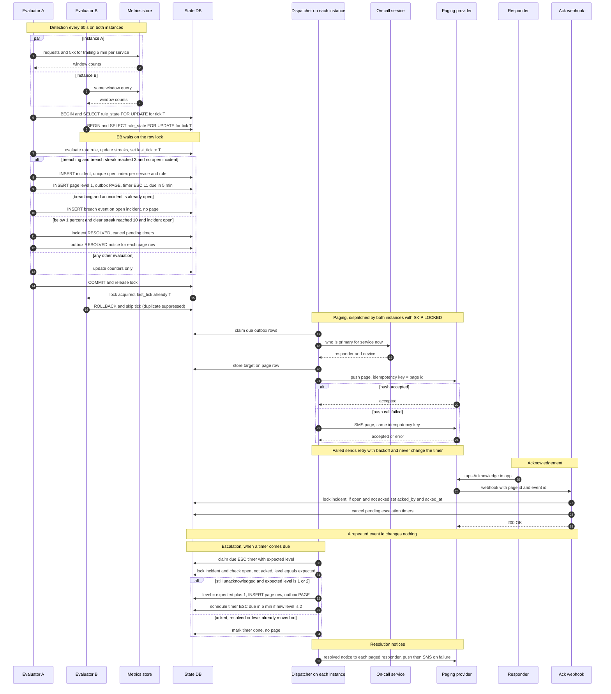

# On-call paging for API error-rate incidents

This design pages the on-call engineer when the public API's error rate is too high. It explains how the system notices a problem, opens an incident, ignores repeated alarms while that incident is open, escalates to more senior people if nobody responds, handles acknowledgement, and closes the incident.

## The short version

Two identical evaluator programs run every 60 seconds. Each run is called a **tick**. Each tick checks the error rate and writes its results to a database inside one **transaction**. A transaction is a group of database writes that either all save or all get undone.

Pages, "resolved" notices and escalation timers are written in the same transaction as the state change that causes them, so they exist only if that change exists.

Messages are never sent from inside a transaction. Instead, each message is written to an **outbox** (a table of messages waiting to be sent). A separate sender process reads the outbox and sends the messages. This keeps slow network calls from holding database locks.

## Plain-language terms

- **Error rate:** the share of requests that failed with a server error (HTTP 5xx). It is calculated as 5xx count divided by total request count.
- **Trailing 5-minute window:** the last 5 minutes of traffic, counted up to the moment of the tick.
- **Breach:** an evaluation where the error rate is above 2% and the window has at least 500 requests. A breach must have enough traffic, so a quiet service cannot page anyone by accident.
- **Clear:** an evaluation where the error rate is below 1%. Clear evaluations are counted regardless of traffic volume, so an idle service can still recover.
- **Streak:** a count of consecutive evaluations of the same kind. An incident opens after 3 breaches in a row. It resolves after 10 clear evaluations in a row (10 minutes).
- **Incident:** one period of trouble for one service and one alert rule, from when it opens until it resolves.
- **Page:** one notification sent to one on-call person at one escalation level.
- **Level:** 1 is the primary on-call engineer, 2 is the secondary, and 3 is the engineering manager (the last level).
- **Idempotency key:** an ID sent with each page. If the same page is sent twice, the paging provider recognizes the repeat and ignores it.
- **Row lock (`SELECT ... FOR UPDATE`):** the database makes any other transaction that asks for the same row wait until the first one finishes.
- **`SKIP LOCKED`:** a way for a worker to pick up rows that no other worker has claimed. Rows already claimed are skipped, not waited on.
- **Partial unique index:** a database rule that refuses a second row with the same values. Here it allows only one open incident per service and rule.
- **Acknowledge webhook (ack webhook):** a URL on our side that the paging provider calls when someone taps Acknowledge in its app.
- **Heartbeat alert:** an alarm that fires when no tick has been recorded for some time.

## Where state lives

- **State database (the only writable store):**
  - `rule_state`: one row per (service, rule). Holds `last_tick` (the time of the last tick that was applied), `breach_streak`, `clear_streak`, and `open_incident_id`.
  - `incidents`: `status` (open or resolved), `opened_at`, `resolved_at`, `acked_at`, `acked_by`, and `level` (1 to 3, the current escalation level). The partial unique index on (service, rule) where status is open means the database itself refuses a second open incident for the same service and rule.
  - `pages`: one row per (incident, level). Stores the **target** (the specific person paged), the channel used (push or SMS), and the send status. The target is filled in when the page is sent, not when the incident opens. Resolved notices go to the people recorded here.
  - `breach_events`: breaching evaluations recorded on an open incident. They are kept for context and never page anyone.
  - `outbox`: pending PAGE and RESOLVED messages.
  - `timers`: escalation timers, each with `due_at`, `expected_level`, and a state.
  - `processed_events`: IDs of acknowledge webhook events already handled, so a replayed event is ignored.
- **Metrics store:** read-only input. Nothing is written to it.
- **Evaluators:** keep nothing in memory. Restarting either one is safe, because all state is in the state database.

## How the 5-minute escalation timers work

1. An escalation timer is a row in the `timers` table with a `due_at` time. It is not an in-process sleep, so a restart does not lose it.
2. The timer row is committed in the same transaction as the page row. The 5-minute clock starts at that commit. It does not depend on whether the push or SMS call succeeds.
3. `expected_level` is the incident's level at the moment the timer is created.
4. When a timer comes due, the dispatcher opens a locked transaction and checks three things:
   - the incident is still open,
   - nobody has acknowledged it, and
   - the incident is still at the timer's `expected_level`.
   If any check fails, the timer is stale or a duplicate, and it does nothing.
5. If all checks pass, the incident moves up one level. A new page row and outbox message are written, and a new timer is created for the next level.
6. The chain is: level 1 page, then a timer, then level 2 page (if still unacknowledged), then a timer, then level 3 page (if still unacknowledged). No timer is created after the level 3 page, because level 3 is the last level.
7. The responder for each page is looked up at send time, not when the incident opened. This means the 09:00 daily handover is respected even in the middle of an incident.

## How the two evaluators avoid duplicates

- Both instances run the same tick at the same time. Each one takes a row lock on its `rule_state` row. The first to commit sets `last_tick` to this tick's time. The second waits for the lock, then sees that `last_tick` already equals this tick and skips it. Its work is rolled back, so it leaves nothing behind.
- The partial unique index is a second guard. Even if both instances tried to open an incident, the database would allow only one.
- Dispatchers on both instances claim outbox and timer rows with `SKIP LOCKED`, so each row is claimed by one dispatcher. Each page carries an idempotency key (the page row's ID). If a row is dispatched twice anyway, the provider sees the same key and sends at most one page.

## What happens when something fails

- **Metrics query fails:** the tick is skipped. No streaks change and `last_tick` does not advance, so the next minute retries the same tick. The heartbeat alert fires if no tick is recorded for a set period.
- **Evaluator crashes during a tick:** the transaction rolls back, so none of that tick is saved.
- **On-call service is down:** the dispatcher retries. If it still cannot find a target, it uses the last cached roster for the service. The escalation timer still advances the level, so escalation does not stall.
- **Push fails:** SMS is sent right away in the same dispatch. It does not wait for escalation. A push that times out may still have been delivered, so the responder may receive both push and SMS. This is an accepted trade-off.
- **Paging provider or ack webhook is down:** if an acknowledgement is lost, escalation continues. This errs toward more paging, never less. Replayed webhooks are ignored when their event ID is already in `processed_events`.
- **Dispatcher is down:** pages are delayed until it recovers. Alert on the age of the oldest outbox row.
- **Resolved notice fails:** it is retried. The resolution itself is already committed and is not undone.

## Sequence diagram

Read it from top to bottom. Detection and the transaction come first, then dispatching pages, then acknowledgement and escalation, then resolved notices.

## Assumptions to confirm

- A window with zero requests has no defined error rate. It changes no streaks.
- A clear evaluation is any window with a defined rate below 1%, regardless of request volume. Without this rule, an idle service could never resolve.
- A breach requires at least 500 requests in the window. A window below that threshold is not a breach, so it resets the breach streak.
- A window that is neither a breach nor a clear window (for example, a rate of 1% to 2%, or a rate above 2% with fewer than 500 requests) resets both the breach streak and the clear streak. This is how "consecutive" is read.