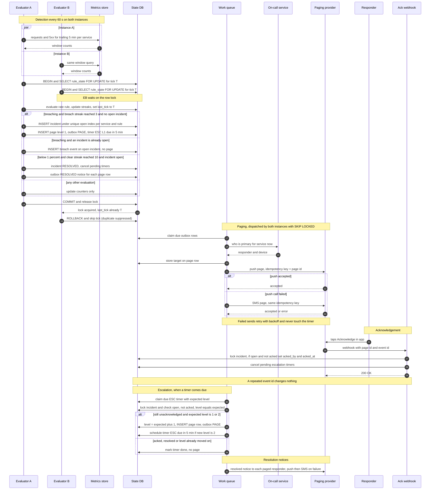

# On-call paging for API error-rate incidents

Detection, incident opening, duplicate suppression, escalation, acknowledgement and resolution. Each evaluator tick runs as one database transaction. Pages, notices and escalation timers are written in that same commit, so they exist only if the state change did.

## Where state lives

- **State DB (the only writable store):**
  - `rule_state` per (service, rule): `last_tick`, `breach_streak`, `clear_streak`, `open_incident_id`.
  - `incidents`: `status` (open or resolved), `opened_at`, `resolved_at`, `acked_at`, `acked_by`, `level` (1 to 3). A partial unique index on (service, rule) where status is open enforces at most one unresolved incident.
  - `pages`: one row per (incident, level) with the resolved target, channel used and send status. Storing the target means resolved notices reach the same people.
  - `breach_events`: breach evaluations recorded on an open incident.
  - `outbox`: pending PAGE and RESOLVED sends.
  - `timers`: escalation timers with `due_at`, `expected_level` and state.
- **Metrics store:** read-only input.
- **Evaluators:** keep nothing in memory. Restarting either instance is safe.

## How the 5-minute timers work

- An escalation timer is a durable row with `due_at`, not an in-process sleep, so a restart does not lose it.
- The timer row is committed with the page row. The clock starts at commit and does not depend on whether the push or SMS call succeeds.
- When a timer fires, the dispatcher re-checks inside a locked transaction that the incident is open, not acknowledged and still at `expected_level`. A stale or duplicate timer is then a no-op.
- The target is resolved when the page is sent, so the 09:00 handover is respected in the middle of an incident.
- Level 3 is final, so no timer is scheduled after the level 3 page.

## How the two evaluator instances coordinate

- Both instances run the same tick. Each takes `SELECT ... FOR UPDATE` on the `rule_state` row, and the first to commit sets `last_tick` to the tick time. The second instance waits on the lock, sees `last_tick` already equal to that tick and skips it.
- The unique open-incident index is a second guard against double-opening.
- Dispatchers on both instances claim outbox and timer rows with `SKIP LOCKED`. Each page carries an idempotency key (its row id), so a double dispatch produces at most one page at the provider.

## Failure handling

- **Metrics query fails:** the tick is skipped, no streak changes and `last_tick` is not advanced. The next minute retries. A heartbeat alert fires if no tick is recorded for a set period.
- **Evaluator crashes mid-tick:** the transaction rolls back, so nothing is half-applied.
- **On-call service is down:** the dispatcher retries. If no target can be resolved, it uses the last cached roster for the service. The timer still advances the level, so escalation never stalls.
- **Push fails:** SMS is sent immediately in the same dispatch and does not wait for escalation. A push that times out may still have been delivered, so the responder can get both push and SMS. This is an accepted trade-off.
- **Paging provider or ack webhook is down:** a lost ack means escalation continues. That errs toward more paging, never less. Replayed webhooks are deduplicated by event id.
- **Dispatcher is down:** pages are delayed until it recovers. Alert on outbox age.
- **Resolved notice fails:** it is retried. The resolution itself is already committed.

## Sequence diagram

## Assumptions to confirm

- A window with zero requests has no rate. It changes no streaks.
- A clear evaluation is any window with a defined rate below 1%, regardless of volume. Otherwise an idle service could never resolve.
- A breach requires at least 500 requests in the window. A window below that threshold is not a breach, so it resets the breach streak.