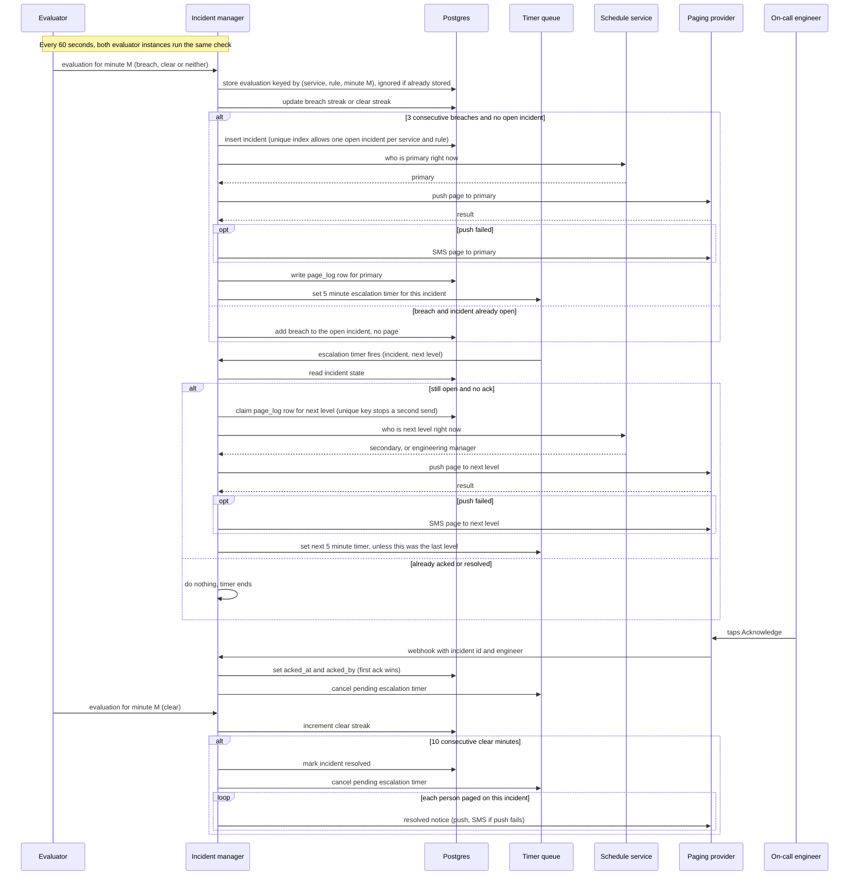

### Error-rate paging

This design pages the on-call engineer when the public API's 5xx error rate spikes. A 5xx response is a server error. The error rate is the share of requests that return one. The design replaces a cron job that emails a shared inbox nobody reads at 3 a.m.

**How it works in brief**
Every 60 seconds, two identical evaluator instances check the error rate over the last 5 minutes. If the rate is too high on 3 checks in a row, the system opens an incident and pages the primary on-call engineer. If nobody acknowledges (acks) the page within 5 minutes, it pages the secondary. If there is still no ack after another 5 minutes, it pages the engineering manager, who is the last level. If the error rate stays low for 10 checks in a row, the incident closes and everyone who was paged gets a "resolved" notice. All state is stored in Postgres.

**Terms used below**
- **Evaluation:** one check, run every 60 seconds, of the error rate over the trailing 5 minutes, for one service and one alert rule.
- **Breach:** an evaluation where more than 2% of requests were 5xx and the window holds at least 500 requests.
- **Clear:** an evaluation where less than 1% of requests were 5xx and the window holds at least 500 requests.
- **Neither:** an evaluation that is not a breach and not a clear. It is one of two kinds:
  - **Middle band:** the window holds at least 500 requests and the rate is 1% or more, but not above 2%.
  - **Low traffic:** the window holds fewer than 500 requests.
- **Streak:** a run of consecutive evaluations of the same kind. The breach streak counts breaches. The clear streak counts clears.
- **Incident:** one open alert for one (service, alert rule) pair. There is at most one open incident per pair.
- **Level:** a step in the escalation order. The levels are primary, secondary and engineering manager (manager).
- **Ack (acknowledgement):** an engineer taps Acknowledge in the paging app. This stops escalation.
- **Rota:** the on-call roster, which names the primary, secondary and manager. It changes at 09:00 each day. The system looks up the rota each time it pages someone, not once when the incident starts.

**Components**
- **Evaluator (two instances):** runs the check every 60 seconds. Both instances run the same logic.
- **Incident manager:** the logic that opens incidents, sends pages, escalates and closes incidents.
- **Postgres:** the database that holds all state.
- **Timer queue:** fires delayed steps, such as the 5-minute escalation.
- **Schedule service:** answers who is on call for a service right now.
- **Paging provider:** sends push notifications and SMS. It also calls our webhook when someone acks.

**Where state lives**
- **Postgres is the single source of truth.** It holds three tables and one index:
  - `incidents`: one row per incident. It holds the state (open or resolved), the breach and clear streak counters, `acked_at`, `acked_by`, `next_escalation_at`, and the rota snapshot from the last successful schedule lookup.
  - `evaluations`: one row per (service, rule, minute). The unique key means both evaluator instances can write the same minute without it being counted twice. The first write wins, and the second is ignored.
  - `page_log`: one row per page attempt. Each row holds the incident id, level, channel (push or SMS), recipient, status and provider reference. A unique key on (incident, level) means only one writer can send a given level. Before sending, the writer inserts this row, which is called claiming the level. If the insert fails, another writer has already claimed it, so this writer does nothing.
  - A partial unique index on open incidents, per (service, rule), means two incidents cannot be open at once. "Partial" means the index applies only to rows whose state is open.
- **The timer queue only triggers the next step.** Timers are not the record of what happened. If the queue loses a timer, each evaluator also sweeps the table for incidents whose `next_escalation_at` has passed, and runs the next step for them. The `page_log` guard makes the sweep safe to run alongside the timers, because a level cannot be sent twice.
- **The two evaluators coordinate through Postgres, not with each other.** Both compute the same rates and write to the same minute key, and only the first write takes effect. No leader election is needed.

**How failures are handled**
- **Push fails:** send an SMS. The escalation clock does not wait for either send. The next timer is set right after the send attempts, whatever their result. Each failure is recorded in `page_log`.
- **Both push and SMS fail:** the incident still escalates on schedule. The failure is logged and flagged for follow-up.
- **Schedule service is down:** use the rota snapshot stored on the incident, from the last successful lookup. Retry the lookup in the background.
- **Postgres is down:** the evaluators cannot record anything, so nothing pages. This is a known gap. A separate dead-man check on the evaluators is recommended, but it is outside this design.
- **One evaluator is down:** the other keeps evaluating and can open incidents alone.

**Rule details to confirm**
- **Middle band resets:** the rule says any evaluation that is not a breach resets the breach streak. So a middle-band evaluation (1% to 2%, enough traffic) resets the breach streak. It also resets the clear streak, because the clear rule says any evaluation at or above 1% resets it. Confirm this is intended.
- **Low-traffic windows:** a window with fewer than 500 requests is neither a breach nor a clear. It does not add to either streak. It also does not reset a streak, so the streak pauses. A quiet service can therefore stay open after a spike. Confirm this is acceptable, and confirm that low traffic should pause the streaks rather than reset them.
- **Reopening:** once an incident resolves, a new breach opens a new incident.
- **First come:** the first ack or resolve wins. A later ack or resolve does not change it.
- **Crash after claiming:** if an evaluator crashes after claiming a level but before sending the page, that level is never paged. Confirm whether the sweep should resend claimed levels that have no provider result.