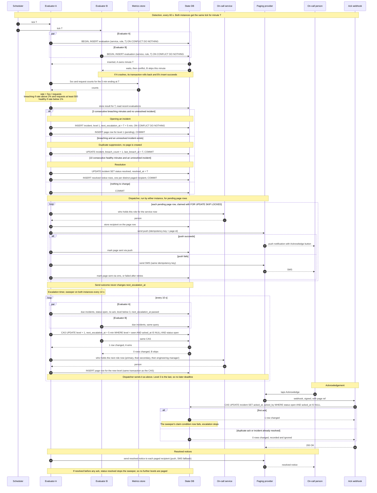

# Paging on-call for public API error-rate spikes: design

## Where state lives

All state is in one transactional SQL database, called "State DB" below. I assumed Postgres-style features: unique partial indexes, `ON CONFLICT`, row locks. No state lives in evaluator memory, so either instance can crash or restart at any point.

| Table | Purpose |
|---|---|
| `evaluations(service, rule, minute_ts, requests, errors, rate, breaching, healthy)` | One row per (service, rule, minute). Its primary key is the coordination lock between the two instances. The streaks are computed from the latest rows. |
| `incidents(id, service, rule, status, opened_at, resolved_at, breach_count, last_breach_at, level, next_escalation_at, acked_by, acked_at)` | A unique partial index on `(service, rule) WHERE status <> 'resolved'` enforces at most one unresolved incident. |
| `pages(id, incident_id, kind, level, recipient, status, channel_used, provider_ref)` | A page outbox. `kind` is `page` or `resolved`. A unique index on `(incident_id, level, kind)` stops a level from being paged twice. |

**Streaks.** A minute is `breaching` only if the rate is above 2% and the window holds at least 500 requests. A minute is `healthy` if the rate is below 1%.
- An incident opens when the last 3 consecutive `minute_ts` rows are all breaching. A missing minute breaks the run.
- An incident resolves when the last 10 consecutive minutes are all healthy. A minute between 1% and 2% is neither breaching nor healthy, so it resets the healthy run.
- Assumption: a minute whose window has zero requests counts as healthy, because there is no error rate to speak of. Confirm this with the owners.

**Two evaluators.** Both run every tick for the same minute-aligned `T`.
1. Each opens a transaction and inserts the `evaluations` row for `(service, rule, T)` with `ON CONFLICT DO NOTHING`.
2. Only the instance that inserts the row proceeds. In Postgres a concurrent inserter waits for the first transaction to finish. If the first instance crashes, its transaction rolls back and the other instance's insert succeeds, so the minute is never lost.
3. The winner queries metrics, stores the result and applies the incident transitions inside that same transaction.
4. The unique partial index is a second guard. Even if the first mechanism failed, a second incident cannot be inserted.

**Timers.** There are no in-memory timers. Each open incident stores `level` and `next_escalation_at`.
- Opening sets `level = 1` and `next_escalation_at = open time + 5 min`.
- Both instances run a sweeper every 10 s. It selects incidents where `status = 'open' AND acked_at IS NULL AND level < 3 AND next_escalation_at <= now()`.
- It claims an incident with a compare-and-set `UPDATE ... SET level = level + 1, next_escalation_at = next_escalation_at + 5 min WHERE id = ? AND level = <seen> AND acked_at IS NULL AND status = 'open'`. Only one instance's update changes a row.
- The update and the new `pages` row are written in one transaction.
- The new deadline is anchored to the previous deadline, not to when sending finished. A slow or failed send therefore cannot move the clock. Escalation lateness is at most about 10 s.
- Level 3 (engineering manager) is the last level, so no further deadline is set.

**On-call lookup.** Recipients are resolved when each level fires, not when the incident opens, so a 09:00 handover mid-incident is picked up. The resolved person is stored on the `pages` row. Acknowledgement and "resolved" notices use those stored rows, not the current schedule.

## How failures are handled

- **Push fails.** The dispatcher sends SMS to the same recipient, with the page id as the provider idempotency key. If both fail, the page is marked `failed`, retried with backoff for a bounded time and raises an internal alert. The escalation deadline is already stored, so it is untouched.
- **Dispatcher crash.** `pages` rows in `pending` or `sending` are picked up again by either instance. The idempotency key avoids duplicate sends on retry.
- **Evaluator crash.** The in-flight transaction rolls back and the other instance takes the minute. If both are down, the minutes are missing and the streaks reset, so there are no false pages. A dead-man's-switch alert should watch for the evaluators going silent.
- **Metrics store failure.** The tick records no breaching or healthy result, so the minute breaks both streaks. Alert on repeated failures. Escalation of an already-open incident does not depend on the metrics store.
- **On-call service failure.** Retry for a few seconds, then use the last known holder of that role. If there is none, record a failed page and continue. The clock advances regardless.
- **Acknowledgement.** The provider webhook is signature-checked and idempotent. It runs a compare-and-set `UPDATE incidents SET acked_at = now(), acked_by = ? WHERE id = ? AND status = 'open' AND acked_at IS NULL`.
  - A person who was paged earlier can still acknowledge after handover.
  - A page already claimed in the same instant as an ack may still go out. That is accepted, and no level after it is claimed.
  - An ack on a resolved incident is recorded but ignored.
- **Resolve before ack.** Resolution sets `status = 'resolved'`, which fails the sweeper's claim condition, so escalation stops. A "resolved" `pages` row is queued for each distinct recipient who has a page row for the incident, and goes by push with SMS fallback.
- **New incident after resolution.** The old incident is no longer unresolved, so the unique index allows a new one. It still needs 3 fresh consecutive breaching evaluations.

## Sequence diagram

