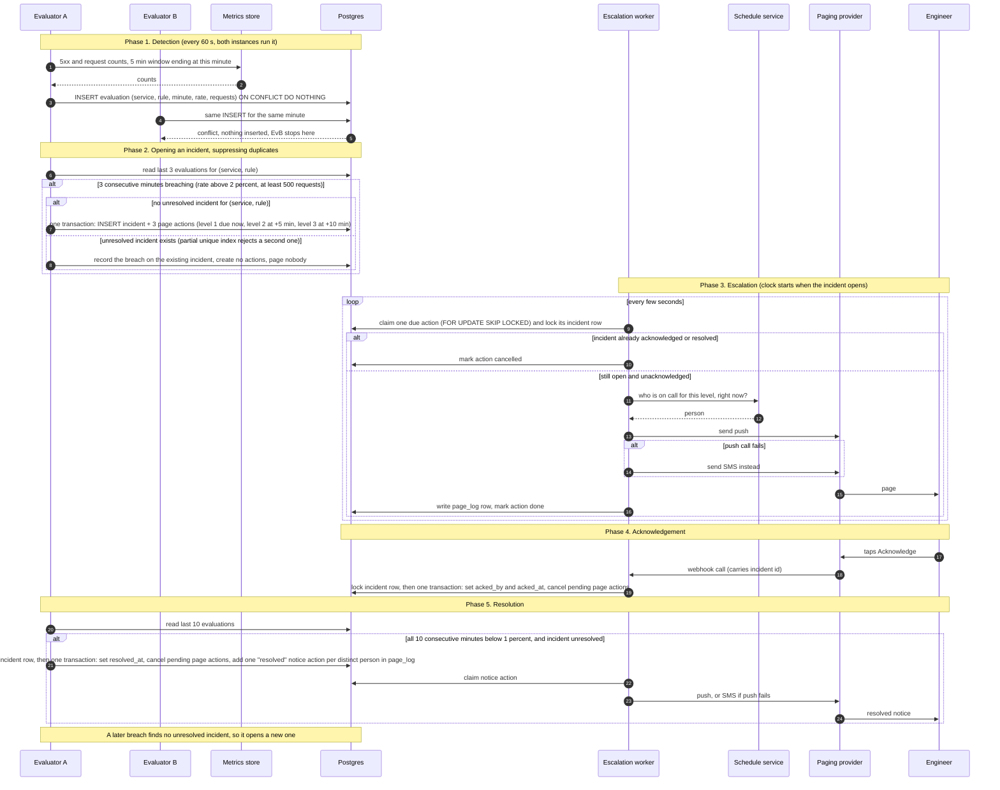

### Error-rate paging

**Summary.** Postgres holds all state, including the escalation timers. There is no separate timer queue. Two identical instances of one service run the same code and never talk to each other. Each instance runs both an evaluator and an escalation worker. Postgres uniqueness constraints and row locks make sure each evaluation, incident and page happens once.

**How it flows.** Once a minute the evaluator measures the error rate and stores the result. After 3 breaching minutes in a row it opens an incident and writes three timed "page" rows to Postgres, due now, in 5 minutes and in 10 minutes. The workers send each page when its time comes, unless the incident has been acknowledged or resolved by then. When the rate has stayed low for 10 minutes, the incident resolves and the people who were paged get a notice.

**Terms**
- *Evaluation*: the result of checking one service against one rule for one minute. It is either breaching or not.
- *Rule*: one alert definition. Here there is one, the 5xx error rate.
- *Incident*: a record that a rule has been breached and people are being paged. It is *unresolved* until it resolves.
- *Page*: one notification to a person, sent by push or SMS.
- *Level*: a step in the escalation chain. 1 = primary, 2 = secondary, 3 = engineering manager (EM).
- *Action*: a row in Postgres that says "do X at time T". Actions are the timers.

**Components**
- **Evaluator** (one per instance, 2 total, same schedule): once a minute, queries the metrics store and records the result in Postgres. It also opens and resolves incidents.
- **Escalation worker** (one per instance): polls Postgres every few seconds for due actions, then sends pages and notices. It also serves the acknowledge webhook. The provider's webhook call can reach either instance.
- **Postgres**: the only place state lives.
- **Metrics store**: time-series database with per-minute request and 5xx counts per service.
- **Schedule service**: says who is primary, secondary or EM for a service right now.
- **Paging provider**: external push and SMS APIs, plus an Acknowledge webhook that we register.

**Where state lives (all in Postgres)**
- `evaluations`: one row per (service, rule, minute), unique on that key. Both instances compute the same result for the same minute, but only the first insert succeeds, so each minute is counted once. "3 consecutive breaches" and "10 consecutive minutes below 1%" are read from the latest rows. A missing minute breaks the streak.
- `incidents`: has `acked_by`, `acked_at` and `resolved_at`. A partial unique index on (service, rule) where `resolved_at IS NULL` means the database itself refuses a second unresolved incident for the same (service, rule). Extra breaches are recorded on the existing incident and never page anyone.
- `actions`: the durable timers. Each row has `incident_id`, `kind` (page level 1 to 3, or resolved notice), `due_at` and `status`. Opening an incident creates the three page actions at once, due at open, +5 min and +10 min. Because the timers are rows, they survive restarts and either instance can run them.
- `page_log`: one row per send attempt (who, level, push or SMS, success or failure). It is the audit trail, and it is also the list of people who get the resolved notice.

**How the two instances coordinate**
- They do not talk to each other. The unique key on `evaluations` and the partial unique index on `incidents` do the work. Whichever instance writes first wins, and the other does nothing.
- If the winning instance dies right after its insert, nothing is lost. The next minute's evaluation re-reads the last 3 rows and opens the incident then, at most one minute late.
- Workers claim actions with `FOR UPDATE SKIP LOCKED`. This locks the action row and makes other workers skip it instead of waiting, so each action runs on only one instance. The worker holds that transaction open while it sends, so if it crashes the lock is released and another worker picks the action up.
- Every page, acknowledgement and resolution locks the incident row first, so these operations on the same incident run one at a time. (An acknowledgement may wait briefly for an in-flight page to finish.)
- If one instance dies, the other keeps going with no failover step.

**How the 5-minute timers work**
- All level times are fixed when the incident opens (open, +5 min, +10 min). A slow or failed page cannot push later levels back.
- An acknowledgement or resolution cancels the pending actions in the same transaction that records it. An action claimed just before that waits for the incident lock, then sees the acknowledged or resolved state and cancels itself.
- The on-call person is looked up when each level fires, not when the incident opens. A 09:00 rotation handover mid-incident therefore pages the new person.

**Failure handling**
- **Push fails:** send SMS. If SMS also fails, log it in `page_log` and move on. The next level still fires on schedule. Failed pages are not retried, because the next escalation level is the retry. Level 3 has no next level, so alert on any incident whose level 3 page failed.
- **Schedule lookup fails:** retry a few times within a few seconds, then log a failure and move on in the same way.
- **Metrics query fails:** the instance records no evaluation row for that minute. The other instance usually still covers it. If neither does, the missing minute breaks the streak, so a failure never counts as a breach or as a recovery.
- **Worker crashes mid-action:** the lock is released and another worker re-runs the action. Delivery is at-least-once, so in a rare crash window someone could get a duplicate page. We accept that rather than risk a missed page.
- **Duplicate or late acknowledgement webhooks:** harmless. Setting the ack twice changes nothing, and an ack on an already-resolved incident is ignored.
- **Resolved notices:** they use the same push-then-SMS path but are retried a few times, because no escalation level backs them up. If an incident resolves before anyone acknowledged, pending page actions are cancelled and only the people already paged get the notice.
- **Both instances down:** no detection happens. Watching for that needs an external heartbeat check, which is outside this design.