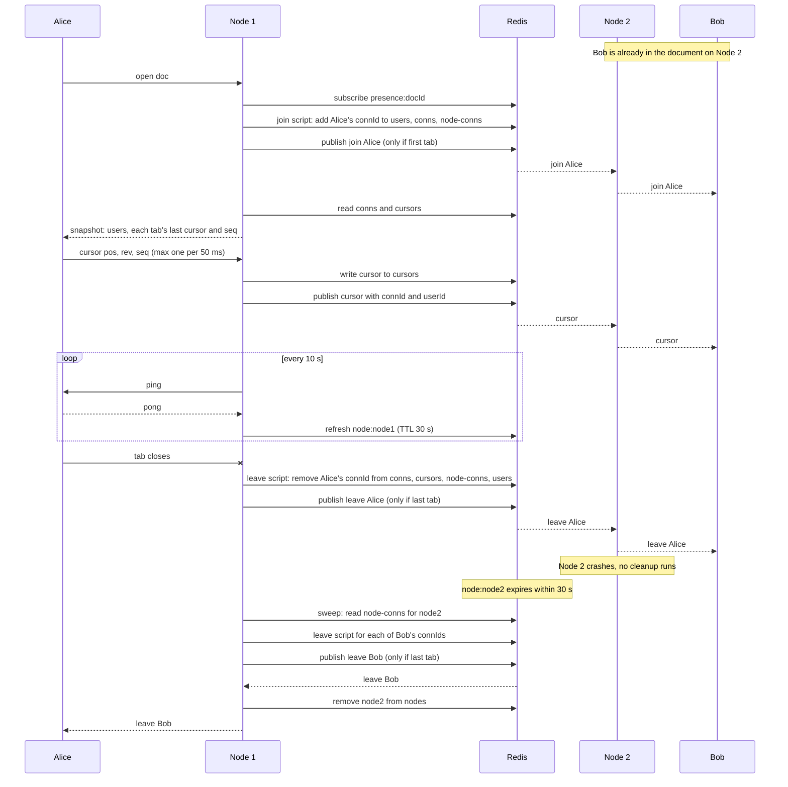

# Live cursors and presence plan

Today the presence list is a Postgres table. Clients poll it every 30 s, and a nightly job removes stale rows. This plan replaces it with Redis. Each gateway node records its open tabs and their last cursors in Redis, and publishes joins, leaves and cursor moves on one channel per document. Every node forwards those messages to its own browser sockets. A tab's records are removed when the tab closes, or by the surviving nodes when its node dies, so nothing stays in Redis for good. Redis is used because nodes cannot see each other's sockets, and it is already running. Edits, the `ops:{docId}` channel and the load balancer do not change.

## Terms

- **Gateway node**: a server process that holds browser WebSockets. Every start of a node gets a new random **nodeId**.
- **Local socket**: a browser WebSocket connected to this node.
- **connId**: a random id for one WebSocket connection. One tab is one connId.
- **userId**: the logged-in user. One user can have several connIds.
- **Ping and pong**: the existing WebSocket liveness check. A node pings each browser, and the browser answers with a pong. Presence does not use it.
- **Heartbeat**: a node's own refresh of its liveness key in Redis. It is separate from the ping.
- **Redis key**: a named value in Redis. A **hash** maps field names to values. A **set** holds unique values.
- **TTL (time to live)**: a time after which Redis deletes a key by itself.
- **Channel, publish, subscribe**: a node publishes a message to a Redis channel, and every node subscribed to it at that moment receives it. Redis stores nothing.
- **Script**: a small program that Redis runs in one step, so two nodes cannot interleave inside it.
- **Caret**: the text cursor position of a user, drawn in the editor for every other user.
- **rev (revision)**: a version of the document. `appliedRev` is the last revision this browser has applied. It only goes up.
- **seq**: a counter that each client increments for every cursor message it sends.
- **Snapshot**: the full list of users and their last cursors, sent to a client when it opens a document.
- **Sweep**: a periodic check by live nodes that removes the records of dead nodes.
- **transformPosition**: the editor function that moves a position from an older revision to a newer one. It throws **HistoryGone** when the older revision is too old to map.

## Diagram

### Notes on the diagram

- Ping and pong are the existing WebSocket check. Presence sends no heartbeat to clients.
- Join and leave are sent per user, not per tab. A join is sent only when a user's first tab appears, and a leave only when the last tab goes.
- Bob is on Node 2, which crashes. Alice loses Bob through the sweep. Node 1 forwards that leave to Alice because her socket is on Node 1.
- Join and leave messages reach Node 2 because Bob's socket is there, so Node 2 is subscribed to the channel.

## Where the state lives

| Key | Type | Holds | Who writes it | Who removes it |
|---|---|---|---|---|
| `conns:<docId>` | hash | connId to userId and nodeId, one field per tab | the node that owns the tab | that node on close, or a sweep |
| `users:<docId>:<userId>` | set | that user's connIds in this document | the owning node | the owning node on close, or a sweep |
| `cursors:<docId>` | hash | connId to last cursor (pos, rev, seq) | the owning node, on each accepted cursor | with the connection |
| `node:<nodeId>` | string, TTL 30 s | heartbeat of a live node | the node, every 10 s | expires when the node dies |
| `nodes` | set | every node id that has run | each node at start | a sweep, after it cleans a dead node |
| `node-conns:<nodeId>` | set | the connections a node owns (docId, connId, userId) | the owning node | the owning node on close, or a sweep |

Only `node:<nodeId>` has a TTL. Presence records have no TTL of their own, so a dead node's records stay until a sweep removes them. Cursors never go through the document service and never go to Postgres.

## How the system runs

### Steps

1. **Open.** Trigger: a client sends `open` for a document. Data: `conns`, `users`, `node-conns` and `cursors`.
   1. The node subscribes to `presence:<docId>` if it is not already subscribed.
   2. The node runs the join script. It adds the tab to `conns`, `users` and `node-conns`, and returns how many tabs the user had before. Because the script runs in one step, when two tabs of one user open on two nodes at once, exactly one sees zero.
   3. If the count was zero, the node publishes `join` with userId and connId. Other nodes forward it to their sockets.
   4. The node reads `conns` and `cursors` and sends the snapshot: every connected user, and each tab's last cursor and seq, including idle tabs.

   The order matters. The node subscribes and writes before it reads the snapshot. So a user who joins in between is either in the snapshot or sends a live join. A join seen twice is ignored.

2. **Cursor move.** Trigger: a user moves the caret. The client sends `cursor {docId, pos, rev, seq}`, at most once per 50 ms. Data: `cursors:<docId>` in Redis, and the throttle timestamp in the node's memory.
   1. The node compares the arrival time with the last cursor it accepted from this connection. If the new one arrives less than 50 ms later, the node drops it silently. Otherwise it records this arrival time as the last accepted one. The timestamp stays in memory, not in Redis. A connection lives on one node, and a node restart resets it.
   2. The node writes the cursor to `cursors:<docId>`, then publishes `cursor` with connId, userId, pos, rev and seq on `presence:<docId>`.
   3. Every node with a local socket on that document forwards the message to its sockets, except the sender.
   4. Each receiving client applies the rules in "What the client does".

3. **Heartbeat.** Trigger: every 10 s, on each node. Data: `node:<nodeId>`, with a TTL of 30 s.
   1. The node sends a WebSocket ping to each socket and waits for a pong. A socket with no pong for 20 s is closed, which runs the clean leave in step 4.
   2. The node rewrites `node:<nodeId>` with a TTL of 30 s. If this write fails, the node closes all its sockets and exits. A node that kept running could refresh its key later, so no sweep would ever see it as dead. Once it exits, its key expires, and a sweep removes its records. Clients reconnect to other nodes and take fresh snapshots.
   3. The node runs a sweep (step 5).

   At start, a node writes its heartbeat key before it adds its id to `nodes`. This stops a live node from being swept while it is starting.

4. **Clean leave.** Trigger: a tab closes, or its socket drops. Data: the tab's records, removed by the node that owns them.
   1. The node runs the leave script. It removes the connId from `conns`, `cursors`, `node-conns` and the user's set. It returns whether it removed anything and how many tabs the user has left. If the connId is already gone, the script does nothing.
   2. If it removed the tab and the user has no tabs left, the node publishes `leave` with userId, connId and `userGone: true`.
   3. If it removed the tab and other tabs remain, the node publishes `leave` with `userGone: false`.
   4. If the node has no local sockets left on that document, it unsubscribes from `presence:<docId>`. It subscribes again at the next open.

   Other users see the leave within 2 s, because it is one publish and one forward.

5. **Node crash.** Trigger: a node dies (deploy, scale-in or crash). It does no cleanup, so its records stay until a sweep removes them.
   1. Its `node:<nodeId>` key stops being refreshed and expires within 30 s.
   2. Each live node sweeps every 10 s. For each id in `nodes` whose `node:<id>` key is gone, it reads that node's `node-conns` set.
   3. For each connection it finds, the node runs the same leave script as a clean leave, using the userId stored in `node-conns`. The script's result says whether this was the user's last tab. Only the node whose script removes the tab publishes `leave`, so two sweeping nodes cannot both publish. The sweeper needs no socket on that document: publishing needs no subscription, and the nodes that hold the other users' sockets are subscribed and forward the leave.
   4. When it is done, the node removes the dead id from `nodes`.

   Worst case is 30 s for the key to expire plus up to 10 s to the next sweep, which is 40 s. The limit for this change is 45 s. Because `nodes` keeps the dead id until it is cleaned, the records survive a restart of the whole cluster.

   A user who reconnects to another node before the sweep is not shown as gone. The new node's join script still counts the old tab, so it returns one, not zero, and no join is published. When the sweep removes the old tab, the user still has a tab, so the leave carries `userGone: false`. The avatar stays and only the old caret goes. Until the sweep, the snapshot may list the old tab too. Other clients see the user's new caret after the user's next cursor move.

### What the client does

- **Snapshot.** Sets the list of users, each tab's last cursor and each tab's seq. Each cursor then goes through the cursor rules below.
- **join.** Adds the user's avatar. If the user is already listed, the client ignores it.
- **leave with `userGone: true`.** Removes the avatar, the user's caret and the state for their connIds.
- **leave with `userGone: false`.** Removes only that connId's caret and state. The avatar stays.
- **cursor.** The message names connId and userId. If the user is not listed, the client adds the avatar, as a join would. Then:
  1. If its seq is not higher than the last seq seen from that connId, drop it. This stops a caret from jumping backwards, even when messages arrive out of order.
  2. If its rev is higher than `appliedRev`, hold it as that connId's pending cursor, replacing any older held cursor. Draw nothing for that tab yet.
  3. Otherwise, call `transformPosition(pos, rev, appliedRev)`. If it throws `HistoryGone`, drop the cursor and wait for the next one. Otherwise draw the caret at the result.
  4. Each time `appliedRev` moves forward, repeat step 3 on the held cursors.
- **Tabs.** Each tab has its own connId, but the client shows one caret per user, from the tab that sent the most recent accepted cursor. When one tab closes and the user has another, the closing tab's caret is removed, and the remaining tab's caret shows at its next move. The server does the de-duplication: avatars are per user.

The server never transforms positions. A cursor is only meaningful at the revision it was sent at.

### What happens when things fail

| Step | What fails | What happens |
|---|---|---|
| Open | Redis is unavailable | The node closes the socket with an error. The client reconnects and opens again. Any partial record is removed by its leave or by a sweep. |
| Cursor move | Redis write for a cursor fails | The cursor is dropped. The next move sends a new one. |
| Cursor move, join, leave | Publish fails after a successful write | Other clients miss that message. For a cursor, the next move fixes it, and a new joiner gets the stored cursor from the snapshot. For a join or leave, other clients are wrong until they reopen (see open questions). |
| Heartbeat | Heartbeat write fails | The node closes all its sockets and exits. Its key expires, and a sweep removes its records. Clients reconnect and take fresh snapshots. |
| Clean leave | The client's socket drops | The clean leave runs. If the node never sees the close, the pong check closes the socket after 20 s, and the clean leave runs then. |
| Clean leave | The leave cannot reach Redis | The records stay until the node's key expires and a sweep removes them. |
| Node crash | A node crashes | Survivors remove its users within 40 s (step 5). |
| Restart | A node restarts on purpose | Its sockets close. Its tabs' clean leaves run if Redis is reachable, otherwise a sweep removes them. Clients reconnect and take fresh snapshots, which correct any join or leave missed during the restart. The restarted node gets a new nodeId, so the old id's records are only ever cleaned by a sweep. |
| Cursor | `HistoryGone` is thrown | That cursor is dropped until the next one arrives. |

## How it is built and rolled out

- No new service or infrastructure. Redis is used for presence and pub/sub, and the existing gateway code is extended. The design builds on `existing/gateway.md` and on the editor's `transformPosition`.
- The Postgres presence polling, and the nightly job that cleans it, are replaced by this design.
- The edit path, the `ops:{docId}` channel and the load balancer are unchanged.

## Open questions

- If a join or leave publish fails, other clients keep a wrong list until they reopen. The plan has no repair step for this. Unknown whether this is acceptable.
- After a Redis failover to a replica, writes that had not replicated can be lost, so users could be missing from the list until they reopen. Unknown how often this happens and whether it is acceptable.
- Unknown whether the Postgres presence table is dropped in this change or left in place.
- The plan does not say how a drawn caret moves when later remote edits arrive. It only re-runs held cursors. Unknown whether the editor handles this already.
