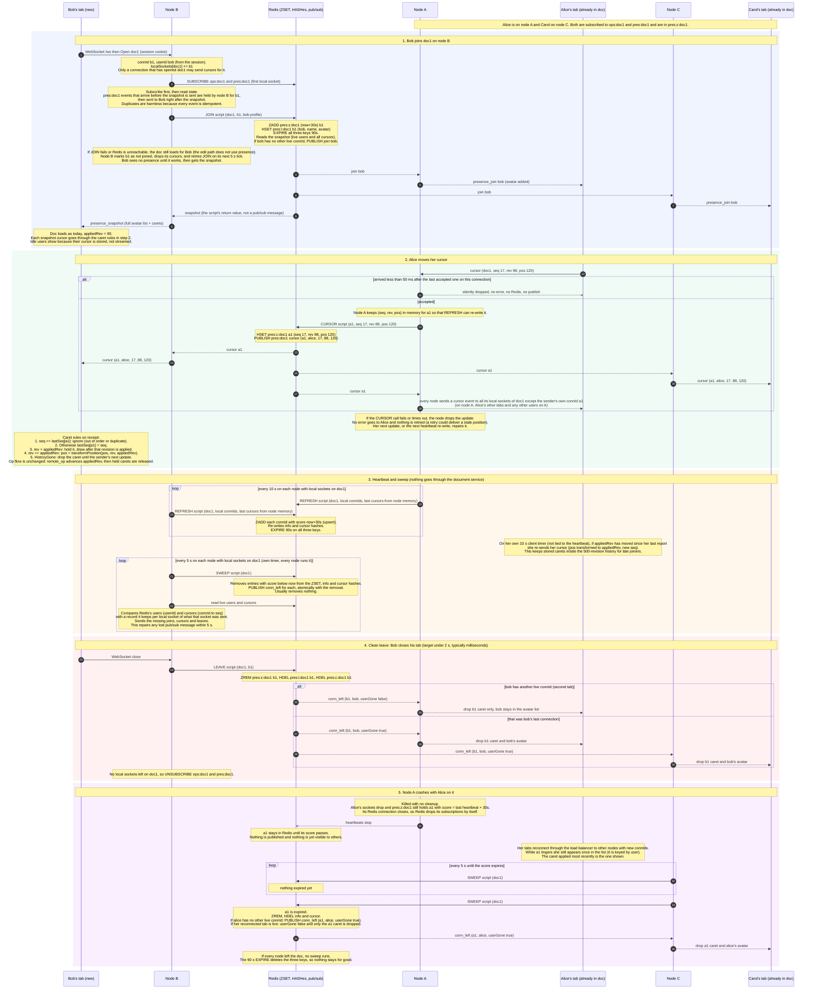

# Live cursors and presence: design and sequence diagram

## Summary

Today the "who's here" list is a Postgres table that is updated on open and close and polled by clients every 30 s. Users on crashed nodes stay listed until a nightly job removes them, and there are no cursors.

In the new design each gateway node keeps the truth about its own connections in memory and writes a short-lived copy per document to the existing Redis. A joining client gets a snapshot from that copy, then live changes over a new pub/sub channel `pres:{docId}`, next to the existing `ops:{docId}`. Nothing new is added. The edit path, document service, Postgres and load balancer are untouched, and cursors never go through the document service or Postgres.

## Terms

- **Gateway node**: a server that holds browsers' WebSocket connections. Two people in the same document are usually on different nodes.
- **`connId` / `userId`**: `connId` is a random UUID, new for every connection. `userId` comes from the session. A user with two tabs has two connIds and one userId.
- **`localSockets`**: the in-memory map on each node, `docId` to its set of local connections.
- **Redis script**: a Lua script that a node runs inside Redis with one call (`EVAL`). Its writes and its publish happen together, so the keys and the pub/sub message never disagree. Its return value comes back to the calling node. JOIN, CURSOR, REFRESH, SWEEP and LEAVE are each one such script.
- **ZSET / HASH**: Redis sorted set (members with a score) and Redis map. Pub/sub only delivers to current subscribers and stores nothing.
- **`rev`, `appliedRev`**: `rev` is a document revision number. `appliedRev` is the last revision this client has applied. It only moves forward.
- **`transformPosition(pos, fromRev, toRev)`**: an existing editor function. It maps a character offset valid at `fromRev` to the same place at `toRev`, using the ops of the last 500 revisions that the client keeps locally. It throws `HistoryGone` when `fromRev` is older than that history, and the caller must then drop the position.
- **`seq`**: a counter per connection, set by the sender and rising with each cursor update. Receivers use it to ignore old or duplicate cursors.

## Where state lives

| State | Where | Written by | Refreshed or removed by |
|---|---|---|---|
| Socket, `connId`, `userId`, last cursor time, last cursor (`seq`, `rev`, `pos`) | Node memory (`localSockets`) | Owning node | Gone when the node dies. It is the source Redis is rebuilt from. |
| Liveness of each connection | Redis ZSET `pres:z:{doc}`, member `connId`, score = expiry (Redis `TIME` + 30 s) | JOIN script | Node heartbeat every 10 s. Removed by clean leave or by the sweep. |
| Who the connection is | Redis HASH `pres:i:{doc}`, `connId` to `userId, name, avatar` | JOIN script | Changed together with the ZSET by the same scripts. |
| Last cursor per connection | Redis HASH `pres:c:{doc}`, `connId` to `seq, rev, pos` | CURSOR script | Heartbeat re-writes it from the node's memory. Removed together with its ZSET entry. |
| Live changes | Pub/sub `pres:{doc}`: `join`, `cursor`, `conn_left` | The same scripts, atomically with the write | Not stored. |
| Held and shown carets, `lastSeq` per `connId` | Client memory | Client | Dropped on `conn_left`. |

## Diagram

## Rules

- **Per user, not per tab.** The avatar list is keyed by `userId` and the ZSET by `connId`. `join` is published only when the user had no other live connection. `conn_left` carries `userGone`, true only when the user's last connection went. A client removes an avatar only when `userGone` is true.
- **Cursor identity is per connection.** Cursors are identified by `connId`, and `seq` is per connection. A reconnect gets a new `connId`, so a restarted `seq` cannot clash with the old one. The UI shows one caret per user: the connection whose cursor was applied most recently on that client. If that connection leaves, the user's other connection's caret shows.
- **Rate limit.** The server keeps a per-connection monotonic timestamp and drops any cursor that arrives less than 50 ms after the last accepted one. The client sends at most one per 60 ms (slack for network jitter), always the latest position on the trailing edge, so a drop is repaired by the next update. The cost is at most 20 cursor writes per second per connection, each one `HSET` plus one `PUBLISH`.
- **No backwards jumps.** Ordering uses the sender's own `seq`, not arrival order or revision. A held cursor keeps one slot per `connId`, holding the highest `seq`. The shown caret is transformed forward each time a revision is applied.
- **No gaps on join.** Subscribe, then snapshot, then send held events. `seq` guards cursors and `join` is a set insert, so the overlap is harmless.
- **No permanent leftovers.** All three keys have `EXPIRE 90`, refreshed on every join and heartbeat. A document nobody is in empties itself.
- **Redis failover.** Heartbeats upsert with `ZADD` (not `XX`) and re-write the info and cursor hashes. A replica that missed writes is repaired within 10 s.
- **Clock.** Scripts use Redis `TIME`, so nodes' clocks do not matter.

## When things fail

| Failure | What happens |
|---|---|
| JOIN fails or Redis is unreachable | Doc loads without presence. Node retries JOIN every 5 s. |
| CURSOR call fails | Update dropped, no retry. The next update or heartbeat repairs it. |
| Pub/sub message lost | The 5 s sweep compare sends what the socket missed. |
| Client WebSocket drops | Client reconnects and sends `Open` again. It gets a new `connId` and a new snapshot, and replaces its whole avatar list, carets and `lastSeq` values. The old `connId` goes by the leave path or the sweep. |
| A node's Redis subscription drops | On resubscribing, the node runs the same read-and-compare as the sweep at once for each of its documents. |
| Browser dies without closing | The node pings every 10 s and closes after 20 s without a pong, then takes the leave path. About 30 s. |
| Node dies | See step 5. The last refresh was at most 10 s before the crash and sets expiry 30 s ahead. The sweep runs every 5 s and finds it at most 5 s later. About 35 s, under the 45 s limit. |
| Nobody left in the doc | `EXPIRE 90` removes the keys, at most 90 s after the last refresh. |

A clean tab close takes milliseconds, well under the 2 s limit.

## Rollout

The edit path, the load balancer and the document service are not changed. The Postgres presence table, its 30 s polling and the nightly cleanup job can be removed once clients use `presence_snapshot`.

## Open questions

- Where do the name and avatar in the JOIN script come from? The gateway doc says only that `userId` comes from the session. If the session lacks them, node B needs a profile lookup, and a failed lookup should fall back to the `userId` and a default avatar. Not yet confirmed.
