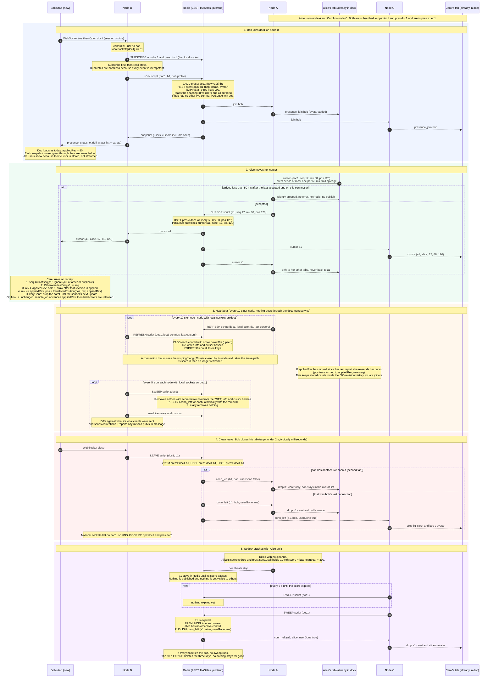

# Live cursors and presence: design and sequence diagram

## Summary

Nodes keep the truth about their own connections in memory. Redis holds a short-lived copy per document so that a joiner gets a snapshot. Redis pub/sub carries the live changes on a new channel, `pres:{docId}`, next to the existing `ops:{docId}`. Everything is on the existing Redis. Nothing is added, and the edit path, document service, Postgres and load balancer are untouched. The Postgres presence table and its 30 s polling are retired.

## Where state lives

| State | Where | Written by | Refreshed or removed by |
|---|---|---|---|
| Socket, `connId`, `userId`, last cursor time | Node memory (`localSockets`) | Owning node | Gone when the node dies. It is the source Redis is rebuilt from. |
| Liveness of each connection | Redis ZSET `pres:z:{doc}`, member `connId`, score = expiry (Redis `TIME` + 30 s) | Join script | Node heartbeat every 10 s. Removed by clean leave or by the sweep. |
| Who the connection is | Redis HASH `pres:i:{doc}`, `connId` to `userId, name, avatar` | Join script | Same scripts as the ZSET, which always change both together. |
| Last cursor per connection | Redis HASH `pres:c:{doc}`, `connId` to `seq, rev, pos` | Cursor script | Heartbeat re-writes it. Removed together with its ZSET entry. |
| Live changes | Pub/sub `pres:{doc}`: `join`, `cursor`, `conn_left` | The same Lua scripts, atomically with the write | Not stored. |
| Held and shown carets, `lastSeq` per `connId` | Client memory | Client | Dropped on `conn_left`. |

- **Per user, not per tab.** The avatar list is keyed by `userId` and the ZSET by `connId`.
  - `join` is published only when the user had no other live connection.
  - `conn_left` carries `userGone`. It is true only when the user's last connection went.
  - A client removes an avatar only when `userGone` is true.
- **No permanent leftovers.** All three keys have `EXPIRE 90`, refreshed on every join and heartbeat. A document nobody is in therefore empties itself.
- **Redis failover.** Heartbeats upsert with `ZADD` (not `XX`) and re-write the info and cursor. A replica that missed writes is repaired within 10 s.
- **Clock.** Scripts use Redis `TIME`, so nodes' clocks do not matter.
- **Cursors are ephemeral.** They exist only on this path. The document service and Postgres never see them.

## Diagram

## Timing budget

| Event | Mechanism | Worst case |
|---|---|---|
| Clean tab close | Close event, `LEAVE` script, publish | Milliseconds, well under 2 s. |
| Alice's browser dies without closing | Ping/pong timeout (20 s), then the leave path | About 30 s. |
| Node dies | Last refresh at most 10 s earlier, expiry 30 s after that, sweep every 5 s | About 35 s from the crash, under the 45 s limit. |
| Orphaned keys when nobody is left | `EXPIRE 90` on every key | 90 s after the last refresh. |

## Rules and rationale

- **Cursor identity is per connection.**
  - Cursors are identified by `connId`, and `seq` is a per-connection counter. A reconnect gets a new `connId`, so its `seq` starting again cannot clash with the old one.
  - The UI shows one caret per user: the connection whose cursor was applied most recently on that client. If that connection leaves, the user's other connection's caret shows.
- **Rate limit.**
  - The server keeps a per-connection monotonic timestamp and drops any cursor message that arrives less than 50 ms after the last accepted one.
  - The client spaces its sends at 60 ms to absorb network jitter. It sends the latest position on the trailing edge, so a drop is repaired by the next update.
- **No backwards jumps.**
  - Ordering uses the sender's own `seq`, not arrival order or revision.
  - A held cursor keeps one slot per `connId`, holding the highest `seq`. The shown caret is transformed forward each time a revision is applied.
  - A client never shows an older report after a newer one.
- **No gaps on join.** Subscribe, then snapshot, then buffer events. `seq` guards cursors and `join` is a set insert, so the overlap is harmless.
- **Volume.** The cost is at most 20 cursor writes per second per connection. Each is one `HSET` plus one `PUBLISH`, and the per-document key sizes are bounded by the number of connections.
- **Unchanged.** The edit path, the load balancer and the document service are not changed. The Postgres presence table and nightly cleanup job can be removed once clients use `presence_snapshot`.
