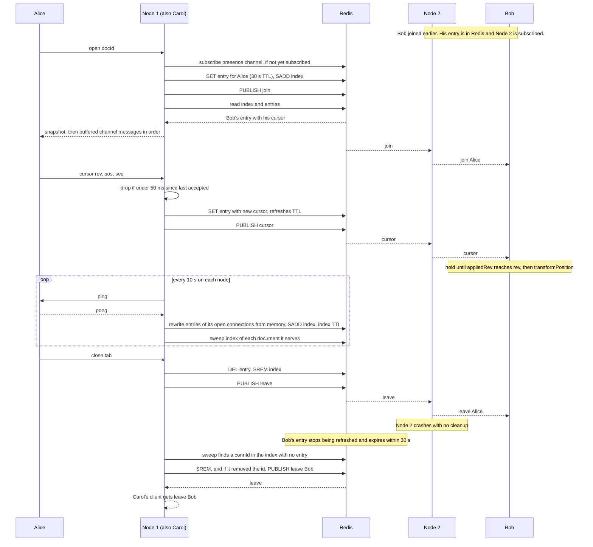

# Presence and cursors plan

Presence (who is in a document) and cursors (where each person's caret is) live in Redis and travel over one pub/sub channel per document. Today, presence is a Postgres table that clients poll every 30 s, and a crashed node's users stay listed until a nightly job. In the new design, each gateway node writes a short-lived Redis entry for each of its connections and refreshes it every 10 s. Nodes tell each other about changes over the channel, and every node also removes entries that stopped being refreshed. Nothing here touches the edit path (the `ops:{docId}` channel and the document service), the load balancer or Postgres, and there is no new infrastructure.

## Terms

- **Node**: one gateway server. A user's browser holds a WebSocket to one node. People in one document are usually on different nodes.
- **connId**: a random id the node gives each WebSocket connection. It is new for every connection, including a reconnect. One user with two tabs has two connIds and one `userId`.
- **Entry**: the record for one connection, kept in Redis under the key `pc:{docId}:{connId}`. It holds `userId`, name, colour, `nodeId`, and the connection's latest cursor `{rev, pos, seq}`. It expires 30 s after its last write.
- **Index**: the Redis set `pd:{docId}` of the connIds in one document. It lets a joining node list everyone. Stale ids are removed by the sweep (step 7). It expires 60 s after its last write.
- **Channel**: the Redis pub/sub channel `presence:{docId}`, one per document. It carries three messages, `join`, `cursor` and `leave`. Pub/sub keeps nothing, so a node only gets messages sent while it is subscribed. A node is subscribed while it has at least one local socket on that document, the same rule it uses for `ops:{docId}`.
- **appliedRev**: the last document revision the client editor has applied. It only moves forward, and it moves when the editor applies a `remote_op` or the `ack` of its own op.
- **rev (in a cursor)**: the sender's `appliedRev` when it sent the cursor. `pos` is a character offset that was valid at that revision.
- **transformPosition(pos, fromRev, toRev)**: the editor function that moves an offset from an older revision to a newer one. `fromRev` must be at most `toRev`, and `toRev` must be at most `appliedRev`. It throws `HistoryGone` if `fromRev` is older than the 500 revisions kept. When it throws, the caller drops the position.
- **seq**: a counter the sending client adds to each cursor message. It starts at 1 for each connection and goes up by 1. Receivers use it to ignore older cursors.

Where state lives:
- **Redis** is the source of truth for who is present. All reads and writes go to the primary.
- **Each client** keeps an in-memory copy: a map from connId to entry, plus the last cursor and `seq` seen for that connId. It is built from the snapshot and the channel, and discarded on disconnect.
- **Each node** keeps its sockets (`localSockets`) and, for each of its connections, the time of the last accepted cursor and the current entry including its latest cursor.

## Diagram

Bob is already in the document on Node 2. Carol is another user already connected to Node 1, and stays there throughout.

## Steps

1. **Open.** Trigger: a client sends `open docId`. The node subscribes to the channel if it is not already. It writes the client's entry, adds the connId to the index (in that order, so the index never lists a connId without an entry), and publishes `join`. The colour is a hash of `userId`, so every tab and every node picks the same colour. If Redis fails, the node closes the socket and the client reconnects. A reconnect is a new connection with a new connId and a new snapshot; the client never reuses a connId. The old entry is removed by the old node's clean leave, or expires within 30 s. The user's other connIds keep the avatar in place, and the same `userId` makes it show once. While the socket is down, the client keeps showing its old list and carets, frozen, until the new snapshot replaces them.
2. **Snapshot.** The node subscribes before it reads, so it cannot miss a join. It reads the index and each entry, and sends the client a snapshot of all entries with their latest cursors `{rev, pos, seq}`. This is why an idle user's caret shows at once. Channel messages that arrive meanwhile are buffered and sent after the snapshot, in order. That includes the client's own `join`, which is applied as an upsert like any other. Every message is an upsert or delete keyed by connId, so a repeated message does no harm. The client replaces its map (including stored `seq` values) with the snapshot, then applies the later messages. It treats each snapshot cursor exactly like a cursor message (step 5): it stores the `seq`, and holds the cursor if its `rev` is above its own `appliedRev`. The client sends its first cursor once the document is loaded, its `appliedRev` is known and the snapshot has arrived, using its current `appliedRev` as `rev`. This way others see its caret even if it never moves. How the editor first loads the document is existing behaviour and outside this plan.
3. **Presence list in the client.** The client shows one avatar per distinct `userId` in its map. A second tab from the same user adds a connId and the avatar does not change. The user leaves the list when the last connId with that `userId` is removed. Carets are drawn for other users only, one per user: the one from the connection whose cursor arrived at this client most recently (arrival order, not `seq`, because `seq` is per connection). If that connection leaves while another of the same user remains, the client draws the caret from the remaining connection that sent a cursor most recently, using the last cursor it stored for it.
4. **Cursor send.** The client sends at most one cursor per 50 ms, and always sends the latest position last, so the final position is never lost. The node enforces the same limit per connection and silently drops anything faster. An accepted cursor is stored in the connection's entry in the node's memory, written to Redis, and published to the channel. The sender gets no reply and no echo. If the Redis write fails, the node closes the socket, as in step 1. Cursors never go to the document service or to Postgres.
5. **Cursor receive.** The receiver keeps the last cursor and `seq` per connId. It ignores any cursor with a `seq` at or below the stored one, so a caret never goes backwards when messages arrive out of order. For a newer cursor:
   - If its `rev` is above the receiver's `appliedRev`, the receiver holds it, replacing any older held cursor of that connection. Each time `appliedRev` moves, the client re-checks its held cursors and draws each one whose `rev` is now reached.
   - Otherwise it draws at `transformPosition(pos, rev, appliedRev)`. When the receiver applies more revisions, it moves the drawn caret forward the same way. If `transformPosition` throws `HistoryGone`, it drops that caret, and it reappears at the sender's next cursor.

   On a `leave`, the receiver deletes that connId's entry, stored `seq`, held cursor and caret together. A later connection always has a new connId, so a new `seq` of 1 never meets an old stored `seq`.
6. **Heartbeat.** Every 10 s each node pings each socket, as today, and closes a socket with no pong for 20 s (a clean leave, step 8). It also rewrites the entries of its open connections from the copies in its own memory, never reading back from Redis. That copy always holds the latest accepted cursor, so a rewrite never stores an older cursor than the one already published, and the heartbeat publishes no cursor. Each rewrite resets the 30 s expiry, runs `SADD` on the index (which puts back a connId that a sweep removed by mistake) and refreshes the index expiry. The rewrite is `SET ... EX 30 GET`, which returns the old value. If it returns nothing, the entry had expired, so the node also publishes `join` again and others show the user again.
7. **Sweep.** Every 10 s each node also checks the documents it serves, meaning those with a key in its `localSockets`. It lists the index and finds connIds whose entry is gone. For each, it runs `SREM` on the index, and only the node whose `SREM` removed the id publishes `leave`, so two nodes do not both announce it (a repeated `leave` would do no harm anyway). A connId in the index always has an entry unless it expired, because step 1 writes the entry first and the primary applies commands in order. The cost grows with the number of connIds in the documents that node serves.
8. **Clean leave.** Trigger: the WebSocket closes. The node deletes the entry, removes the connId from the index, and publishes `leave`. Others see it in well under 2 s. When a node has no sockets left on a document, it unsubscribes from the channel.
9. **Node crash.** The node does nothing. Its entries stop being refreshed and expire within 30 s. The next sweep, within 10 s, removes them from the index and publishes `leave`. Total: at most about 40 s (10 s refresh gap, 30 s expiry, 10 s sweep as bounded here), under the required 45 s. During that time nothing else tells other users the node is gone: the dead user's avatar and carets stay on screen, frozen, until the `leave` arrives. If no node serves the document any more, the entries expire by themselves and the index expires 60 s after its last write. Nothing stays in Redis for good.

## Failures

| What fails | What happens |
| --- | --- |
| A cursor arrives too fast | The node drops it, with no reply. |
| A cursor message is lost or arrives late | The `seq` rule keeps the caret from going back. The next cursor corrects it. |
| Redis is unreachable | Presence and cursors go stale. Edits still work, because they use the unchanged edit path. A Redis error on open or on a cursor write closes the socket, and the reconnect gets a new snapshot. |
| Redis fails over to the replica | Recent writes may be lost. The next 10 s refresh rewrites the entries, so they come back. |
| A live node refreshes late and an entry expires | The sweep may remove the user and publish `leave`. The next heartbeat rewrites the entry, re-adds it to the index and publishes `join`, so the user comes back within 10 s. |
| A browser vanishes with no clean close | The pong timeout closes the socket within 20 s, then the clean leave runs. The requirements set no limit for this case. |
| The client's socket drops | The client shows its old list until it reconnects and gets a new snapshot. |
| A node crashes | See step 9. |

## Open questions

- The number of colours in the palette is not set. This does not affect the design.
- If one user has two tabs, only the most recently moved caret is drawn. Drawing a caret per tab would be a small client-only change. The requirements do not say which they want.
- If a sweep removes a connId just after the heartbeat has rewritten its entry, others get a `leave` and no new `join`. The user returns to others' lists only on the next entry expiry or reconnect. The window is tiny and the plan does not close it.
- Whether anything besides `remote_op` and `ack` moves `appliedRev` (for example the first document load) is not checked. The held-cursor re-check in step 5 works either way.
