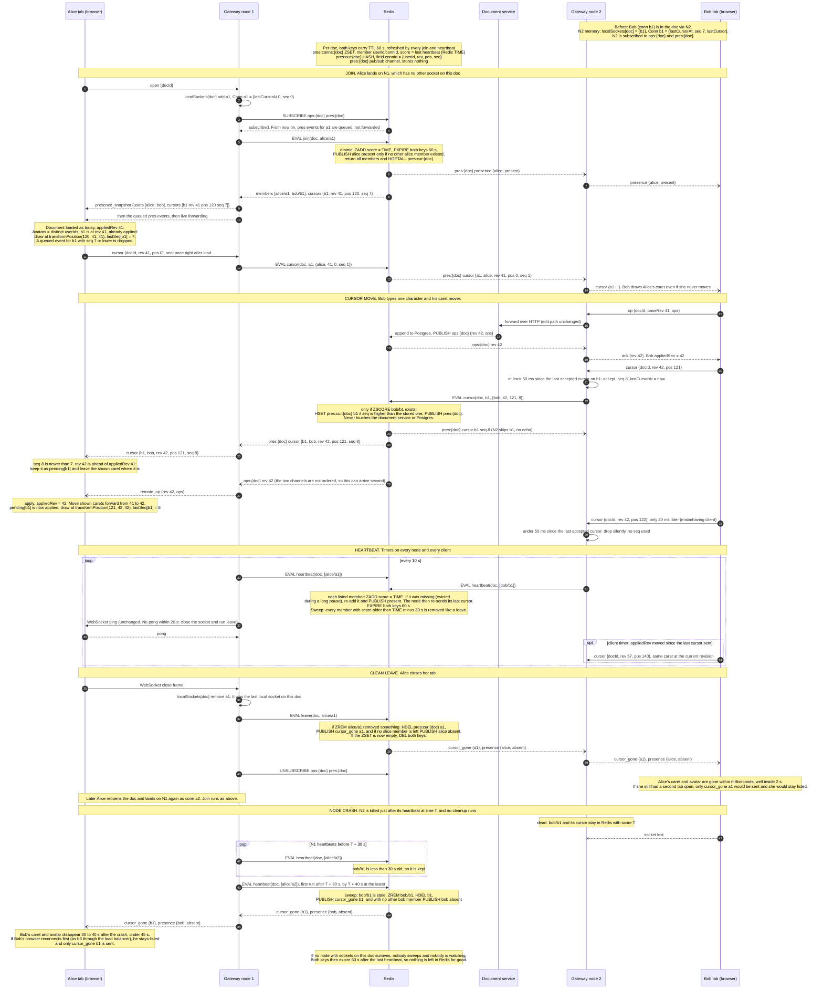

# Live cursors and presence: sequence

## Decisions

- **All presence and cursor state lives in the Redis we already run.** Nothing new is added, and the edit path, the document service and the load balancer stay as they are. Each doc gets two keys and one channel, and every change goes through a short Lua script so that it is atomic.
  - `pres:conns:{doc}` is a ZSET. Each member is `userId/connId` and its score is the time of that connection's last heartbeat, taken from Redis `TIME` so that clocks on different nodes don't matter.
  - `pres:cur:{doc}` is a HASH. Each field is a `connId` and its value is `{userId, rev, pos, seq}`, the last accepted cursor for that connection.
  - `pres:{doc}` is a pub/sub channel. It carries the `presence`, `cursor` and `cursor_gone` events, in the order Redis ran the scripts.
- **Presence is stored per connection and published per user.** A script publishes `presence {userId, present: true}` only when that user had no other member yet. It publishes `present: false` only when the user's last member is removed. Events state the absolute state, not a delta, so applying one twice does nothing.
- **Carets are keyed by `connId` and coloured by `userId`.** A user with two tabs has two carets in the same colour. A client ignores carets that carry its own `userId`.
- **`seq` is set by the gateway node.** It increases for each accepted cursor on a connection. Only one node ever owns a connection, so there is a single writer. Receivers use `seq` to drop updates that are stale, duplicated or out of order.
- **A node subscribes to `pres:{doc}` on the same terms as `ops:{doc}`.** It subscribes while it has at least one local socket on the doc, and it never echoes a cursor back to the connection that sent it.



## Where each piece of state lives

| State | Where | Written by | Refreshed by | Removed by |
|---|---|---|---|---|
| `localSockets`, `Conn {lastCursorAt, seq, lastCursor}` | Gateway memory | open | – | socket close or ping timeout; lost when the node dies |
| Connection presence `userId/connId` | Redis ZSET `pres:conns:{doc}` | `join` script | `heartbeat` script every 10 s (score = Redis `TIME`) | `leave` on close; a sweep once older than 30 s; `DEL` when empty; key TTL 60 s |
| Last cursor per connection | Redis HASH `pres:cur:{doc}` | `cursor` script, only for a member that is still present, and only when `seq` is higher | each new cursor; the client re-sends every 10 s once its `appliedRev` has moved; key TTL refreshed by heartbeat | same script as the presence member (`HDEL`); key TTL 60 s |
| Live events | Redis channel `pres:{doc}` | the same scripts, atomic with the state change | – | not stored |
| Avatars, shown carets, `pending`, `lastSeq` | Browser memory | snapshot plus events | – | `presence absent`, `cursor_gone`, page close |

The Postgres presence table, the 30 s client polling and the nightly cleanup job are all removed.

## Join without a gap

1. The node subscribes to `pres:{doc}` before it reads the snapshot. If it is already subscribed for another local socket, nothing changes.
2. It queues events for the new connection until the snapshot has been sent.
3. It then sends the queued events, in order.

The snapshot is taken by the same script that registers the connection, so it is consistent with that registration. Every event states an absolute state and the channel delivers in the order Redis ran the scripts, so the last event the client gets for each user or connection always matches the current state.

A cursor queued from before the snapshot is either dropped by `seq`, or followed by its `cursor_gone` later in the same queue.

## Receiver rules (client)

```ts
// New messages
type SendCursor  = { t: "cursor"; docId: string; rev: number; pos: number };          // client -> server
type CursorState = { connId: string; userId: string; rev: number; pos: number; seq: number };
type PresenceSnapshot = { t: "presence_snapshot"; users: string[]; cursors: CursorState[] };
type Presence    = { t: "presence"; userId: string; present: boolean };
type RemoteCursor = { t: "cursor" } & CursorState;
type CursorGone  = { t: "cursor_gone"; connId: string };

function onCursor(c: CursorState) {            // snapshot entries go through this as well
  if (c.userId === myUserId) return;
  if (c.seq <= (lastSeq.get(c.connId) ?? 0)) return;   // older or duplicate: never jump back
  lastSeq.set(c.connId, c.seq);
  if (c.rev > appliedRev) { pending.set(c.connId, c); return; }  // not applied yet: hold it
  pending.delete(c.connId);
  draw(c.connId, c.pos, c.rev);
}
function draw(connId: string, pos: number, rev: number) {
  try { shown.set(connId, { pos: transformPosition(pos, rev, appliedRev), rev: appliedRev }); }
  catch { /* HistoryGone: drop this position, keep whatever caret is already shown */ }
}
function onApplied() {                          // after each ack or remote_op moves appliedRev
  for (const [id, s] of shown) draw(id, s.pos, s.rev);
  for (const [id, c] of pending) if (c.rev <= appliedRev) { pending.delete(id); draw(id, c.pos, c.rev); }
}
function onCursorGone(id: string) { shown.delete(id); pending.delete(id); lastSeq.delete(id); }
```

- Every call keeps to the `transformPosition` contract: `fromRev <= toRev = appliedRev`, and a position is dropped when the call throws.
- A sender's `appliedRev` only moves forward, so a higher `seq` never carries a lower `rev`. Holding only the newest pending update therefore never shows an older position.
- An idle sender re-sends its caret whenever its `appliedRev` has moved, checked every 10 s. This keeps the stored cursors close to the head revision, so a joiner's `transformPosition` doesn't hit `HistoryGone` and idle carets still show up on join.
- Carets are kept at `appliedRev`. If the editor has local ops that are not acknowledged yet, it maps the drawn caret through them for display only.

## Sending and rate

- The client throttles to one cursor every 60 ms and always sends the last position (trailing edge).
- Once the caret stops, the client sends the final position once more after 250 ms. If network jitter made the server drop the last throttled update, this repeat restores it.
- The server checks 50 ms per connection, on arrival. It drops faster updates silently and gives them no `seq`.

## Timing budget

| Event | Bound |
|---|---|
| Clean close | Close frame, `leave` script, publish, forward: milliseconds, well under 2 s |
| Connection lost, node alive | Existing ping/pong closes the socket within 30 s, then `leave` runs |
| Node crash | The member is stale 30 s after its last heartbeat. A node still on the doc sweeps every 10 s, so removal is 30 to 40 s after the crash, plus under 1 s of delivery: under 45 s |
| Everything about a doc gone | `DEL` when the last member leaves. Otherwise the key TTL is 60 s after the last heartbeat or join |

- Sweeps by several nodes are safe. A script publishes only when its `ZREM` actually removed the member, so a `leave` that runs after a sweep, or a second sweep, publishes nothing.
- A live node can be paused long enough to be swept, for example by a long GC pause. Its next heartbeat or cursor finds the member missing. It re-adds the member, which publishes `present`, and then re-sends the last cursor with a new `seq`.
- On a Redis failover, writes that had not reached the replica are restored by the next heartbeat (within 10 s) and by the next cursor.
