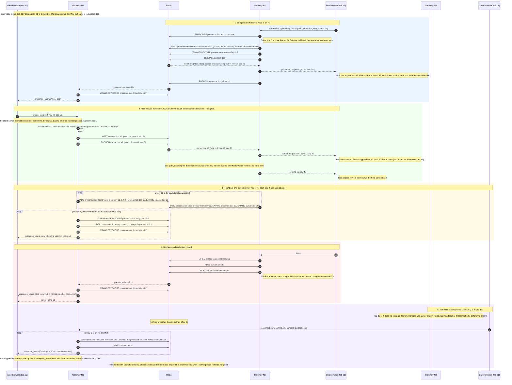

# Live cursors and presence: sequence design

## What this is

Presence (who is in a document) and carets (where each person's text cursor is) run on the existing gateway nodes and the existing Redis. Redis holds this short-lived state, and its pub/sub channels pass updates between nodes. The edit path, the load balancer and Postgres do not change, and the document service is not involved. Cursors are never written to Postgres.

The main flow: a user opens a document, and their node records them in Redis and sends back the current list and carets. Cursor moves and heartbeats keep that state fresh. A clean close removes it at once. If a node crashes, the other nodes remove its users within 35 seconds.

Today the "who's here" list is a Postgres table. It is updated on open and close and polled by clients every 30 s. Crashed nodes stay listed until a nightly job removes them. There are no cursors. This design replaces the list and adds carets.

## Terms

- **Gateway node**: a server that holds browsers' WebSocket connections. There are six, autoscaled. The load balancer spreads new connections across them round-robin, so people in the same document are usually on different nodes. A killed node does no cleanup.
- **Document service**: the service that owns the document and Postgres. It gives each applied edit its revision number. It is not used here.
- **Connection (connId)**: one WebSocket connection, with a new random id each time. A user with two tabs has two connections.
- **User (userId)**: the user's id from their session cookie. It is the same across tabs.
- **Revision (rev)**: the number the document service gives each applied edit, in order.
- **appliedRev**: the highest revision this editor has applied. It only goes up.
- **Caret**: a text cursor position, as a character offset from the start of the document.
- **seq**: a counter that the sending client increases with each cursor it sends on one connection. A higher seq is newer.
- **transformPosition(pos, fromRev, toRev)**: an editor function that moves a caret offset from an older revision to a newer one. It needs the editor to still hold history back to fromRev, which is the last 500 revisions. If it throws HistoryGone, the caller drops the caret.
- **Heartbeat**: a refresh every 10 s that says a connection is still alive.
- **Sweep**: a cleanup that every node runs every 5 s to remove stale entries.
- **Nudge**: a short pub/sub message that means "something changed, re-read". It is only a hint.
- **Pub/sub**: Redis channels. A subscriber gets only the messages sent while it is subscribed. Redis stores nothing.
- **Sorted set (ZADD)**: a Redis set where each member has a score. Here the score is the time of the member's last heartbeat.
- **Hash (HSET)**: a Redis map from field to value. Here the field is a connId and the value is that connection's last caret.
- **EXPIRE**: a Redis timer that deletes a key after a set time. Here it is 60 s after the last write.

## Sequence

## Steps

The diagram shows the order. These steps add the trigger, the state and the failure for each part.

1. **Join.** Trigger: a browser opens the document on a node. The node subscribes to `presence:doc` and `cursor:doc` first. Then it writes the user's member, reads the members and the cursor hash, sends `presence_snapshot`, and only then forwards live frames. Subscribing first means nothing is missed in the gap. Overlap may repeat a message, and the seq rule makes repeats harmless. Right after its open completes, each client sends one cursor, so idle users still have a caret stored in `cursors:doc`.
2. **Cursor move.** Trigger: the user moves the caret. The client sends at most one cursor every 50 ms and keeps a trailing timer so the last position gets through. The node drops any cursor that comes less than 50 ms after the last accepted one from that connection, with no message back. An accepted cursor is written to `cursors:doc`, then published on `cursor:doc`. Receivers apply the revision rules below. Text edits still use the unchanged edit path.
3. **Heartbeat and sweep.** Every 10 s, each node refreshes each of its local connections. It updates that member's score and sets EXPIRE 60 on `presence:doc` and `cursors:doc`. Every 5 s, each node with local sockets on the document sweeps. It removes members whose score is older than 30 s, deletes cursor fields whose connId is no longer a live member, and reads the live members again. It sends `presence_users` only when the user list changed. Several nodes can sweep at once. This is harmless, so no leader is needed.
4. **Clean leave.** Trigger: the tab closes cleanly. The node removes the member (ZREM), deletes the cursor (HDEL) and publishes a `left` nudge. Other nodes re-read the members, send `presence_users`, and send `cursor_gone` for that connId. The user disappears only if this was their last connection. Explicit removal plus the nudge makes the change arrive within 2 s. If the nudge is lost, the next sweep catches it within 5 s.
5. **Node crash.** Trigger: a node dies. It does no cleanup, so its members and carets stay with their last heartbeat time, t0. That is at most 10 s before the crash. Nothing refreshes them. The sweeps on the surviving nodes remove them once they are 30 s old, plus up to 5 s of sweep lag, so at most 35 s after the crash. The users reconnect to a live node and join as in step 1.

## Where state lives

| State | Location | Written by | Refreshed or removed by |
|---|---|---|---|
| Presence member, one per connection (userId, name, colour, connId) | Redis sorted set `presence:doc`, score = last heartbeat time | The node that owns the socket, on join | Heartbeat every 10 s. Removed by clean close (ZREM), or by sweep when the score is older than 30 s. The node keeps the member string exactly as written for the connection's life, because ZREM and ZADD need an exact match. |
| User list | Not stored. Distinct userIds among live members | Each receiving node, on read | Recomputed on every nudge and every 5 s sweep. A user is listed while any of their members is live. |
| Last caret per connection | Redis hash `cursors:doc`, field = connId | The node, on each accepted cursor | Removed on clean close, or by sweep when the connId is no longer a live member. Kept while the user is idle, so joiners see idle users. |
| Key liveness | TTL on `presence:doc` and `cursors:doc` | Every heartbeat (EXPIRE 60) | Expires 60 s after the last write if no node is left. |
| Socket map and throttle timestamp | Node memory only | The node | Lost with the node. Rebuilt from Redis on the next join. |
| Applied rev, held carets, displayed carets, highest seq per connId | Client memory | The client editor | Carets dropped on HistoryGone or on clean close. |

## Rules

- **Per user, not per tab.** The list is built from distinct userIds among live members. Closing one of two tabs changes nothing visible.
- **Revisions.** Each cursor carries the sender's `rev` and `seq`.
  - If `rev` is above `appliedRev`, hold the caret. Draw it when `appliedRev` reaches `rev`.
  - If `rev` is at or below `appliedRev`, map it forward with `transformPosition(pos, rev, appliedRev)`. On HistoryGone, drop the caret until the next update.
  - On every applied revision, re-map the displayed caret from its stored rev to the new `appliedRev`.
- **No backwards jumps.** The receiver keeps the highest seq per connId and discards any message with a lower or equal seq. A held caret is replaced only by a higher seq. The sender's seq only increases, so reordering cannot move a caret back.
- **Messages (new).**
  - Client to server: `cursor {docId, pos, rev, seq}`.
  - Server to client: `presence_snapshot {users, cursors}`, `presence_users {users}`, `cursor {connId, userId, pos, rev, seq}`, `cursor_gone {connId}`.
  - The existing messages (`open`, `op`, `ack`, `remote_op`) are unchanged.

## What happens when things fail

| What goes wrong | What happens | Bounded by |
|---|---|---|
| Tab closes cleanly | Explicit removal and a nudge. Other users see it. | 2 s |
| Nudge is dropped | The next sweep re-reads the members. | 5 s |
| Node crashes, or a connection stops heartbeating | Its entries go stale, then the sweeps remove them. | 35 s after the crash |
| Node crashes and no node with sockets is left | The keys expire. | 60 s after the last write |
| Cursor arrives less than 50 ms after the last accepted one | The node drops it silently. | Per connection |
| Cursor is at a revision the client has not applied | The caret is held and drawn once that revision is applied. | Until applied |
| Old revision history is gone (HistoryGone) | The caret is dropped until the next update. | Next update |
| Cursors arrive out of order | Any message with a lower or equal seq is discarded. | Per connId |
| Redis primary fails over | With async replication, the last few writes can be lost. Heartbeats re-add members. | 10 s |
| Node restarts | Its socket map and throttle timestamps are lost. They are rebuilt on the next join. | Next join |

## Open questions

None block the design. The one accepted risk is the Redis failover row above. Presence heals on its own, so the loss is accepted and stated here.