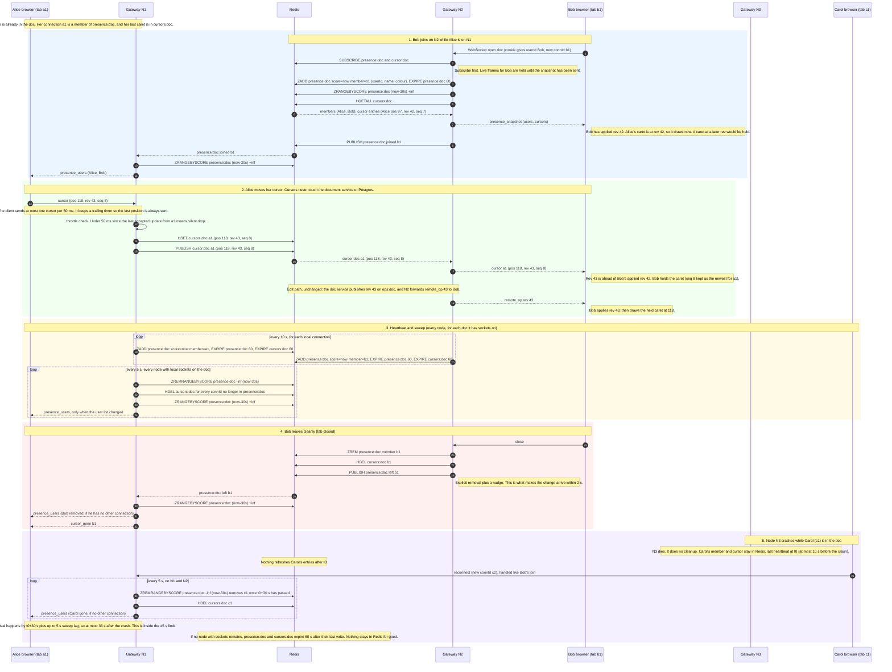

# Live cursors and presence: sequence design

Presence and cursors ride on the existing gateway nodes and the existing Redis (pub/sub for fan-out, plus short-lived keys for state). The edit path, the load balancer and Postgres are not touched. The document service is not involved.

## Sequence

## Where state lives

| State | Location | Written by | Refreshed or removed by |
|---|---|---|---|
| Presence membership, one member per connection (`userId`, `name`, `colour`, `connId`) | Redis sorted set `presence:doc`, score = last heartbeat time | Node that owns the socket, on join | Heartbeat every 10 s. Removed by clean close (ZREM) or by sweep when score is older than 30 s. |
| User list | Derived, not stored. Distinct `userId` values among live members. | Each receiving node, on read | Recomputed on every nudge and every 5 s sweep. A user is listed while any of their members is live. |
| Last caret per connection | Redis hash `cursors:doc`, field = `connId` | Node, on each accepted cursor update | Removed on clean close, or by sweep when the connId is not a live member. Kept while the user is idle, so joiners see idle users. |
| Liveness of the whole key | TTL on `presence:doc` and `cursors:doc` | Every heartbeat (EXPIRE 60) | Expires 60 s after the last write if no node is left. |
| Socket map, throttle timestamp, highest seq per connId | Node memory only | Node | Lost with the node. Rebuilt from Redis on the next join. |
| Applied rev, held carets, displayed carets | Client memory | Client editor | Carets dropped on HistoryGone or on clean close. |

## Rules the protocol enforces

- **Per user, not per tab.** The list is built from distinct userIds among live members. Closing one of two tabs changes nothing visible.
- **Join gets everything at once.** The node subscribes first, then reads the members and the cursor hash, sends `presence_snapshot`, and only then forwards live frames. Overlap may repeat a message, but the seq rule below makes repeats harmless.
- **Cursor rate.** The node accepts at most one cursor per connection every 50 ms and drops the rest silently. Clients coalesce with a trailing timer so the final position always gets through.
- **Revisions.** Each cursor carries the sender's `rev` and a per-connection `seq`. On receipt:
  - If `rev` is above `appliedRev`, hold the caret. Draw it when `appliedRev` reaches `rev`.
  - If `rev` is at or below `appliedRev`, map it forward with `transformPosition(pos, rev, appliedRev)`. On `HistoryGone`, drop the caret until the next update.
  - On every applied revision, re-map the displayed caret from its stored rev to the new `appliedRev`.
- **No backwards jumps.** The receiver keeps the highest `seq` per connId and discards any message with a lower or equal seq. A held caret is replaced only by a higher seq. Because the sender's seq is strictly increasing, reordering cannot move a caret back.
- **Joiners see idle users.** Every client sends one cursor right after its `open` completes. Its position is then in `cursors:doc`, so users who never move still have a caret for others to see.
- **Ephemeral.** Cursor traffic uses only pub/sub and the `cursors:doc` hash, which expires with the document's presence keys. Nothing goes to the document service or Postgres.

## Protocol messages (new)

- Client to server: `cursor {docId, pos, rev, seq}`.
- Server to client: `presence_snapshot {users, cursors}`, `presence_users {users}`, `cursor {connId, userId, pos, rev, seq}`, `cursor_gone {connId}`.
- Redis pub/sub: `presence:doc` carries nudges (`joined` / `left` / `changed` with connId). `cursor:doc` carries cursor frames. Nudges are only hints. Every node also re-reads on its 5 s sweep, so a dropped nudge costs at most 5 s.

## Requirement check

- Presence list replaces the Postgres polling: yes, all presence state is in Redis and pushed live.
- Full list on join, then live changes: yes, snapshot then nudges.
- Cursors on join, including idle users: yes, via `cursors:doc`.
- 50 ms per connection, silent drop: yes, enforced on the node.
- Ephemeral, never in Postgres: yes.
- Revision hold, transform forward, no backwards jumps: yes, via `rev` and `seq`.
- Clean leave within 2 s: explicit ZREM and nudge, both immediate.
- Node crash gone within 45 s: removal at most 35 s after the crash (30 s stale window plus 5 s sweep). Nothing is left for good: keys expire 60 s after the last write.

## Open points for the implementer

- Redis failover: with async replication, a primary failover can lose the last few writes. Presence is self-healing (heartbeats re-add members within 10 s), so this is acceptable, but it should be stated.
- Sweeps from several nodes at once are idempotent, so no leader election is needed.
- The member string must be stored exactly as written, because ZREM needs an exact match. The node that created it keeps it for the connection's life.