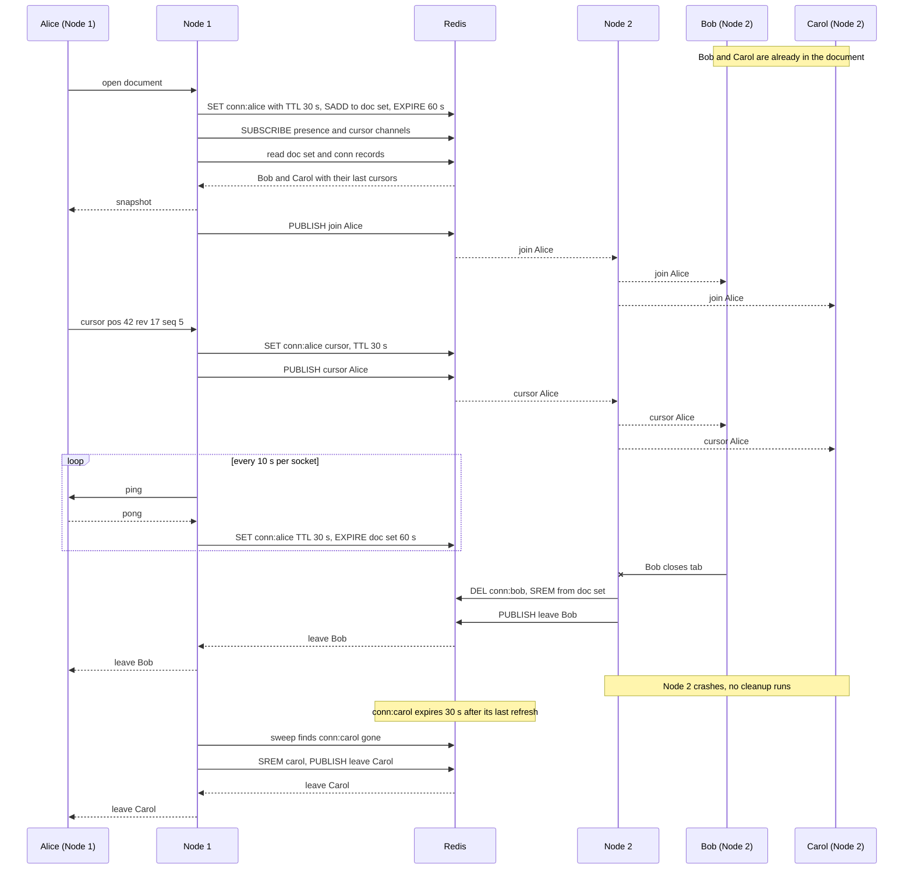

# Presence and cursors plan

Presence and cursors for the document editor. Browsers already connect to gateway nodes, and the nodes already share Redis. Each connection writes a short-lived record to Redis and refreshes it on every heartbeat. Nodes announce joins, leaves and cursor moves over Redis pub/sub, which stores nothing. So the same records also serve as the snapshot a new joiner reads. A crashed node stops refreshing its records, they expire, and the surviving nodes remove them within 40 s.

Today the "who's here" list is a Postgres table, written on open and close, polled by clients every 30 s. Crashed nodes leave stale rows until a nightly job runs. There are no cursors. This plan replaces that for presence and adds cursors. The edit path does not change.

## Terms

- **Node**: a gateway server. Browsers connect to it over WebSocket.
- **Connection (connId)**: one WebSocket. One user with two tabs has two connections.
- **Presence**: the list of users in a document. Each user appears once.
- **Redis key with TTL**: a value that Redis deletes by itself after its time-to-live (TTL) unless something refreshes it.
- **Pub/sub channel**: Redis delivers a message only to nodes that are subscribed at that moment. It stores nothing.
- **Revision (rev)**: the number of a document version. A caret position only means something at one revision.
- **transformPosition**: the editor function that moves a character position from an older revision to a newer one. It throws HistoryGone when the old revision is too old to map.
- **seq**: a counter that each client adds to its cursor messages. A higher seq is always newer.
- **Heartbeat**: the node pings each socket every 10 s. A pong shows the socket is alive.
- **Sweep**: a check that a node runs every 10 s, on each document where it has sockets, to remove records whose connection is gone.

## Diagram

Notes:
- Node 1 runs the sweep for Carol because Node 1 has Alice's socket on this document. Only nodes with local sockets on a document sweep it.
- The Redis keys are `conn:{connId}` and `doc:{docId}:conns`. The channels are `presence:{docId}` and `cursor:{docId}`.

## How the system runs

1. **Open.** Trigger: the client opens a document. The node subscribes to `presence:{docId}` and `cursor:{docId}` first, so it misses no event while it reads. It then writes `conn:{connId}` (userId, docId, nodeId, TTL 30 s) and adds the connId to `doc:{docId}:conns`. It reads the set and each connection record, and sends the snapshot: one entry per user, with each connection's last cursor. If the user has no other live connection on the document, the node publishes join. Clients ignore a join for a user already listed. If the snapshot fails, see the table.
2. **Cursor.** Trigger: the caret moves. The client sends at most one cursor per 50 ms. It keeps the latest position and sends it when the window ends, so the last move is never lost. Each message carries pos, its applied rev and seq. The node drops a cursor silently if less than 50 ms has passed since its last accepted cursor on that connection. Otherwise it stores the cursor in `conn:{connId}` (TTL 30 s) and publishes it on `cursor:{docId}`. Nodes with sockets on the document forward it. Cursors never go to the document service or Postgres. A client sends its cursor once after joining, so an idle user still has a stored caret for the snapshot.
3. **Heartbeat.** Trigger: every 10 s per socket. The node pings. Each pong makes the node write `conn:{connId}` again with TTL 30 s, and refresh the doc set to TTL 60 s. Writing the record again also restores it after a short Redis outage. If no pong arrives within 20 s, the node closes the socket and runs step 4.
4. **Clean leave.** Trigger: the socket closes, because the tab closed or a pong timed out. The node deletes `conn:{connId}` and removes the connId from the doc set. If the user has no other connection on the document, it publishes leave. Other users see the change within 2 s. Clients remove the user.
5. **Node crash.** Trigger: none. A killed node runs no cleanup. Its records stop being refreshed and expire 30 s after their last refresh. Each sweep (every 10 s, on each document where the node has sockets) finds connIds whose records are gone, removes them and publishes leave when the user has no other connection. Worst case: 30 s expiry plus 10 s sweep gives 40 s, inside the 45 s limit. If no node has sockets on a document, the doc set expires after 60 s without a refresh. Nothing stays in Redis for good.

## Drawing carets on the client

- Presence is keyed by userId. A snapshot replaces the list. Join adds a user, leave removes one. Two tabs of one user make one entry.
- For each cursor, from the snapshot or from a cursor event: drop it if its seq is not higher than the last seq shown for that connId.
- If its rev is above appliedRev, hold it. Keep only the newest held cursor per connection. Draw it when appliedRev reaches its rev, and check seq again at that moment.
- Otherwise call transformPosition(pos, rev, appliedRev). If it throws HistoryGone, drop the cursor. Otherwise draw the result and remember its seq.

## What happens when things fail

| What goes wrong | What happens |
|---|---|
| Cursor sent faster than 50 ms | The node drops it silently. The client sends the latest position when the window ends. |
| Client has not applied the cursor's rev yet | The cursor is held and drawn once that rev is applied. |
| Old revision outside the editor's history | transformPosition throws HistoryGone. The client drops that cursor. The next cursor from that user replaces it. |
| Tab closes cleanly | Clean leave (step 4). Visible within 2 s. |
| Node crashes | Expiry and sweep (step 5). Gone within 40 s. Nothing left in Redis. |
| Pong timeout while the node is alive | The node closes the socket and runs clean leave. |
| Redis unreachable | Nodes keep sockets open and log errors. Records return on the next heartbeat. The list may be stale until then. |
| Join snapshot fails | Not decided. See open questions. |
| Second tab of the same user | One list entry. Leave is published only when the last tab closes. |

## How it is built

- **Adds**: the Redis keys and channels above, the client presence store and caret drawing. It uses the existing Redis 7, pub/sub and ping/pong. No new infrastructure.
- **Unchanged**: the edit path (`op`, the document service, `ops:{docId}`, `remote_op`), the load balancer, and Postgres. Presence and cursors are never written to Postgres.
- **Replaces**: the Postgres presence table, its open and close writes, and the 30 s client polling.

## Open questions

- A user with two tabs can have two carets in different places. Which one is drawn is not decided.
- Join, leave and cursor messages missed during a Redis reconnect are not replayed. Should the node re-read the snapshot after reconnecting?
- What the client does when the join snapshot fails is not decided.
- The brief does not say whether the Postgres presence table and the nightly cleanup job are removed.