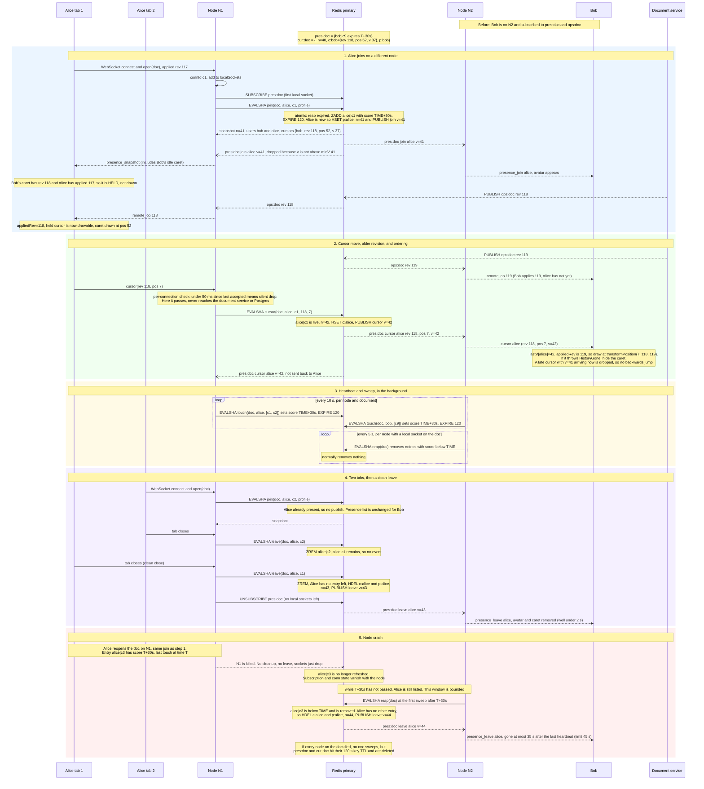

# Live cursors and presence: design

## Summary

Today, "who's here" is a Postgres table that is written on open and close, polled by clients every 30 s, and cleaned nightly, so users on crashed nodes stay listed until the next night, and there are no cursors. The new design keeps all presence and cursor state in Redis, which the gateway already uses. A joining node runs an atomic Lua script that adds the connection and returns a snapshot of everyone present plus their last cursors. After that, changes travel live on a pub/sub channel `pres:{docId}`. Every entry expires unless its node keeps refreshing it, so a dead node's users vanish without any cleanup from the dead node. The edit path, the load balancer and the document service are unchanged, there is no new infrastructure, and nothing about presence or cursors is ever written to Postgres.

## Terms

- **Gateway node**: a server that holds browsers' WebSocket connections. Six today, autoscaled, and killable at any time with no cleanup. People in one document are usually on different nodes.
- **`connId` / `userId`**: `connId` is a random UUID, new for every connection. `userId` comes from the session. One user with two tabs has one `userId` and two `connId`s.
- **`localSockets`**: each node's in-memory map of `docId` to its local connections.
- **Pub/sub**: Redis broadcast. It delivers only to current subscribers and stores nothing. This is why cursors are also stored in a hash, so that a joiner can see idle users' carets.
- **ZSET / HASH**: Redis sorted set (members with a numeric score) / Redis key-to-value map.
- **Lua script**: code that Redis runs atomically. It can read the Redis clock (`TIME`) and publish. There are five: `join`, `touch`, `cursor`, `leave`, `reap`.
- **Entry**: one `userId|connId` member of the `pres:{docId}` ZSET. Its score is its expiry time.
- **Reap**: remove entries whose expiry has passed.
- **`_n` and `v`**: `_n` is one counter per document, stored in `cur:{docId}`. Each presence event takes the next number as its `v`, inside the same script that publishes it. Receivers use `v` to discard stale or duplicate messages.
- **Snapshot**: what `join` returns: the live users, their profiles, their last cursors, and the current `n`.
- **`minV`**: the snapshot's `n`, stored on the connection. The node forwards only events with `v > minV`.
- **`appliedRev`**: the last document revision this client has applied. It only moves forward.
- **`transformPosition(pos, fromRev, toRev)`**: existing client function. It maps a character offset valid at `fromRev` to the same place at `toRev`, where `fromRev <= toRev <= appliedRev`. The client keeps the last 500 revisions of ops. If `fromRev` is older than that, it throws `HistoryGone`, and the caller must drop the position.
- **Held cursor**: a cursor whose `rev` is above `appliedRev`. The client stores it and draws nothing until it has applied that revision.
- **`lastV[user]`**: on the client, the highest cursor `v` seen for that user.

## Where state lives

| State | Location | Created by | Refreshed by | Removed by |
|---|---|---|---|---|
| Socket, `connId`, `userId`, `minV`, `lastCursorAt` | Node memory (`localSockets`) | WebSocket connect | None | Socket close, or node death |
| Subscription to `pres:{docId}` | Node, per document | First local socket on the document | None | Last local socket closes, or node death |
| `pres:{docId}`: ZSET, member `userId\|connId`, score = expiry in ms | Redis primary | `join` | `touch`, every 10 s (new score = Redis `TIME` + 30 s) | `leave`, `reap`, or key TTL |
| `cur:{docId}`: HASH with `_n`, `c:<userId>` = `{rev,pos,v}`, `p:<userId>` = profile | Redis primary | `join` (profile), `cursor` | `EXPIRE 120` on every script call | `leave` or `reap` when the user's last entry goes, or key TTL |
| Presence list, `lastV`, held cursors, drawn carets `(pos, atRev)`, `appliedRev` | Client memory | Snapshot, then live events | Live events | Reconnect (rebuilt from a new snapshot) |
| Anything about presence or cursors | Postgres | Never | N/A | N/A |

| Timing | Value |
|---|---|
| Heartbeat (`touch`) | every 10 s |
| Entry expiry | 30 s after the last `touch` |
| Sweep (`reap`) | every 5 s, by every node that has a local socket on the document |
| Key TTL (backstop) | 120 s |
| Existing WebSocket ping/pong | unchanged: ping every 10 s, close if no pong in 20 s |
| Client cursor sends | at most one per 60 ms |
| Server cursor limit | at least 50 ms between accepted cursors per connection |

Requirements met by these numbers: after a clean tab close, others see the change within 2 s. After a node dies, its users leave everyone's list within 45 s (expiry 30 s plus up to 5 s until the next sweep is 35 s at most).

Two infrastructure rules:
- **Redis `TIME`, not node clocks.** Entry scores come from Redis `TIME` inside the scripts, so clock skew between nodes does not matter.
- **Primary only.** All scripts and reads go to the Redis primary, never the replica, because a stale snapshot would break the `v` ordering. If Redis is ever clustered, the keys need a `{docId}` hash tag.

## How it runs

The diagram shows one scenario. Bob is on node N2. Alice joins on N1 with applied revision 117, moves her cursor, opens a second tab, closes both tabs, and later reopens the document and N1 crashes.

### Steps in detail

The diagram shows the order of messages. These notes add the rules and failure handling that it cannot show.

1. **Join.** Trigger: a client opens a document. The node subscribes to `pres:{docId}` first (if this is its first local socket on the document), then runs `join`.
   - `join` first reaps expired entries, then does `ZADD`. It stores the profile and publishes `join` only if this is the user's first live entry. A second tab of the same user publishes nothing. It always returns a snapshot. Profile data (name, avatar) is taken from the session and kept in `p:<userId>`. Caret colour is derived from `userId`.
   - The "does this user already have an entry" check scans the document's `pres` set. That is cheap, because a document has tens of connections.
   - The node sends the snapshot to the client and sets `conn.minV = n`. It then forwards only events with `v > minV`. This is why the node does not echo the join event from its own publish.
   - The client replaces its whole list with the snapshot, and clears `lastV` and held cursors. It applies later events only if `v > snapshot.n`.
   - Failure: if Redis is down, the join fails and the editor still works (see the failure table).
2. **Cursor update.** Trigger: the user moves the caret.
   - **Client sends** `{t:"cursor", docId, rev: appliedRev, pos}` at most once per 60 ms. The margin over 50 ms covers network bunching. A trailing send always goes out, so the final position is sent. One extra re-send happens 1 s after the last move, to repair a final update the server dropped, which would otherwise leave an idle caret stale.
   - **Node checks** that at least 50 ms have passed since the last accepted cursor on that connection (monotonic clock). Otherwise it drops the message silently. Accepted messages go to the `cursor` script. They never go through the document service and never reach Postgres.
   - **`cursor` script** does nothing if `userId|connId` is not in `pres`. Otherwise it increments `_n`, stores `c:<user>` and publishes `cursor {userId, rev, pos, v}`.
   - **Nodes** forward the event to their local sockets, except that a user's own cursor is never sent back to that user.
   - **Receiving client**, in this order:
     1. If `v <= lastV[user]`, drop it, whatever order messages arrive in. Otherwise set `lastV[user] = v`. Only the newest cursor per user is kept, held or drawn.
     2. If `rev > appliedRev`, hold it and draw nothing. After each applied remote op, draw any held cursor whose `rev <= appliedRev`.
     3. If `rev < appliedRev`, draw at `transformPosition(pos, rev, appliedRev)`. If it throws `HistoryGone`, drop the position and hide that caret until the next update.
     4. On every applied op, re-transform each drawn caret from its `atRev`, so no drawn caret falls outside the 500-revision history.
3. **Heartbeat and sweep.** Trigger: timers on each node.
   - Every 10 s, for each document and user with local connections, the node runs `touch` with that user's `connId`s. `touch` is `join` without the snapshot: it sets the score to `TIME + 30 s` and `EXPIRE 120`. If Redis lost an entry (failover or a stalled node), `touch` re-adds it and announces the join if the user had vanished.
   - Every 5 s, every node with a local socket on the document runs `reap`. It normally removes nothing.
4. **Leave.** Trigger: a socket closes, cleanly or because the existing 20 s pong timeout fired. Both use the same path. The node runs `leave`.
   - `leave` and `reap` remove the entries. If the user has no entry left, they delete `c:<user>` and `p:<user>` and publish `leave {userId, v}`. Otherwise they publish nothing.
   - When the last local socket on a document closes, the node unsubscribes from `pres:{docId}`.
   - Receivers remove the avatar and caret.
5. **Node crash.** Trigger: a node is killed. It does no cleanup, so its entries stop being touched. Within 35 s, a sweeping node reaps them and publishes `leave` if the user has no other entry. If every node on the document died, nobody sweeps, but the 120 s key TTL deletes `pres:{docId}` and `cur:{docId}`, so nothing stays in Redis for good.
   - If a user reconnects to another node before the old entry expires, the new entry has a new `connId`. The old entry expires silently, because the user still has a live entry, so no leave is published.

## What happens when things fail

| Failure | Result |
|---|---|
| Client sends faster than 50 ms | Node drops the extra messages silently. The 1 s re-send repairs a dropped final position. |
| Messages arrive out of order or duplicated | Client drops any cursor with `v <= lastV[user]` and any event with `v <= snapshot.n`. |
| Cursor is for a revision the client has not applied | It is held, then drawn once that revision is applied. |
| `transformPosition` throws `HistoryGone` | The position is dropped and the caret hidden until the next update. |
| Cursor from a connection that is not in `pres` (expired or removed) | `cursor` script ignores it. |
| Redis lost an entry (failover, stalled node) | The next `touch` re-adds it and announces the join if needed. |
| Redis outage | Editing is unaffected, because the edit path does not use these scripts. Presence and cursors freeze. The next `touch` or `join` after recovery rebuilds them. |
| Client reconnects | It gets a new snapshot, which replaces its list and clears `lastV` and held cursors. |
| Node dies | See step 5: gone within 35 s, limit 45 s. |
| Every node on a document dies | Key TTL (120 s) deletes both keys. |

## Choices and limits

- **One caret per user.** Two tabs share one caret: the tab that moved last. If that tab closes while the other stays open, the caret stays at its last position until the other tab moves.
- **Cursor write cost.** The worst case is about 20 Redis writes per second per active user. This is the price of showing idle users' carets on join, because pub/sub alone stores nothing.

## Rollout

Retire the Postgres presence table, the 30 s client polling and the nightly cleanup job. The design adds no new infrastructure and makes no change to the edit path or the load balancer.

## Open questions

None. The one condition to remember is that a clustered Redis needs a `{docId}` hash tag on the keys.