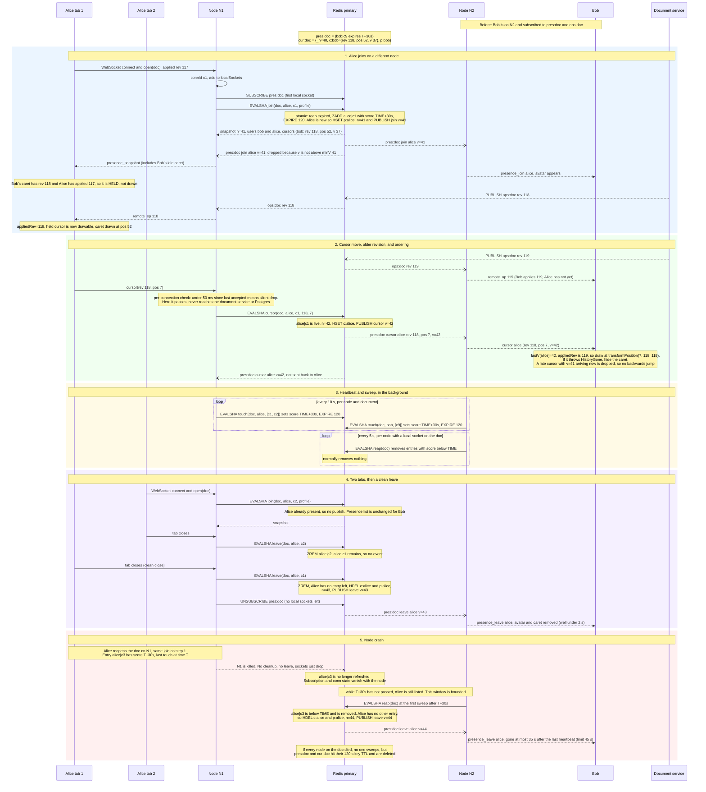

# Live cursors and presence: design

## Summary

- **No new infrastructure.** Redis holds all presence and cursor state, and the pub/sub channel `pres:{docId}` carries the live changes. The edit path, the load balancer and the document service are unchanged, and nothing here touches Postgres.
- **Postgres presence goes away.** The presence table, the 30 s client polling and the nightly cleanup job are retired.
- **Entries expire.** Every Redis entry has an expiry that live nodes refresh. When a node dies, its entries stop being refreshed and any surviving node removes them.
- **One counter orders everything.** Each document has one counter, `_n`, in the `cur:{docId}` hash. Each event gets the next number as `v`, inside the same Lua script that publishes it. Receivers use `v` to discard stale or duplicate messages.

## Where state lives

| State | Location | Created by | Refreshed by | Removed by |
|---|---|---|---|---|
| Socket, `connId`, `userId`, `minV` (the snapshot's `n`), `lastCursorAt` | Node memory (`localSockets`) | WebSocket connect | None | Socket close, or node death |
| Pub/sub subscription `pres:{docId}` | Node, per document | First local socket on the document | None | Last local socket closes, or node death |
| `pres:{docId}`, a ZSET with member `userId\|connId` and score = expiry in ms | Redis primary | `join` script | `touch` script every **10 s** (new score = Redis `TIME` + **30 s**) | `leave` script, `reap` script, or key TTL |
| `cur:{docId}`, a HASH with `_n`, `c:<userId>` = `{rev,pos,v}` and `p:<userId>` = profile | Redis primary | `join` (profile) and `cursor` scripts | Key `EXPIRE 120` on every script call | `leave` or `reap` (when the user's last entry goes), or key TTL |
| Presence list, `lastV[user]`, held cursor, drawn caret `(pos, atRev)`, `appliedRev` | Client memory | `presence_snapshot` and live events | Live events | Reconnect (rebuilt from a new snapshot) |
| Anything about presence or cursors | Postgres | Never | N/A | N/A |

Timings:

| Item | Value |
|---|---|
| Heartbeat | 10 s |
| Entry expiry | 30 s |
| Sweep | every 5 s, by every node that has a local socket on the document |
| Key TTL (backstop) | 120 s |
| Existing WebSocket ping/pong | unchanged (10 s / 20 s) |

- **Scripts use Redis `TIME`.** Entry scores come from Redis `TIME` inside the Lua scripts, so node clock skew does not matter.
- **One Redis, one slot.** Every script runs on the primary, which is a single Redis. Reads never go to the replica, because a stale snapshot would break the `v` ordering. If Redis is ever clustered, the keys need a `{docId}` hash tag.

## Rules

**Server (node)**
- On join, subscribe to `pres:{docId}` first, then run `join`. The script returns a snapshot and its `n`. The node sends the snapshot to the client and sets `conn.minV = n`. After that it forwards only events with `v > minV`, so the join event the node sees from its own publish is not echoed back as a duplicate.
- A cursor message is accepted only if at least 50 ms have passed since the last accepted one on that connection (monotonic clock). Otherwise it is dropped silently. Accepted messages go to the `cursor` script.
- A node never sends a user's own cursor back to that user.

**Server (Lua scripts, each atomic)**
- `join` first reaps expired entries, then does `ZADD`. The profile is stored only if this is the user's first live entry, and only then does it publish `join`. A second tab of the same user publishes nothing. It always returns a snapshot of the live users, their cursors and `n`.
- `touch` is `join` without the snapshot. If Redis lost an entry (failover or a stalled node), it is re-added and the join is announced if the user had vanished.
- `cursor` does nothing if `userId|connId` is not in `pres`. Otherwise it increments `_n`, stores `c:<user>` and publishes `cursor {userId, rev, pos, v}`.
- `leave` and `reap` remove the entries. If the user has no entry left, they delete `c:<user>` and `p:<user>`, and publish `leave {userId, v}`.

**Client**
- **Presence.** Apply an event only if `v > snapshot.n`. A reconnect replaces the whole list and clears `lastV` and held cursors.
- **Backwards jumps.** For each user, keep `lastV[user]`. Drop any cursor with `v <= lastV[user]`, whatever order it arrives in. This is checked on arrival, before the revision check. Only the newest cursor per user is kept, held or drawn.
- **Future revisions.** If `cursor.rev > appliedRev`, hold the cursor and draw nothing. After each applied remote op, draw any held cursor whose `rev <= appliedRev`.
- **Older revisions.** If `cursor.rev < appliedRev`, draw at `transformPosition(pos, rev, appliedRev)`. If it throws `HistoryGone`, drop the position and hide that caret until the next update.
- **Keeping drawn carets current.** Re-transform each drawn caret from its `atRev` on every applied op, so it never falls outside the 500-revision history.
- **Sending.** Send `{t:"cursor", docId, rev: appliedRev, pos}` at most once per 60 ms. The margin over 50 ms covers network bunching. There is always a trailing send, so the final position goes out. One extra re-send happens 1 s after the last move. This repairs a final update the server dropped, which would otherwise leave an idle caret stale.

## Choices and limits

- **One caret per user.** Two tabs of the same user share one caret: the tab that moved last. If that tab closes while the other stays open, the caret stays at its last position until the other tab moves.
- **Display data.** Profile data (name and avatar) is taken from the session at join and kept in `p:<userId>`. The caret colour is derived from `userId`.
- **Join check.** The "does this user have another entry" check scans the document's `pres` set. That is cheap, because a document has tens of connections.
- **Cursor writes.** The worst case is about 20 Redis writes per second per active user. This is the price of showing idle users' carets on join. Pub/sub alone stores nothing, so it cannot do that.
- **Redis outage.** Editing is unaffected, because the edit path does not use these scripts. Presence and cursors freeze and are rebuilt by the next `touch` or `join` after recovery.

## Sequence

Notes on step 5:
- If Alice's browser reconnects to another node before expiry, her new entry has a new `connId`. The old entry expires silently, because she still has a live entry and no leave is published.
- A user whose connection is closed by the existing 20 s pong timeout goes through the same `leave` path as a clean close.
