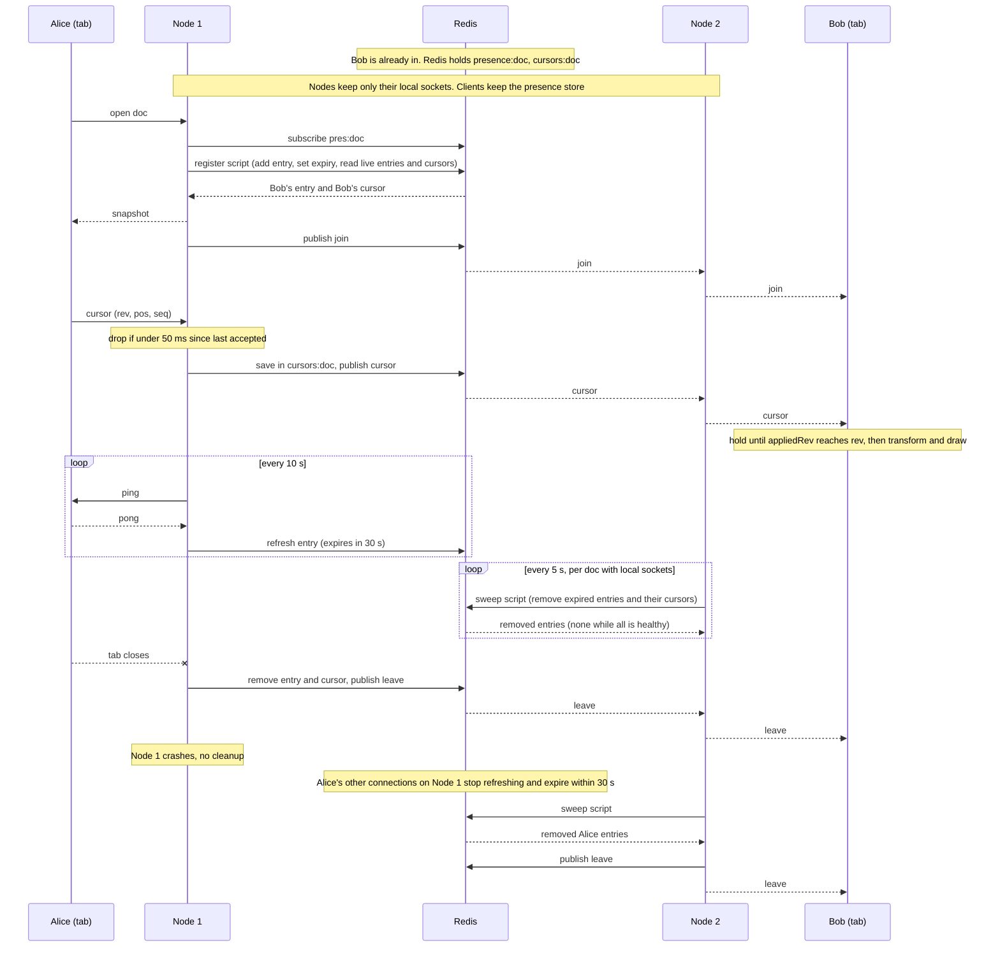

## Presence and cursors plan

Today the "who's here" list is a Postgres table that clients poll every 30 s, crashed nodes stay listed until a nightly job runs, and there are no cursors. This plan replaces it with Redis. Each gateway node writes a presence entry per connection into Redis and publishes join, cursor and leave events on a Redis channel for the document. Every node that has a local socket on that document forwards the events to its clients. Entries expire unless a heartbeat refreshes them, so a crashed node cleans itself up. Presence and cursors never touch the document service or Postgres, and the edit path and load balancer are unchanged. No new infrastructure is added.

### Terms

- **Gateway node**: one of the WebSocket servers. People in the same document are usually on different nodes.
- **connId**: a random UUID, new for every connection. A user with two tabs has two connIds and one userId.
- **Presence key** `presence:{docId}`: a Redis sorted set. Each member is `userId|connId`. Its score is the time the entry expires.
- **Cursor key** `cursors:{docId}`: a Redis hash. The field is `userId|connId`. The value is the latest `{rev, pos, seq}`.
- **Event channel** `pres:{docId}`: a Redis pub/sub channel carrying `join`, `cursor` and `leave` events. A node subscribes while it has a local socket on the document, like `ops:{docId}`. Pub/sub stores nothing, which is why the keys above exist.
- **Redis script**: a short Lua script that Redis runs as one atomic step. All scripts read the time from Redis, not from the node, so node clocks do not matter.
- **rev / appliedRev**: a document revision number. The editor's `appliedRev` is the last revision it has applied and only moves forward.
- **seq**: a counter the sending client adds to each cursor message. It goes up by one per message on one connection.
- **transformPosition(pos, fromRev, toRev)**: the editor's function that moves a position from an older revision to a newer one, up to `appliedRev`. It keeps history for 500 revisions. Past that it throws `HistoryGone`, and the caller must drop the position.
- **Presence store**: the client's map of `userId` to the set of that user's connIds. A user is listed once, while the set is not empty.

### Diagram

### Steps

1. **Join.** Trigger: a client sends `open` and the node has assigned a connId. The node subscribes to `pres:{docId}`, then runs the register script. The script removes expired entries, adds `userId|connId` with expiry now+30 s, sets both keys to expire 60 s after this write, and returns every live entry with its cursor. The node sends this as a `snapshot`, so the client has the full list and everyone's caret at once, including idle users. It then publishes `join`. Subscribing first means no event is missed. Events that arrive during the read are harmless: connIds are never reused, so a repeated `join` or `leave` changes nothing. If Redis fails, the client edits without presence, and the next heartbeat tries to register again.
2. **Cursor.**
   - Sending: the client sends at most one cursor message per 60 ms, plus one trailing message so the last position is never lost. It sends `{rev: appliedRev, pos, seq}`. 60 ms leaves room under the server's 50 ms rule for network jitter.
   - Server: the node keeps the time of the last accepted message per connection. Anything under 50 ms after it is dropped silently. Otherwise the node saves it in `cursors:{docId}` and publishes it. Cursors are never sent to the document service.
   - Receiving, in order:
     - Ignore it if its userId is your own.
     - Ignore it if its seq is not higher than the highest seq already taken for that connId. This stops backwards jumps from out-of-order messages. A held cursor counts as taken.
     - If its rev is above your `appliedRev`, hold it, replacing any older held cursor. Draw it once you have applied that rev.
     - Otherwise draw it at `transformPosition(pos, rev, appliedRev)`. If that throws `HistoryGone`, remove that caret until the sender's next update.
     - Each time you apply more revisions, move every drawn caret forward the same way.
   - The caret colour comes from a hash of the userId, so every client picks the same one.
3. **Heartbeat and sweep.** The node already pings every 10 s and closes a socket with no pong in 20 s. Each pong triggers a refresh script. It sets that entry's expiry to now+30 s and pushes both keys' expiry out to 60 s. If the entry is missing (Redis failover or a wrong sweep), the node registers again and publishes `join`. Separately, every 5 s each node runs the sweep script for each document it has local sockets on. The script removes expired entries and their cursors, and returns what it removed. The node that gets the list publishes a `leave` for each. Because the script is atomic, only one node gets any given entry.
4. **Clean leave.** Trigger: a socket closes, whether the tab closed or the pong timeout fired. The node removes the entry and cursor, publishes `leave` and, if that was the last local socket on the document, unsubscribes. Clients see this within a moment, well under 2 s. On receiving `leave`, a client removes that connId from its presence store, and the user disappears only when their set is empty.
5. **Node crash.** Nothing runs on the dead node. Its entries stop being refreshed and expire at most 30 s after the last refresh. The next sweep by a surviving node on that document, at most 5 s later, publishes the leaves. Worst case is about 35 s plus delivery, inside the 45 s limit. If no node is left on the document, the keys expire by themselves 60 s after the last write, so nothing stays in Redis. A user whose tab reconnects gets a new connId. The old entry just expires, and the user stays listed throughout.

### What happens when things fail

| Failure | Result |
| --- | --- |
| A Redis call fails on join or cursor | That update is lost. Editing is unaffected. The next heartbeat re-registers the entry, and the next cursor move replaces the lost one. |
| The node's pub/sub subscription drops and reconnects | The node re-runs a read of live entries and cursors and sends each of its clients a fresh `snapshot`. The client replaces its list. It keeps its seq records, so carets still never go backwards. |
| Redis fails over to the replica | Presence and cursors may be lost. Heartbeats re-register entries. Cursors come back on the next move. |
| Cursor messages arrive out of order | Dropped by the seq rule. |
| A cursor needs a revision the client does not have yet | It is held until that revision is applied. |
| A cursor's revision is older than 500 revisions behind | `HistoryGone`, so the caret is removed until the next update. |
| A node crashes | Step 5. |

### Rollout

Only gateway-node code and the client change. The document service, Postgres edit path and load balancer are untouched. Build the Redis side first, then the client presence store and cursors. Once clients use `snapshot` and events, remove the 30 s Postgres polling. Drop the presence table and the nightly cleanup job afterwards.

### Open questions

- Where does the avatar list get names and pictures from? Only userId is known here.
- Should a cursor sent while the sender has unacknowledged local ops include those ops in `pos`? The editor protocol does not say.
- Cursor writes cost one Redis write and one publish each, up to about 17 per second per active connection. This load is not measured.
- The 60 ms client spacing against the 50 ms server rule is a guess about network jitter, not a measured one.