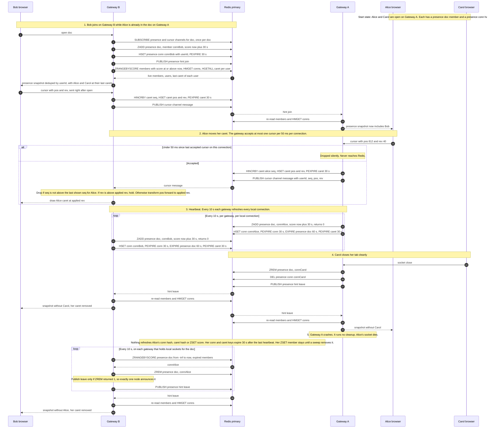

# Live cursors and presence: sequence design

## What this adds

The document editor gets two live features, like Google Docs:

- **Presence list:** the avatars of everyone currently in a document.
- **Carets:** a coloured text cursor for every other user in the document.

Both update live. The design uses Redis, the shared in-memory store that the gateway servers already use. It adds no new service and does not change the edit path or the load balancer. The Postgres presence table is removed, along with the 30-second client polling of it and the nightly cleanup job.

## Background terms

- **Gateway node:** a server process that holds WebSocket connections from browsers. A WebSocket is a connection that stays open, so the server can push messages to the browser at any time. There are six nodes today, and the count changes with load.
- **Load balancer:** the front door that gives each new connection to a node, in turn. Two people in the same document are therefore usually on different nodes. This is why shared state must live in Redis, not in one node's memory.
- **Connection (connId):** one WebSocket, usually one browser tab. Each connection gets a random ID. A user with two tabs has two connections.
- **Presence:** who is in the document. It is tracked per user, not per tab.
- **Revision (rev):** the document's version number. Each applied change moves it forward. A caret position only has meaning at the revision it was measured at, because text before the caret may have changed since.
- **Lease:** a membership entry with an expiry time (a deadline). It is stored as a score in a sorted set. It stays valid only while something keeps extending it.
- **Heartbeat:** every 10 seconds, each node extends the leases and expiry times of its own connections.
- **TTL (time to live):** an expiry time on a Redis key. If nothing refreshes it in time, Redis deletes the key by itself.
- **Pub/sub:** Redis broadcast. A message reaches only the servers subscribed at that moment. Redis stores nothing.
- **Hint:** a pub/sub message that says "something changed, read the state again." It carries no data to trust.
- **seq:** a per-user counter that goes up on every accepted caret update. It puts a user's carets in order when they arrive out of order.
- **transformPosition:** the editor function that moves a character offset from an older revision to a newer one. It throws `HistoryGone` if the old revision is older than the last 500 kept.

### The Redis parts used

- **Sorted set:** a list of unique members, each with a number (the score). Used for membership. The score is the lease deadline.
- **Hash:** a small map of named fields under one key. Used for each connection's identity and each user's caret.
- **Commands:**
  - `ZADD` adds a member or updates its score. It returns 1 if the member was new and 0 if it already existed.
  - `ZREM` removes a member. It returns 1 if it removed one.
  - `ZRANGEBYSCORE` lists members whose score falls in a range.
  - `HSET`, `HMGET`, `HGETALL` and `HINCRBY` write, read or increment hash fields.
  - `DEL` deletes a key.
  - `PEXPIRE` and `EXPIRE` set a key's TTL, in milliseconds and seconds.
  - `PUBLISH` and `SUBSCRIBE` send and receive pub/sub messages.

## How it works in brief

- Redis holds all presence state. Pub/sub only tells nodes to read it again.
- Every key has a TTL, so a crash cannot leave data behind for good.
- Each node refreshes state only for its own connections. A dead node refreshes nothing, so its state expires on its own.

The diagram shows five things:

1. Bob joins on Gateway B while Alice is already in the document on Gateway A.
2. Alice moves her caret.
3. The heartbeat keeps live state alive.
4. Carol closes her tab cleanly.
5. Gateway A crashes, and the surviving nodes clean up after it.

### What each step shows

- **Join (step 1).** Bob's browser connects to Gateway B. The first time Gateway B has a local user in this document, it subscribes to the two pub/sub channels for it, one for presence hints and one for carets. Then it adds Bob's connection to the sorted set and writes his identity (userId) to a small hash. It reads the full current state from Redis, not from pub/sub history, so it cannot miss a join that happened earlier. It sends that snapshot to Bob and publishes a join hint so other nodes re-read the state. Bob's first caret is sent right after open, so others can see it even if he never moves.
- **Cursor move (step 2).** The gateway accepts at most one cursor per 50 ms per connection and drops the rest silently. An accepted cursor is written to Redis and published. Each receiving node applies the seq, revision and transform rules below before it draws anything.
- **Heartbeat (step 3).** Every 10 s each node extends every local connection, and the caret of every local user. An idle user therefore keeps their caret.
- **Clean leave (step 4).** The closing node removes the connection at once and publishes a leave hint. The other nodes re-read the state at once.
- **Crash (step 5).** The dead node runs nothing. Its entries stop being extended and expire. Any surviving node with a local socket on the document sweeps the sorted set every 10 s and removes expired entries. For each expired member, only the node whose removal succeeds (`ZREM` returns 1) publishes the leave hint, so exactly one announcement goes out. Reads already ignore members whose lease has passed. Clients change only when a hint arrives, so the list changes at the sweep.

## Where state lives

| State | Where it lives | Written by | Kept alive by | Removed by |
|---|---|---|---|---|
| Membership: one entry per connection | Redis sorted set `presence:doc:{docId}`. Member is the connId. Score is the lease deadline in milliseconds. | The node, on open, on each heartbeat, and on clean close | Each heartbeat sets the score to now plus 30 s. The key's TTL is 60 s, and the heartbeat refreshes it. | Clean close: `ZREM`. Crash: a surviving node with local sockets on the document removes members whose score has passed. |
| Identity per connection (userId, name, colour) | Redis hash `presence:conn:{connId}`, TTL 30 s | The node, on open | Heartbeat rewrites the identity fields and resets the TTL | Clean close: `DEL`. Crash: TTL expiry. |
| Caret per user (seq, pos, rev) | Redis hash `presence:caret:{docId}:{userId}`, TTL 30 s | The node, on each accepted cursor. Every client sends an initial cursor on open. | Heartbeat, for local users | TTL expiry. Clients draw only users who are in the current list. |
| Change hints | Pub/sub channels `presence:doc:{docId}` and `cursor:doc:{docId}` | Nodes | Not stored | Not stored. A node subscribes only while it has local sockets on the document. |
| Rate limit | Node memory: the last accepted time per connId | The node | Each accepted cursor | Connection close |
| Client view | The presence list, the last seq per userId, and held carets | The client | Snapshots and cursor messages | A snapshot that omits the user |

Nothing stays in Redis for good. Every key has a TTL. A document with no live connections has its sorted set expire after 60 s.

When a snapshot finds a member whose identity hash has already expired, the reader skips that member. The identity hash and the lease both run out about 30 s after the last heartbeat, so this can happen briefly.

## Timing budgets

- **Clean leave:** the close handler runs `ZREM` and `PUBLISH`, and the other nodes re-read at once. This is well under the 2 s budget.
- **Node crash:** the last heartbeat happened at most 10 s before the crash, and it set the deadline 30 s after itself. So the lease deadline is at most 30 s after the crash. The next sweep runs at most 10 s after that deadline. The worst case is 40 s, inside the 45 s budget.
- **Join:** the snapshot comes from Redis on the joining node, not from pub/sub history, so no join is missed.
- **Stall:** if a node stalls past a deadline and a sweep removes its member, the next heartbeat's `ZADD` returns 1 instead of 0, because the member is new again. The node then publishes a join hint again. A stalled node causes a brief flicker in the list, not a leak.

## Client rules

These rules decide what a client draws. They handle messages that arrive out of order or too early. The client tracks `appliedRev`, the last revision it has applied.

- **Ordering (seq).** Drop any caret whose seq is not above the last seq shown for that user. A caret never jumps backwards, even when messages arrive out of order. Because seq is per user, it is ordered across that user's tabs.
- **Held carets.** The client must never draw a caret at a revision it has not applied yet. If a caret's rev is above `appliedRev`, hold it. For each user, keep only the held caret with the highest seq. Draw it when `appliedRev` reaches its rev.
- **Transform.** If a caret's rev is at or below `appliedRev`, call `transformPosition(pos, rev, appliedRev)`. If it throws `HistoryGone`, drop the position and hide that caret until the user's next update. After each applied batch, move each shown caret to the current `appliedRev` by calling `transformPosition` again, then store the new position with the new revision. After that, the original revision is never needed again.
- **Presence list.** Draw a caret only for users in the current presence list. When a user leaves the list, their caret goes with them.

## Other notes

- **Client coalescing.** The gateway silently drops any cursor within 50 ms of the last accepted one. The client must keep the latest pending caret and send it when the window opens. Otherwise the final move in a burst is lost, and the caret stays wrong until the next move.
- **One user, two tabs.** The snapshot is deduplicated by userId, so the user appears once. The user stays listed until the lease on their last connection ends. There is one caret and one seq per user, so tabs cannot conflict.
- **Hints, not events.** Receivers re-read Redis on every hint rather than trusting the message body. Out-of-order or duplicate hints therefore cannot leave a wrong list.
- **Lost pub/sub messages.** A missed cursor message is harmless, because the next move corrects the caret. A missed join is also harmless, because joins read state from Redis.
- **Primary reads.** Presence reads go to the Redis primary, not the replica, so a fresh join is not hidden by replica lag. After a failover, heartbeats rebuild lost state within 10 s.
- **Unchanged.** The edit path, the load balancer and the document service are untouched. Postgres loses only the presence table.

## Open gap

`seq` lives in the caret hash. If that hash is lost while the user is still listed, seq restarts at 1. Receivers then drop the user's new carets until seq climbs past the old value, which can take a long time. The caret hash can be lost in two ways:

- A failover that loses recent Redis writes.
- Every node holding the user's connections dies, and the caret TTL runs out before the user reconnects.

The design does not fix this yet. The options are to keep seq in a key with a longer TTL, or to store it with the identity hash. **A decision is needed.**