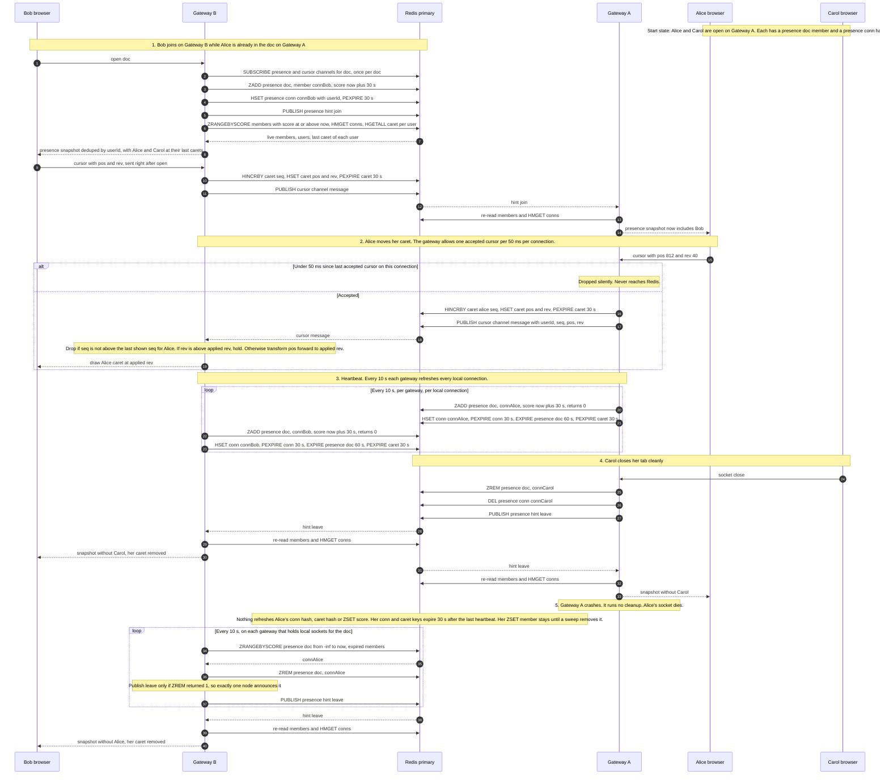

# Live cursors and presence: sequence design

Presence is built on the Redis primary that gateways already use. No new service, no change to the edit path or the load balancer. The Postgres presence table, its 30 s client polling and the nightly cleanup job are removed. Membership is a lease per connection, refreshed by heartbeat. Carets are ephemeral per-user hashes in Redis with a 30 s TTL. Pub/sub carries change hints only, and every hint is followed by a re-read of Redis state.

## Where state lives

| State | Where | Written by | Refreshed by | Removed by |
|---|---|---|---|---|
| Membership, one entry per connection | Redis ZSET `presence:doc:{docId}`, member connId, score = lease deadline | Node on open, on heartbeat, on clean close | Heartbeat every 10 s sets score to now plus 30 s. Key TTL 60 s, refreshed by heartbeat | Clean close: ZREM. Crash: any surviving node with local sockets on the doc sweeps expired scores and ZREMs them |
| Identity per connection (userId, name, colour) | Redis HASH `presence:conn:{connId}`, TTL 30 s | Node on open | Heartbeat | Clean close: DEL. Crash: TTL expiry |
| Caret per user (seq, pos, rev) | Redis HASH `presence:caret:{docId}:{userId}`, TTL 30 s | Node on each accepted cursor. Client sends an initial cursor on open | Heartbeat for local users | TTL expiry. Clients draw only users in the current list |
| Change hints | Pub/sub `presence:doc:{docId}` and `cursor:doc:{docId}` | Nodes | Not stored | Not stored. Subscribe only while the node has local sockets on the doc |
| Rate limit | Node memory, lastAcceptedAt per connId | Node | Each accepted cursor | Connection close |
| Client view | Presence list, lastSeq per userId, held carets | Client | Snapshots and cursor messages | Snapshot without the user |

Nothing is left in Redis for good. Every key has a TTL. A doc with no live connections has its ZSET expire after 60 s.

## Timing budgets

- **Clean leave:** ZREM and PUBLISH happen in the close handler, and other nodes re-read at once. Well under 2 s.
- **Node crash:** the last heartbeat was at most 10 s before the crash, so the lease ends at most 30 s after the crash. The next sweep runs at most 10 s later. Worst case is 40 s, inside the 45 s budget.
- **Join:** the snapshot comes from Redis on the joining node, not from pub/sub history, so no join is ever missed.

## Client rules (revisions and ordering)

- Each caret carries a per-user `seq` assigned by the node with HINCRBY, so it is monotonic across that user's tabs.
- Drop any caret whose seq is not above the last seq shown for that user. This is the no-backwards-jump rule and covers out-of-order arrival.
- If `rev` is above `appliedRev`, hold the caret. Keep only the highest-seq held caret. Draw it when `appliedRev` reaches `rev`.
- If `rev` is at or below `appliedRev`, call `transformPosition(pos, rev, appliedRev)`. On `HistoryGone`, drop the position and hide the caret until the next update. After each applied batch, move the shown caret to the current `appliedRev`, so it never needs its original revision again.
- Draw a caret only for users in the current presence list. Carets whose user has left disappear with the list.

## Other notes

- **Client coalescing.** The gateway drops anything within 50 ms and says nothing. The client must keep the latest pending caret and send it when the window opens. Otherwise the final move in a burst is lost and the caret stays wrong until the next move.
- **One user, two tabs.** The list is deduplicated by userId when the snapshot is built. The user stays listed until their last connection's lease goes. There is one caret per user, and the seq is per user, so no ordering problem arises between tabs.
- **Hints, not events.** Receivers re-read Redis on every hint instead of trusting the message body. Out-of-order or duplicate hints cannot leave a wrong list.
- **Re-add after a stall.** If a heartbeat arrives after a sweep has removed the member, ZADD returns 1. The node then publishes join again. A stalled node causes a brief flicker, not a leak.
- **Lost pub/sub messages.** Missed cursor messages are harmless. The next move corrects the caret, and joins read state from Redis.
- **Primary reads.** Presence reads go to the Redis primary, not the replica, so a fresh join is not hidden by replica lag. After a failover, heartbeats rebuild lost state within 10 s.
- **Idle users.** Their carets persist because the caret hash is refreshed by heartbeat, not by movement. Every client sends an initial cursor on open, so a user who never moves still has a caret for joiners.
- **Unchanged.** The edit path, the load balancer and the document service are untouched. Postgres loses only the presence table.
