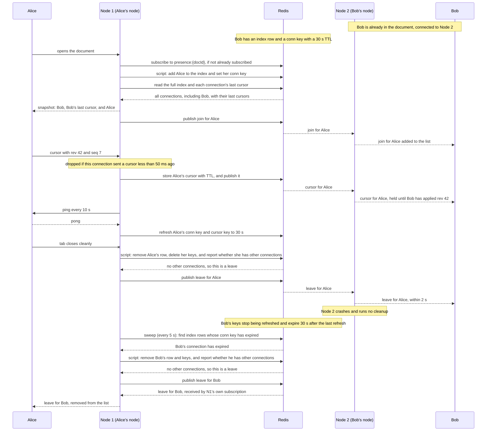

# Presence and cursors plan

This plan adds two features to the document editor:

- **A presence list**: who is in the document right now.
- **Live carets**: a coloured text cursor for every other user, showing where they are typing.

Both update live. The plan uses Redis, a fast shared store that all gateway nodes already connect to. It adds no new service, does not change how edits are saved, and does not change the load balancer.

## How the system works today

Browsers connect to the server over a WebSocket. A WebSocket is a connection that stays open, so the server can push messages to the browser at any time. A load balancer spreads these connections across several gateway nodes. So two people editing the same document are usually connected to different nodes.

Edits go through the document service. It saves each edit to Postgres (the main database), gives it a revision number, and publishes it to all nodes through a Redis channel. Each node then forwards the edit to its own browsers.

The presence list today is a Postgres table. Browsers ask for it every 30 seconds. This plan replaces that. Carets do not exist today.

## Words used

- **Gateway node**: a server that holds browser WebSocket connections. There are 6 today, and autoscaling can change that number. The load balancer spreads new connections across them, so two people in the same document are usually on different nodes.
- **WebSocket connection**: one open two-way link between one browser tab and one node.
- **connId**: a random ID for one WebSocket connection. It is new every time a connection opens. A user with two tabs open has two connIds.
- **userId**: the logged-in user's ID, taken from the session cookie. The presence list is keyed by userId, so each person appears once.
- **Revision (rev)**: the document's version number. Every saved edit gets a higher number. A caret position only has meaning at the revision where it was measured, because edits move text around.
- **Caret**: another user's text cursor, drawn in that user's colour.
- **seq**: a counter that each connection increases with every cursor it sends. Receivers use it to spot old or out-of-order messages.
- **Redis**: an in-memory data store shared by all nodes. It holds small values, can give each value a time limit, and supports publish and subscribe.
- **Hash**: a Redis value that holds many named fields. Here, the hash has one field per connection.
- **TTL (time to live)**: a time limit on a Redis key. When it runs out, Redis deletes the key by itself. A key that nobody refreshes cannot stay forever.
- **Pub/sub (publish and subscribe)**: a Redis channel. A node that subscribes to the channel receives every message published while it is subscribed. Redis stores nothing and does not resend. A node that is not subscribed at that moment misses the message.
- **Script**: a small program that Redis runs in one step. No other command runs between its steps, so a check and the write that follows it cannot be split by another request.
- **Ping and pong**: the node sends a ping over each WebSocket, and the browser replies with a pong. A pong proves the connection is still alive.
- **Heartbeat**: the regular ping-and-pong cycle.
- **Sweeper**: a timer on each node that looks for leftover presence records and removes them.
- **Idempotent**: safe to repeat. Running it twice gives the same result as running it once.
- **Snapshot**: the full current list of users and carets, sent to a browser when it first joins. Later changes arrive as small live messages on top of it.
- **transformPosition**: a function in the editor. It takes a character position that was valid at one revision and returns where that same spot sits at a later revision. It throws `HistoryGone` if the editor no longer keeps the history for the old revision.

## Where each piece of state lives

| State | Where it lives | Written by | Refreshed by | Removed by |
|---|---|---|---|---|
| Who is in the document: one row per connection, with userId and node | Redis hash `doc:{docId}:conns`, one field per connId | The node, when a connection opens | Not renewed. The sweeper only checks these rows | A clean close, or the sweeper once the row's connection key has expired |
| Connection liveness | Redis string `conn:{connId}`, TTL 30 s | The node, when a connection opens | The node, on each pong (every 10 s) | TTL expiry, or a clean close |
| Last cursor of each connection | Redis string `cursor:{docId}:{connId}`, same TTL | The node, when it accepts a cursor | Each pong and each accepted cursor | A clean close, the sweeper, or TTL expiry |
| Join, cursor and leave messages | Redis pub/sub channel `presence:{docId}` | The nodes | Not applicable | Not stored. Delivered only to nodes subscribed at that moment |
| The list and carets the editor shows | Browser memory, in the editor's presence store | Built from the snapshot and live messages | Each live message | Leaving the document |

Postgres is not used for presence. The old presence table and its 30-second polling are retired. The edit path, the document service and the load balancer are unchanged. Cursors never reach the document service or Postgres.

## Sequence

## What each step does

1. **Open.** The node subscribes to `presence:{docId}` first, so it cannot miss a message sent while it reads the snapshot. It then adds Alice to the index and creates her connection key in one script, so the check and the write happen together. Next it reads the full index and each connection's last cursor from Redis, and sends that as the snapshot. Idle users appear with their carets at once, because their last cursor is stored in Redis, not only in memory. After the snapshot, the node publishes a join. Alice's own node also receives that join. Duplicate joins are harmless, because the list is keyed by userId.

2. **Cursor.** The browser sends its cursor with the revision it has applied and a seq. If this connection sent a cursor less than 50 ms earlier, the node silently drops the new one. The limit is enforced on the server, per connection. Otherwise, the node stores the cursor with a TTL and publishes it. Each node forwards it to its own browsers.

3. **Heartbeat.** Every 10 s the node pings each browser. Each pong refreshes the connection key and the cursor key to a 30 s TTL. If no pong arrives within 20 s, the node closes the socket, which counts as a leave.

4. **Clean leave.** The node runs one script. It removes Alice's row, deletes her keys, and reports whether she has other connections to this document. The node publishes a leave only if she has none left, so two tabs never show up as two leaves.

5. **Node crash.** A crashed node runs no cleanup. Its keys stop being refreshed and expire 30 s after their last refresh. Every surviving node sweeps every 5 s. A sweep finds index rows whose connection key has gone, removes them and their cursors, and publishes a leave if that was the user's last connection. Sweeps are idempotent, so two nodes doing the same sweep publish only one leave. The worst case is that the user disappears 35 s after the crash. The last refresh happened no later than the crash, then the key has 30 s of TTL, then the sweep waits up to 5 s. That is inside the 45 s requirement.

6. **Edits.** Unchanged. Cursors never touch the document service or Postgres.

A node subscribes to `presence:{docId}` while it has at least one local browser connection on that document. It unsubscribes when the last one closes. This is the same pattern the edit path uses for `ops:{docId}`.

## Client rules for cursors

- Each cursor carries `rev`, the sender's applied revision, and `seq`, the sender's counter for that connection.
- **No backwards jumps.** For each connection, the browser remembers the highest seq it has accepted. A cursor with an equal or lower seq is discarded, even if it arrives late. This includes cursors that are still being held. If a newer cursor is accepted, any older held cursor from the same connection is dropped.
- **Revision check.** If `rev` is higher than the browser's `appliedRev` (the last revision it has applied), the browser holds the cursor and draws nothing yet. When `appliedRev` reaches `rev`, the cursor is drawn.
- If `rev` is at or below `appliedRev`, the browser calls `transformPosition(pos, rev, appliedRev)` to move the position forward. If that throws `HistoryGone`, the browser drops the cursor and waits for the next one.
- Whenever `appliedRev` moves forward, the browser checks the held cursors again and draws any that are now ready.
- **Tabs.** The presence store is keyed by userId, so a user with two tabs has one list entry and one caret. The caret uses the cursor from whichever of that user's connections arrived most recently. The seq rule still applies to each connection separately.

## Limits

- Pub/sub stores nothing and does not retry. A node that misses a join or leave message leaves a stale entry on that client until the user reopens the document. The snapshot on open corrects it. A periodic resync is a possible later addition and is not part of this plan.
- Cursors are best effort. A lost cursor is replaced by the next one, and the sender's position is always in the snapshot.
- The 50 ms limit and the 30 s, 10 s and 5 s timings are plan values. Tune them with load tests.