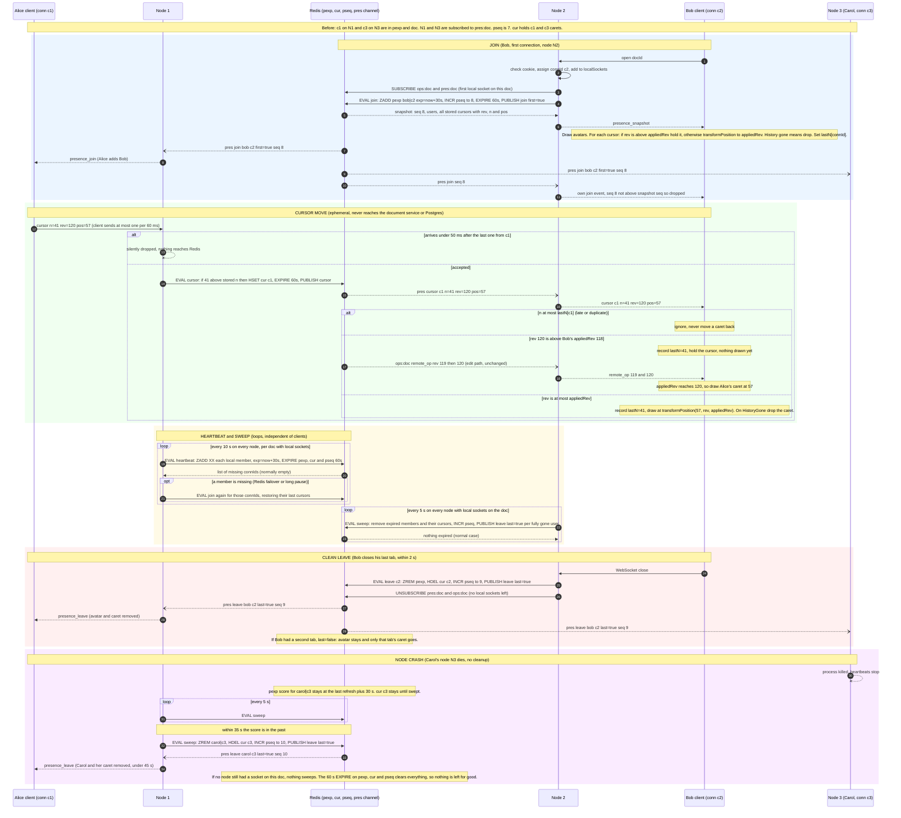

# Live cursors and presence: design

## Where state lives

| State | Lives in | Written by | Refreshed by | Removed by |
|---|---|---|---|---|
| Connections per doc (`connId`, `userId`) | Redis ZSET `pexp:{doc}`. Member is `userId\|connId` and score is its expiry in ms. | Node's `join` script | Heartbeat every 10 s (expiry = now + 30 s) | Clean `leave`, or `sweep` once the score is in the past. The key also has `EXPIRE 60 s`, refreshed by every write. |
| Latest cursor per connection | Redis HASH `cur:{doc}`. Field is `connId` and value is `{userId, n, rev, pos, ts}`. | Node's `cursor` script, only if `n` is greater than the stored `n` | Each cursor update. Heartbeat refreshes the key TTL. | `leave`, `sweep`, or key TTL |
| Presence change counter | Redis `pseq:{doc}` | Incremented by `join`, `leave` and `sweep` | Same TTL as the other keys | Key TTL |
| Change feed | Redis pub/sub `pres:{doc}`. It carries `join`, `leave` and `cursor` events. It stores nothing. | Lua scripts, so event order matches state order | n/a | n/a |
| `localSockets`, per-conn `lastCursorAt`, `connId` to `userId` | Node memory | Node | Node | Socket close, or the node dying |
| Applied revision, shown carets, held cursors, `lastN[connId]`, `seq` | Client memory | Client | n/a | Tab close |

- **Postgres and the document service.** Neither is touched. The old presence table, the 30 s polling and the nightly cleanup job go away.
- **Existing paths.** The edit path, `ops:{doc}` and the load balancer are unchanged. The only new infrastructure is the Redis keys and channel above.
- **One channel per doc.** Nodes subscribe to `pres:{doc}` at the same moment they subscribe to `ops:{doc}`, which is when the first local socket opens the doc. They unsubscribe when the last local socket closes.
- **Scripts.** Each Lua script runs atomically and reads time from Redis `TIME`, so node clocks do not matter. Scripts publish inside Lua. `userId` must not contain `|`, which holds for UUIDs.

## Rules that make it correct

- **Per user, not per tab.**
  - Each connection is its own ZSET member. `join` and `leave` check whether another live member with the same `userId` exists.
  - Every event carries `connId`, and `join` and `leave` also carry `first` and `last` flags.
  - Clients add an avatar when `first=true`. They remove it only when `last=true`.
  - Carets are per connection. Each avatar's caret is the one with the highest `ts`.
- **Join without gaps.**
  - The node subscribes before it runs `join`, and `join` returns the snapshot in the same atomic step as its own publish.
  - The snapshot holds the live users, every stored cursor and `seq`.
  - The client drops any `join` or `leave` with `seq <= snapshot.seq`. Idle users' carets arrive in the snapshot because their last cursor is kept in `cur:{doc}`.
- **Cursor rate.**
  - The client sends at most one update per 60 ms, with a trailing send so the final position is not lost. 60 ms leaves margin for network jitter.
  - The node compares server arrival time with the connection's `lastCursorAt` and silently drops anything under 50 ms. A dropped update never reaches Redis.
- **Revisions.**
  - The sender reports its position at its `appliedRev`. If local edits are not yet acked, it maps the position back through them, or waits for the ack.
  - A receiver never draws a caret at a revision it has not applied. It holds the newest such cursor per `connId` and draws it when `appliedRev` reaches that revision.
  - A cursor with `rev < appliedRev` is drawn at `transformPosition(pos, rev, appliedRev)`.
  - If `transformPosition` throws `HistoryGone`, the caret is dropped until the sender's next update.
  - A caret that is already shown is transformed forward on each applied `remote_op`.
- **No backwards jumps.**
  - Each connection stamps its cursors with a counter `n` that only increases.
  - The receiver keeps `lastN[connId]` and ignores any cursor with `n <= lastN`. This covers messages that arrive late or out of order, and a held cursor that is replaced by a newer one. Redis applies the same rule.
  - A cursor for a `connId` that has already left is ignored.
- **Clean leave.** `leave` runs when the socket closes, and the event fans out in milliseconds, well inside 2 s. Graceful node shutdown runs `leave` for every local connection.
- **Crash.**
  - A dead node stops refreshing its members, and their scores run out within 30 s of the last heartbeat.
  - Every node that still has local sockets on a doc runs `sweep` for it every 5 s. The script removes expired members and their cursors, and publishes `leave` with `last=true` for users with no live member left. Because it runs atomically, only one node publishes each removal.
  - Worst case is about 35 s, against the 45 s limit.
  - If no node has a socket on the doc, nobody needs the removal, and the `EXPIRE 60 s` on the keys clears them. Nothing stays in Redis for good.
- **Redis failover or a paused node.** The heartbeat only refreshes members that still exist (`ZADD XX`) and returns the missing `connId`s. The node re-runs `join` for them quietly, without a new announcement, and restores their last cursors.

## Sequence diagram

Setup: Alice (tab `a1`, `c1`) is on node N1. Carol is on node N3. Bob joins on node N2, and his tab `c2` is his first connection. Alice's cursor is already stored in `cur:doc`. The document service and Postgres do not appear because they are not involved.

## Timings

| Event | Detection | Visible to others |
|---|---|---|
| Clean tab close | Immediate | Milliseconds (limit 2 s) |
| Node crash | Score expiry (last heartbeat + 30 s) plus up to 5 s until the next sweep | About 35 s (limit 45 s) |
| Dead socket on a live node | Ping/pong timeout of 20 s, then `leave` | About 20 s |
| Redis failover | Next heartbeat (10 s) re-adds the members | No visible change if it is fast enough |

## Left open

- **Several tabs per user.** The design assumes that showing the most recently moved tab's caret is acceptable. Showing every tab's caret would need no protocol change, only a client choice.
- **Load.** Cursor traffic costs one Redis script call per accepted update per user, at most about 17 per second per user. If Redis becomes the bottleneck, nodes could coalesce updates per connection, but that is not needed for the requirements.
