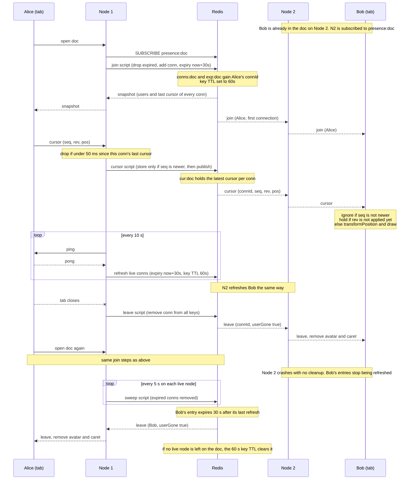

## Presence and cursors plan

Presence and cursors use the Redis instance we already run. Each gateway node writes the state of its own connections into Redis and announces changes on a Redis pub/sub channel. Nodes never talk to each other directly, and clients never poll. The edit path, the load balancer and Postgres are unchanged. The Postgres presence table and its 30 s polling are removed.

Terms:
- A *connection* is one WebSocket (one tab). It has a `connId`.
- A *user* may have several connections.
- Everything below is per document. The diagram writes the document as `doc`.
- A *node* is one gateway server. Users in the same document are usually on different nodes.

### Where state lives

| State | Where | Written by | Refreshed or removed by |
|---|---|---|---|
| Connections: `connId -> {userId, name, nodeId}` | Redis hash `conns:{docId}` | the node that owns the socket | removed on clean close, or by a sweep once the entry has expired |
| Expiry time per connection | Redis sorted set `exp:{docId}`, score = expiry time | same | pushed forward to now+30 s by the owning node every 10 s |
| Last cursor per connection: `connId -> {seq, rev, pos}` | Redis hash `cur:{docId}` | the owning node, only if `seq` is newer than the stored one | removed with the connection |
| Live events (`join`, `leave`, `cursor`) | Redis pub/sub channel `presence:{docId}` | the Lua scripts below | not stored; only current subscribers receive them |
| Open sockets, and the time of each connection's last accepted cursor (for the rate limit) | node memory (`localSockets`) | the node | dropped when the socket closes or the node dies |
| Presence list, carets, `lastSeq` per `connId`, held cursors | client memory | the client | rebuilt from the snapshot on every join |

Rules that apply to all of it:
- The three Redis keys (`conns:`, `exp:`, `cur:`) each get a 60 s key TTL, reset on every write. If everyone has left a document, or all its nodes have died, Redis forgets it.
- Each operation (join, cursor, refresh, leave, sweep) is one Lua script. Redis runs a script atomically, so the stored state and the published event cannot disagree. Scripts read the Redis `TIME`, so node clocks do not matter.
- As with `ops:{docId}`, a node subscribes to `presence:{docId}` while it has at least one local socket on that document.

### How it works

**Join.** The node subscribes to `presence:{docId}` first, then runs the `join` script. The script:
1. Removes expired entries and publishes `leave` for each, as the sweep does.
2. Registers the connection.
3. Returns a snapshot: the distinct users, plus every connection's last cursor from `cur:`.
4. Publishes `join` only if this is the user's first connection to the document. A second tab publishes nothing, so the user appears once.

Subscribing before reading the snapshot means no event can fall in a gap. An event may show up both in the snapshot and on the channel, but applying it twice is harmless, so the client converges. Idle users' carets arrive in the snapshot because their last cursor is stored in Redis. Pub/sub alone could not provide them. The client sets each connection's `lastSeq` from the snapshot.

**Cursor.** The client sends `{t:"cursor", docId, rev, pos, seq}`.
- `rev` is the revision the client has applied (`appliedRev`).
- `seq` counts up per connection.
- The client sends at most one update per 50 ms, and always sends the final position once movement stops.

The node remembers when it last accepted a cursor from each connection and silently drops any that arrives less than 50 ms later. Otherwise it runs the `cursor` script, which stores the cursor and publishes it only if `seq` is newer than the stored one. The message never touches the document service or Postgres.

An idle client re-sends its cursor every 10 s, but only if `appliedRev` has moved since its last send. This keeps the stored `rev` inside the editor's 500-revision history, so a user who joins later can still place the caret.

**Receiving a cursor.** For each `connId`, the client applies these rules in order:
1. If `seq <= lastSeq`, ignore it. This prevents backwards jumps when messages arrive out of order. Otherwise set `lastSeq = seq`.
2. If `rev > appliedRev`, hold it, keeping only the newest held cursor per connection. Draw it once that revision has been applied.
3. Otherwise draw at `transformPosition(pos, rev, appliedRev)`. If that throws `HistoryGone`, drop the position and hide that caret until the next update.
4. Each time `appliedRev` advances, move the drawn carets forward with `transformPosition` from the revision they were drawn at.

Carets are drawn per connection and coloured per user. A client skips carets belonging to its own user, so it never shows its own other tabs.

**Heartbeat.** Every 10 s the node pings each socket (existing behaviour). For every connection that answers, the node runs the `refresh` script, which pushes that connection's `exp:` score to now+30 s and resets the key TTLs. It also re-adds any entry that is missing, for example after a Redis failover lost recent writes.

**Clean leave.** On socket close the node runs the `leave` script. It removes the connection from all three keys and publishes `leave {connId, userId, userGone}`. `userGone` is true only if the user has no other connection. Clients always remove that connection's caret, and remove the avatar only when `userGone` is true. This takes milliseconds, well inside 2 s. A tab that vanishes without closing (laptop lid, network loss) is closed by the existing ping timeout after 20 s, then follows the same path.

**Node crash.** A dead node cleans up nothing, so its entries stop being refreshed and expire 30 s after their last refresh. Every surviving node runs the `sweep` script every 5 s for each document it has sockets on. The script removes expired connections (from all three keys) and publishes `leave` for each. Scripts are atomic, so concurrent sweeps are safe: each expired connection is removed, and its `leave` published, exactly once. Worst case is 30 s + 5 s = 35 s, inside the 45 s limit. If no live node is left on the document, the 60 s key TTL removes everything.

### Sequence diagram

The diagram starts with Bob already in `doc` on Node 2. Alice joins on Node 1, moves her cursor, then her tab closes. She then reopens the document on Node 1, so Node 1 has a socket on `doc`, is subscribed, and is sweeping when Node 2 crashes.

### Timings

| Setting | Value |
|---|---|
| Cursor send and accept interval | 50 ms |
| Refresh and ping interval | 10 s |
| Connection expiry, from last refresh | 30 s |
| Sweep interval | 5 s |
| Redis key TTL | 60 s |
| Crash to disappearance | at most 35 s (limit 45 s) |
| Clean leave | milliseconds (limit 2 s) |