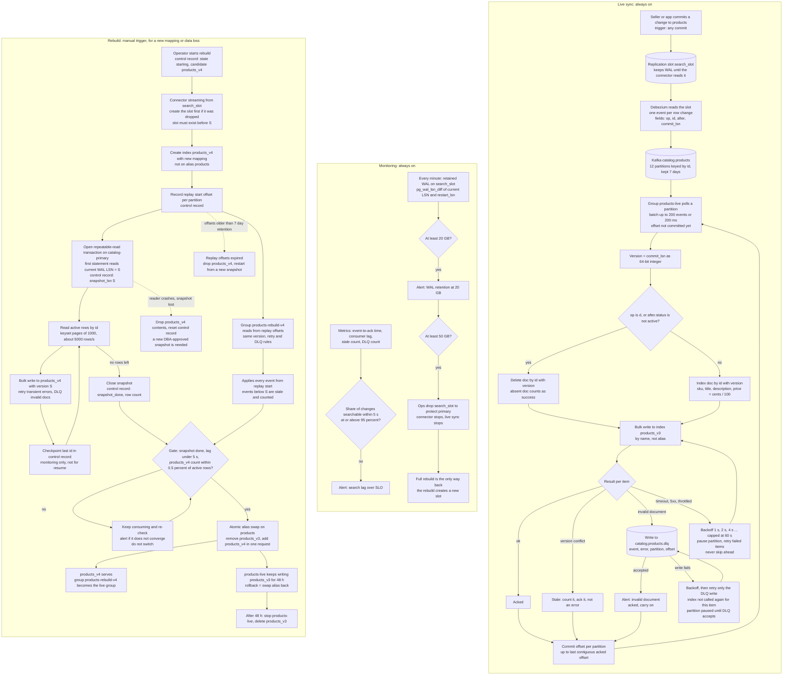

# Search sync: change data capture and rebuild plan

This is a plan only. Nothing was run against the cluster, the connector, or the primary, so the failure behaviour and the gates below are design targets to verify.

## Summary

Today a cron job runs every 15 minutes. It reads `products` rows changed since its last run and writes them straight into the live index `products_v3`. It misses hard deletes, can let an old run write over newer data, and shows changes up to 15 minutes late.

The new design streams every committed change through Debezium and Kafka to a new indexer service (consumer group `products-live`). Each change is written with its commit position as its version, so stale writes lose. A rebuild fills a second index from a snapshot plus a replay of the stream, and moves the search alias to it only when it has caught up, so search never sees a half-built index. The table has about 40 million rows and up to about 300 writes per second at peak.

## Terms

- **Alias `products`**: the only name the search API queries. It points at one index (`products_v3` today). Moving it is atomic.
- **Version**: a number stored with each document. A write with a lower version than the stored one is refused as a version conflict.
- **WAL**: Postgres's log of committed changes.
- **LSN (`commit_lsn`)**: a position in the WAL, written as hex `X/Y`. A larger LSN means a later commit.
- **Replication slot `search_slot`**: a marker in Postgres that keeps WAL until the connector has read it.
- **Debezium**: the CDC connector already installed. It reads the slot and writes one Kafka event per row change. It watches `products` through the publication `catalog_search`.
- **Topic `catalog.products`**: a Kafka topic with 12 partitions, keyed by product id, so all changes to one product stay in order in one partition. Kept for 7 days.
- **Consumer group and offset**: a named reader of a topic, and its position in each partition. Each group keeps its own offsets, so two groups can read the same topic at once.
- **DLQ**: the dead-letter topic `catalog.products.dlq`, for events the index refuses as invalid.
- **Snapshot and S**: one repeatable-read transaction on `catalog-primary`. S is the WAL position read as its first statement.
- **Control record**: the rebuild's small status record (state, candidate index, replay offsets, S, row count). Where it is stored is an open question.
- **Stale event**: an event whose version is below the stored version. It is counted and acked.

## The flow

## Rules for the live path

- **Version.** Parse `commit_lsn` as `(X << 32) + Y` into an unsigned 64-bit integer. Compare numerically, never as text. Equal versions are accepted: two events for one product in the same transaction share an LSN, and one product always lands in one partition, so their order holds.
- **Deletes.** Op `d` deletes the document by `id`, which is a top-level field, because `after` is null. A `c` or `u` event whose `after.status` is not `active` also deletes. Deleting an absent document counts as success. A versioned delete cannot remove a newer write.
- **Searchable rows.** Only `active` rows may appear in search.
- **Offsets.** A partition's offset moves only up to the last contiguous acked event. After a crash, later events that were already written are replayed. The version rule makes that harmless.
- **Lag and the 5 s target.** Lag is now minus the commit time of the last event applied. Commit time is the Kafka record timestamp, assumed to be Debezium's source commit time. Confirm this in the connector config before relying on the SLO. During a replay, lag is large. It falls under 5 s only when the consumer reaches the live end of the topic.
- **SLO.** The share is changes acked within 5 s of commit, divided by changes committed in the same window. Consumer lag is only an early warning. A change that lands in the DLQ counts as a miss.

## Rebuild path

An operator starts a rebuild, for a new mapping or after data loss. It writes only to `products_v4`, never to the alias.

- **Live stream first.** The connector must stream from a slot created at or before S, so no commit after S is missed. This also applies after an ops slot drop. The new slot is created before S is read, so the snapshot holds the commits made during the gap, and later commits are streamed.
- **Replay start before the snapshot.** The replay offset is recorded before the snapshot opens. So every commit after S lands after that offset in Kafka. Commits below S are already in the snapshot, and their replayed events are harmless.
- **Snapshot version S.** Every snapshot document is written with version S. S and each `commit_lsn` are WAL positions on `catalog-primary`, so they compare directly. Events below S are stale and counted. Events at or above S apply on top.
- **Separate group.** `products-rebuild-v4` reads the same topic from the replay offsets, under the same version, retry and DLQ rules. It does not touch `products-live`'s offsets.
- **Reading.** Keyset pages of 1000 by id, at about 5000 rows/s, which is about 2.5 hours for the active rows. The snapshot holds back vacuum on the primary for the whole run. The DBA has approved this.
- **Checkpoint.** The last id is saved in the control record for monitoring only. A crashed reader cannot resume the snapshot. Its contents are dropped, the control record is reset, and a new DBA-approved snapshot is needed.

## Gate and switch

- Switch only when the snapshot is done, lag is under 5 s, and the `products_v4` count is within 0.5 percent of the active row count. That is about 200,000 documents of slack at 40 million rows.
- If the gate fails, keep consuming and re-check. Alert if it does not converge. Do not switch.
- The count cannot detect wrong content. A sampled field comparison would add confidence. The brief does not ask for one.
- The swap is one request: remove `products_v3` and add `products_v4` to the alias. Then `products-rebuild-v4` is the live group.
- `products-live` keeps writing `products_v3` for 48 hours. Rollback swaps the alias back, and no change made after the switch is lost. After 48 hours, stop `products-live` and delete `products_v3`.
- Rollback caveat: `products_v3` still holds cron-era state. Documents for rows hard-deleted before the switch may remain. Reconcile `products_v3` against active ids before relying on rollback, or accept that risk explicitly.

## What happens when things fail

| Failure | What happens | Alert or next step |
|---|---|---|
| Connector stops | The slot keeps WAL, so no data is lost | Alert at 20 GB retained WAL. At 50 GB, ops drop the slot and live sync stops. A full rebuild is then the only way back. |
| Index timeout, 5xx or throttling | Retry with backoff: 1 s, 2 s, 4 s, capped at 60 s. The partition pauses and its offset does not move. Never skip ahead. | Lag grows. The 5 s SLO alert fires first. |
| Version conflict | Counted as stale and acked. Not an error. | Stale count metric |
| Invalid document | Event, error, partition and offset go to the DLQ. Acked. Processing continues. | Alert. Replaying the DLQ after a fix is manual and not covered by the brief. |
| DLQ write fails | Backoff, then retry only the DLQ write. The index is not called again for this item. The partition stays paused until the DLQ accepts it. | Treated as transient |
| Consumer restarts | Unacked events are replayed. The version rule makes this harmless. | None |
| Replay offsets older than 7-day retention | Replay cannot start. Drop `products_v4` and take a new snapshot. | Operator |
| Snapshot reader crashes | Snapshot cannot resume. Drop `products_v4` contents and reset the control record. | New DBA-approved snapshot |
| Gate not met | Keep consuming. Do not switch. | Alert if it does not converge |

## Rollout: one-time cutover from cron

This is how the system is moved over. It is not part of how the system runs.

0. Point the Debezium connector at `catalog-primary`, slot `search_slot`, and topic `catalog.products`. Do this at least 20 minutes before step 1, so the topic holds the events the replay needs. The brief does not say who does this.
1. Stop cron after its last run.
2. Start `products-live` from the Kafka offsets at the timestamp 20 minutes before that stop. Cron can be up to 15 minutes behind, so 20 minutes covers one full cron cycle of changes it may not have written.

Cron writes documents with no version. What happens when a replayed event meets one of them is unverified. See open questions.

## Open questions

- Where control records are stored, and who reads them to decide the rebuild's state.
- Who runs the cutover, and who repoints the connector. The plan assumes an operator starts any rebuild, including after an ops slot drop, because the brief does not name who decides.
- Cron-written documents have no version. Neither the brief nor search-setup.md says what the store does when a versioned write replaces one. The risk is that a replayed older event overwrites newer state that cron wrote, and the stale value stays until the product changes again.
- Snapshot race: a commit whose WAL record lies below S but becomes visible only after the snapshot starts may be missing from the snapshot. Its event is then stale under the version rule. Not verified.
- The SLO measurement window is not stated.
- Whether `products-rebuild-v4` keeps its name after the switch.
- Whether the Kafka record timestamp is Debezium's source commit time. Confirm in the connector config.