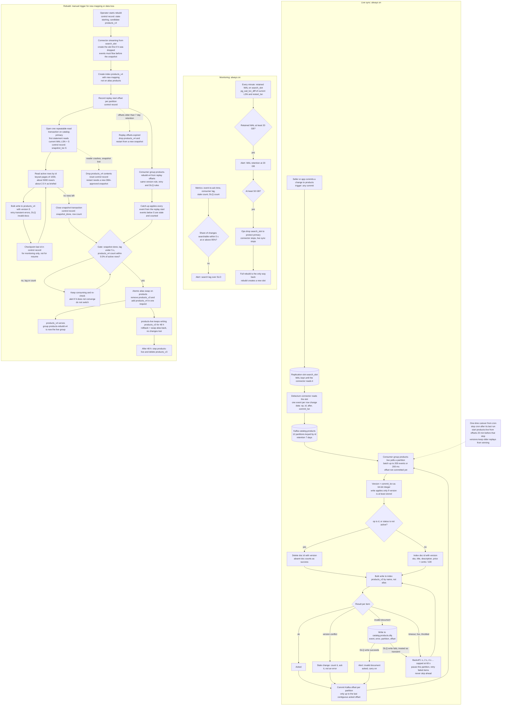

# Search sync: change data capture and rebuild plan

This is a plan only. Nothing was run against the cluster, the connector, or the primary, so the failure behaviour and the gates below are design targets to verify.

## Key decisions before the diagram

- **Version as LSN.** Parse `commit_lsn` (`X/Y`, hex) as `(X << 32) + Y` into an unsigned 64-bit integer, and compare numerically, never as text. The store's "at least stored" rule accepts equal versions. That matters because two events for one product in the same transaction share an LSN, and they stay in order because one product always lands in one partition.
- **Deletes are versioned too.** An old delete cannot remove a newer write. Deleting an absent document counts as success.
- **Snapshot version S.** Every document from the snapshot is written with version S, the WAL LSN read as the first statement of the repeatable-read transaction. Events below S are stale and are counted. Events at or above S apply on top.
- **Lag measurement is an assumption.** The event shape in search-setup.md has no commit time. This plan assumes the Kafka record timestamp (Debezium's source commit time). Confirm that in the connector config before relying on the 5 s SLO.
- **Writes go to index names, not the alias.** The alias moves only at the switch, so the search API never sees a half-built index.
- **Rebuild needs a live stream.** The connector must be streaming from a slot created at or before S, so no commit after S is missed. This applies after an ops slot drop too.

## Notes on failures and open items

- **Connector down:** the slot keeps WAL and no data is lost until ops drop the slot at 50 GB. The 20 GB alert is the warning.
- **Index down or throttled:** the partition pauses, its offset does not move, and lag grows until the index recovers. The 5 s SLO alert fires first.
- **Invalid documents:** they go to the DLQ and processing continues. Replaying the DLQ after a fix is manual and is not covered by the brief.
- **Snapshot reader crash:** the snapshot cannot be resumed, so the candidate is discarded and a new snapshot is needed. The checkpoint only reports progress.
- **Count gate is weak:** 0.5% of 40 million is about 200,000 documents of slack, and a count does not detect wrong content. A sampled field comparison would add confidence, but the brief does not ask for one.
- **Rollback caveat:** the 48-hour window protects changes made after the switch. `products_v3` still carries cron-era state, so documents for rows hard-deleted before the switch may still be present. Either reconcile `products_v3` against active ids before relying on rollback, or accept that risk explicitly.
- **Snapshot load:** the one repeatable-read transaction holds back vacuum on the primary for the whole run. The DBA has already approved this.