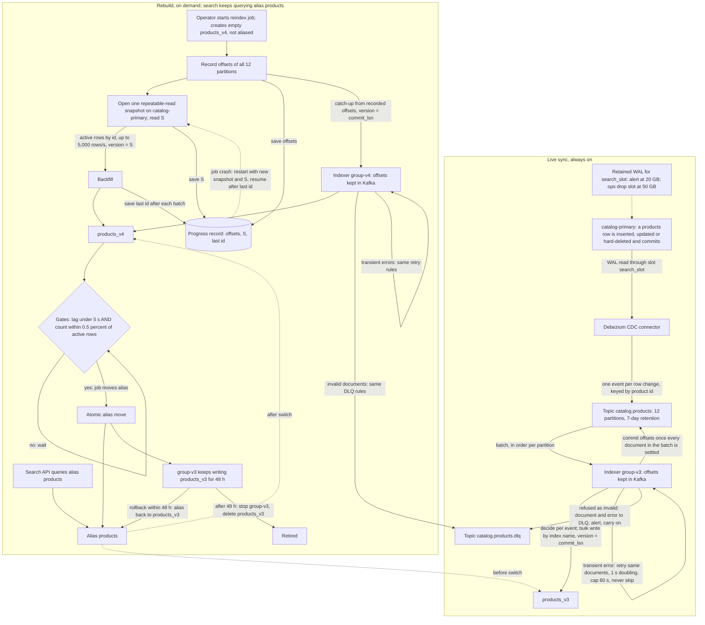

# Plan: move search to CDC

## Summary

Product search is fed today by a cron job (`existing/indexer_cron.py`). Every 15 minutes it reads `products` rows changed since its last run and writes them straight into the live index `products_v3`. It misses hard deletes, can let an older run overwrite newer data, and shows changes up to 15 minutes late. The new design streams every committed change through Debezium into Kafka, and a new indexer writes each change with its commit position as the version, so a stale write is refused and the cron is retired. A rebuild fills a new index, `products_v4`, from one snapshot plus the same change stream, while search keeps using `products_v3`. When `products_v4` is caught up, the alias `products` moves to it in one atomic step, and `products_v3` is kept for 48 hours as a rollback.

## Terms

- **Primary `catalog-primary`:** the Postgres 16 database that holds the table `products`. It has about 40 million rows and about 300 writes/s at peak. A seller's removal hard-deletes the row.
- **Active row:** a `products` row with status `active`. Only active rows may appear in search.
- **Search store and index:** one search cluster. Each index holds one copy of the catalog, here `products_v3` or `products_v4`. Each product is one document in an index, with the product id as its id.
- **Alias `products`:** the one name the search API queries. It points at one index. Moving it is atomic, so a query never reaches neither index.
- **CDC (change data capture):** reading committed changes from the database's own log, instead of querying tables.
- **WAL:** the primary's log of committed changes. Debezium reads it.
- **Replication slot `search_slot`:** a bookmark on the primary. Postgres keeps the WAL until the reader has read past it, so a stopped reader makes the WAL grow.
- **Debezium:** the CDC connector. It reads the slot and writes one Kafka event per row change.
- **Topic `catalog.products`:** the event stream. It has 12 partitions and keeps events 7 days. It lives on 3 Kafka brokers shared with other teams. Events are keyed by product id, so all changes to one product land in one partition, in commit order.
- **Event:** `op` (`c` insert, `u` update, `d` delete), `id`, `after` (the whole row, or null on delete) and `commit_lsn`. It holds no old values and does not list only the changed columns.
- **commit_lsn:** the WAL position of the transaction that committed the change. Larger means committed later. Rows changed in one transaction share one commit_lsn.
- **Partition and offset:** a partition is one of the topic's 12 ordered lanes. An offset is a message's position in its partition.
- **Consumer group:** indexers that share saved offsets, kept in Kafka. `group-v3` writes `products_v3`. `group-v4` writes `products_v4`.
- **Version:** a number sent with each write. The store applies a write only if its version is at least the stored version. Otherwise it returns a version conflict for that document.
- **Version conflict:** the store's refusal of an older write. It means the change is stale.
- **Snapshot:** one repeatable-read transaction on the primary, which the DBA allows. It sees the data as it was when it started.
- **S:** the WAL position read inside the snapshot. Changes in the snapshot committed before S. Later changes have a larger commit_lsn.
- **Settled:** a document the index accepted, a version conflict, or a document written to the DLQ with its error. Deleting a document that is not in the index also counts as settled.
- **DLQ `catalog.products.dlq`:** the dead-letter topic for documents the index refuses as invalid.
- **Lag:** zero when the group has read to the end of every partition. Otherwise it is the age of the oldest committed change the group has not applied.
- **Gate:** a condition the rebuild must pass before the switch.
- **Progress record:** the reindex job's stored record of the offsets, S and last backfilled id. Where it is kept is an open question.

## Diagram

Notes:
- The live path runs all the time. The rebuild runs only on demand and does not touch the alias until the switch.
- The write rules in step 3 apply to both consumer groups.
- A transaction that changes several products can show partly updated in search for a few seconds. Debezium writes one event per row, and the indexer applies each event on its own. This is accepted, because each product's document is independent.

## Live sync steps

1. **Trigger: a `products` row is inserted, updated or hard-deleted, and the change commits.** Debezium reads it from the WAL through `search_slot` and writes one event to `catalog.products`, keyed by product id. Postgres keeps the WAL until Debezium has read it. Kafka keeps the topic 7 days.
2. **Trigger: new events in the topic.** `group-v3` reads batches from each partition, in order.
3. **Decide the write for each event.** Only active rows may appear in search.
   - `c` or `u` with status `active`: index the full row, version = `commit_lsn`.
   - `c` or `u` with status `draft` or `archived`: delete the document, version = `commit_lsn`. A product that stops being active leaves search this way.
   - `d`: delete the document, version = `commit_lsn`.
4. **Bulk write the batch to `products_v3`, by index name, not by alias.** Writing by name keeps `products_v3` current after the alias moves, which rollback needs.
   - Version conflict: the change is stale. Count it, treat it as settled, and do not retry.
   - Transient error (timeout, 5xx, throttling): retry the same documents, waiting 1 s, then 2 s, 4 s and so on, capped at 60 s. Never skip ahead.
   - Refused as invalid: write the document and its error to the DLQ, raise an alert and carry on.
5. **Commit offsets once every document in the batch is settled.** A crash before that replays the unsettled events. Replays are safe, because the same version gives the same result.
6. **Freshness target.** Batches are flushed often enough that 95% of committed changes are searchable within 5 seconds of commit.
7. **Trigger: checked continuously.** Watch the WAL retained for `search_slot`. Alert at 20 GB. At 50 GB, ops drop the slot to protect the primary. After that, a full rebuild is the only way back.

## Rebuild steps

The rebuild runs on demand, for example for a new mapping or after data loss. Search keeps querying `products` throughout.

8. **Trigger: an operator starts the reindex job.** It creates an empty `products_v4` with the new mapping. Nothing points at it yet. If a progress record for `products_v4` already exists, the job is a restart. It does not create the index again. It goes on to step 9 with a new snapshot.
9. **Start the snapshot, in this order.** First the job records the topic offsets for all 12 partitions. Then it opens the one snapshot on `catalog-primary` and reads S in the same transaction. Both go into the progress record. The order closes the gap. A change committed before the snapshot is in the snapshot. A change committed after the offsets were recorded has an event after them, so catch-up reads it. Overlap is harmless, because the version rule refuses older writes.
10. **Backfill.** The job reads active rows in id order from the snapshot, at up to 5,000 rows/s. That is about 2.5 hours for the active rows. It writes each row to `products_v4` with version = S. It saves the last id read after each batch, so a restart can resume.
11. **Catch-up, in parallel.** `group-v4` starts from the offsets saved in step 9 and applies every event with the rules of steps 3 to 5, version = `commit_lsn`. It keeps running after the backfill, so `products_v4` stays current. When a change and a backfill write meet on the same row, the version rule decides:
    - A change after S that is applied first has a higher version than S. The backfill write of that row is refused as a version conflict, and the newer change stands.
    - A delete applied after the backfill write removes the document, because its version is higher than S.
    - An older event, with commit_lsn below S, is refused on a backfilled row. The snapshot already holds the newest state of that row, so a stale draft or delete does not remove it. If such a delete runs before the backfill write, it removes nothing, and the backfill write at version S is accepted and restores the row.
    - Exception: a row deleted or made inactive after S, whose delete is applied before the backfill writes that row. The backfill write is then accepted only if the store still remembers the deleted version. This is unknown. See the rollout precondition and the open questions.
    - After a restart, `group-v4` keeps reading from its own committed offsets. It does not go back to the step 9 offsets.
12. **Gate check, repeated until both pass.**
    - The lag of `group-v4` is under 5 seconds.
    - The `products_v4` document count is within 0.5% of the active row count in `products` on the primary.
    If the backfill has finished and the count stays outside 0.5%, the job does not switch (see the failure table).
13. **Switch.** When both gates pass, the job moves the alias `products` from `products_v3` to `products_v4` in one atomic step. The job checks the gates just before the move and does not check them again. Lag or count may change in between. That is safe. Each group has applied every change to its own index, and `group-v4` keeps applying changes to `products_v4` after the move, so no change is lost. The search API uses the new index from its next query. There is no manual step. `group-v3` is not a gate, because the switch does not depend on it, but it must keep running for 48 hours so that rollback works.
14. **Rollback, within 48 hours.** Move the alias `products` back to `products_v3` in one atomic step. `products_v3` has every change made since the switch, so nothing is lost.
15. **After 48 hours.** Stop `group-v3` and delete `products_v3`.

## What happens when things fail

| What fails | What happens | What to do |
|---|---|---|
| Index timeout, 5xx or throttling (either group) | The same documents are retried, waiting 1 s, 2 s, 4 s and so on, capped at 60 s. The indexer never skips ahead, so its offsets stop and the topic backlog grows. | Nothing. It resumes when the index recovers. |
| Index refuses a document as invalid (either group) | The document and its error go to the DLQ, an alert is raised, and processing carries on. Offsets commit after the DLQ write is acknowledged. | Fix the cause, then replay the DLQ message through the indexer. The version rule keeps the replay safe if a newer change was applied. The owner is unknown (see open questions). |
| Version conflict | Counted as stale. Not an error. No retry. | None. |
| Indexer crashes | It restarts from its last committed offset and replays unsettled events. | None. |
| Debezium stopped, or Kafka unreachable | No new events. Postgres keeps the WAL for `search_slot`, so the WAL grows. | Alert at 20 GB. At 50 GB, ops drop the slot. Then only a full rebuild brings the index back. |
| Indexer slow or down, Kafka up | Debezium keeps publishing, so the WAL does not grow. The topic backlog grows. | If the backlog outlasts the 7-day retention, the lost changes need a full rebuild. |
| Reindex job crashes, or its snapshot ends | Search still uses `products_v3`. `products_v4` is not aliased. Rows written before the crash keep their older S. | Restart. The job takes a new snapshot and a new S, and resumes the backfill after the last saved id. `group-v4` keeps reading from its own committed offsets. |
| A gate does not pass | No switch. Both groups keep running. The count can be off because of documents in the DLQ, writes still in flight, or deleted rows that came back. | Wait. If the backfill is done and the count stays outside 0.5%, alert an operator. The cause must then be found by hand. |
| `products_v4` is bad after the switch | Search serves bad results. | Roll back (step 14). |

## Rollout

These steps are about building and turning on the change. They are not part of how the running system works.

- Before any rebuild, point Debezium at `catalog.products` and slot `search_slot`. It currently feeds only a test topic. Turn off Debezium's own initial snapshot, because the rebuild's snapshot covers existing rows. The topic then holds only changes made after the slot's position.
- Before any rebuild, confirm that the store keeps deleted-document versions at least as long as the backfill and catch-up take, about 2.5 hours. If it does not, do not start a rebuild.
- The first rebuild (steps 8 to 13) makes the first switch. Until then the cron keeps serving `products_v3`, and `group-v3` does not run.
- At the first switch, stop the cron and start `group-v3` from the offsets saved in step 9. The cron writes without versions, so it must never run alongside an indexer that writes `products_v3`.
- After the first switch, the cron is retired for good.

## Open questions

- Does the store keep a deleted document's version, and for how long? If it forgets, a backfill write of a row deleted after S can bring the product back. This must be checked before any rebuild.
- Who reads the DLQ and fixes documents? The brief names no owner.
- Where is the progress record (S, offsets, last id) kept? The brief names no store. The reindex job writes and reads it.
- Which rows count as active for the count gate, and how is a live active row count taken without heavy load on the primary? A count read inside the snapshot is right only at S. After S, the primary and `products_v4` both move, so the count gate needs a live count, and its method is not known.
- A snapshot open for about 2.5 hours can hold back Postgres cleanup (vacuum) on the primary. The DBA must confirm that is acceptable.
- Changes between the cron's last run and the first switch may be missing from `products_v3`. A rollback in the 48 hours after the first switch would then show them missing. The fix without a rebuild is unknown. Starting `group-v3` at the offset for the cron's last run time is one option, but it is unverified. It is also unknown how the store treats a versioned write that lands on a document the cron wrote without a version.
- Does the connector's current configuration take an initial snapshot? If it does, its events include a read operation that this plan does not list.
- 40 million rows at 5,000 rows/s is about 2.2 hours. The brief's 2.5 hours is kept as the budget.
- How does a commit position written as text (for example `0/16B3748`) become a version number that the store can compare? The brief does not say. This is a gap the author should verify.