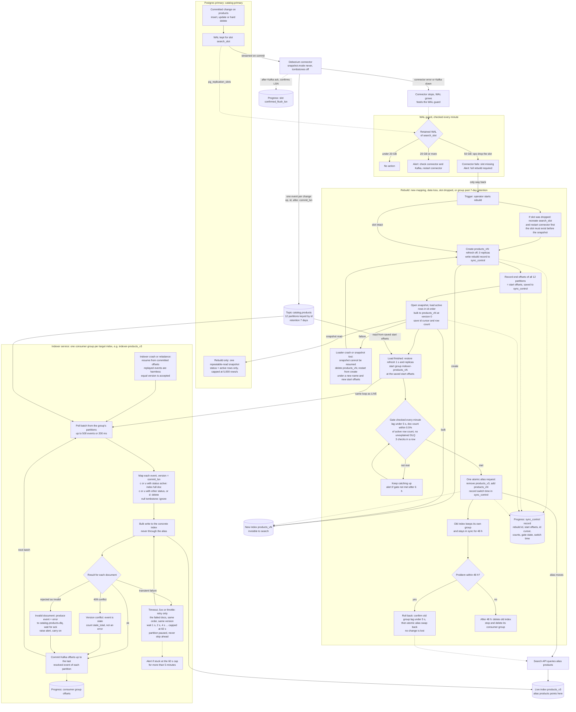

# Search sync: change data capture plan

This plan has two parts. One is the live path that streams every committed change on `products` into the index. The other is the rebuild path that builds a new index beside the live one and switches by moving the `products` alias.

## Flowchart

## Notes

**Live path**
- A committed change goes from Postgres to Debezium, to `catalog.products`, to the indexer, to the index. The cron job is retired.
- The indexer writes only to named indexes (`products_v3`, `products_vN`), never to the alias. It runs one consumer group per target index, so each index has its own offsets.
- Every write carries `commit_lsn` as the document version, converted to a 64-bit integer. Writes use the store's "new must be at least stored" rule.
  - A version conflict means the change is stale. It is counted in `stale_total` and the indexer moves on.
  - Replays and duplicates are harmless because an equal version is accepted.
- Search rule: a create or update whose status is not `active` becomes a delete. Hard deletes (`op = d`) are deleted from the index. The snapshot load also reads only `status = 'active'`.
- Offsets are committed only after every document up to that offset has been acknowledged. An acknowledged document is one of these:
  - written successfully;
  - rejected as stale (version conflict);
  - confirmed in `catalog.products.dlq`.
- Transient failures retry only the failed documents, in the same order and with the same versions. Backoff is 1 s, 2 s, 4 s and so on, capped at 60 s. The partition stays paused, so the indexer never skips ahead. Per-document versions make an out-of-order retry safe, because the older write simply conflicts.
- An invalid document goes to the DLQ with its error. The indexer raises an alert and keeps processing. A later valid change to the same product is still applied.

**5-second target.** Budget for 95% of changes:
- capture and Kafka: about 1 s;
- indexer batch wait: 0.2 s;
- bulk write: under 1 s;
- index refresh: 1 s, so set `refresh_interval` to 1 s on every live index.

That leaves about 1.5 s of slack. Measure it end to end with a synthetic canary product that a probe updates every 30 s and then waits to see in search. The canary needs an owner and has to be excluded from real results.

**Rebuild**
1. Create `products_vN` with refresh off and no replicas, and write a record to `sync_control`. This is a document in a small control index in the search cluster.
2. Record the end offsets of all 12 partitions. These are the start offsets.
3. Open one repeatable-read snapshot and load the active rows in id order at version 0. The DBA's read cap is 5,000 rows/s.
4. When the load finishes, restore refresh and replicas. Start the group `indexer-products_vN` at the saved start offsets. This reuses the live indexer loop, so the new index replays everything committed since the snapshot and catches up.
5. When the gate passes, move the alias in one atomic request.

Why this order is safe:
- Offsets are read before the snapshot opens. Any change committed after the snapshot is therefore at or after the saved offsets.
- Events committed before the snapshot that get replayed carry the same or older state, and ordering within a key means the last event wins.
- Version 0 for snapshot rows means any replayed event can overwrite them.
- Replaying starts only after the load finishes. This avoids a delete tombstone being applied before a snapshot row that would then be wrongly kept.
- Catch-up is cheap: 2.5 h at 300 writes/s peak is about 2.7M events.

A snapshot that dies cannot be resumed. The partial index could hold rows deleted since, so it is dropped and the load restarts under a new name with new start offsets. The cursor in `sync_control` is for visibility, not for resuming.

**Gate details**
- Lag is the time since the commit of the newest applied event, measured against the connector head.
- The active row count is the snapshot count, plus created minus deleted from the bulk results. This avoids a second heavy read on the primary. If the DBA allows a short `count(*)`, add it as a cross-check.
- A person approves the first switch. After that the controller can switch on its own when the gate passes.

**After the switch.** The old index keeps its own group and stays in sync for 48 h. Rollback is an atomic alias swap back, after checking that the old group is under 5 s behind. After 48 h, delete the old index and its group.

**WAL and slot loss**
- Alert at 20 GB of retained WAL. At 50 GB ops drop the slot, the connector fails, and a full rebuild is required.
- The rebuild runbook recreates `search_slot` and restarts the connector before the snapshot. The slot has to exist first, so that everything after the snapshot is retained.
- Index updates for changes made between the drop and the new slot are lost. The old index is therefore not a clean rollback target for that gap.
- A rebuild opens no second replication slot, so it adds no WAL risk. The long snapshot only delays vacuum on the primary. Watch for bloat during the 2.5 h load.
- A group that is down for more than the 7-day retention also needs a rebuild.

**First go-live (retiring cron)**
1. Deploy the connector and indexer.
2. Run a rebuild to create `products_v4`.
3. At the switch, stop the cron job and start a stream group for `products_v3`. It starts at the saved start offsets, so it keeps the fallback in sync.
4. The fallback still has its old gaps, such as ghost hard-deleted rows.

**Open items to check**
- Set Debezium `snapshot.mode` so it does not snapshot the 40M rows into the topic, and turn tombstones off. If tombstones stay on, the indexer ignores null-value records.
- Confirm that update events carry the full `description`. By default Postgres omits unchanged large (TOAST) columns, and Debezium emits a placeholder. If so, set `REPLICA IDENTITY FULL` on `products`. This increases WAL volume, so re-check the 20 GB alert level.
- The brief says the load takes about 2.5 h, but 40M rows at 5,000/s is about 2.2 h. Treat 2.5 h as a conservative budget.
- The indexer's document mapping is per target index. A rebuild for a new mapping needs one build that can write both the old and new document shapes during the 48 h hold.
- The Kafka cluster is shared. Agree quotas, and the topic and DLQ settings, with the other teams.
